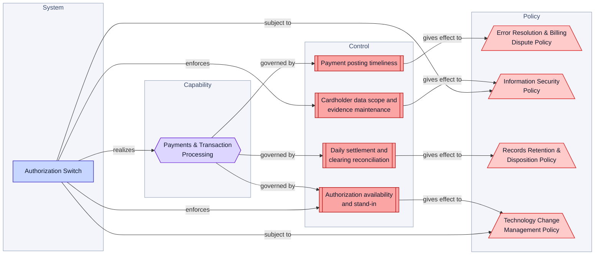
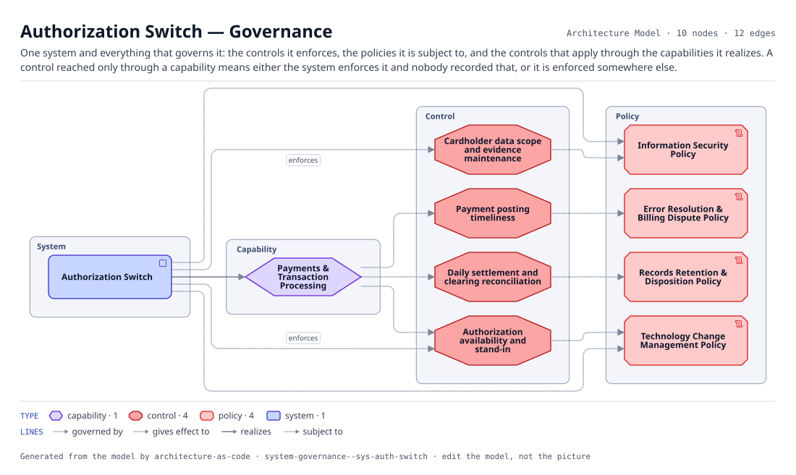

# Authorization Switch — Governance

One system and everything that governs it: the controls it enforces, the policies it is subject to, and the controls that apply through the capabilities it realizes. A control reached only through a capability means either the system enforces it and nobody recorded that, or it is enforced somewhere else.

The same view as the app draws it, written beside the Mermaid by `terrane render`:

**Hue is the entity type.**

| | Entity type |
|---|---|
| `#6d28d9` | capabilities |
| `#b91c1c` | controls |
| `#dc2626` | policies |
| `#4338ca` | systems |

10 entities, 12 relationships. Generated from the model; edit the model, not this file.
