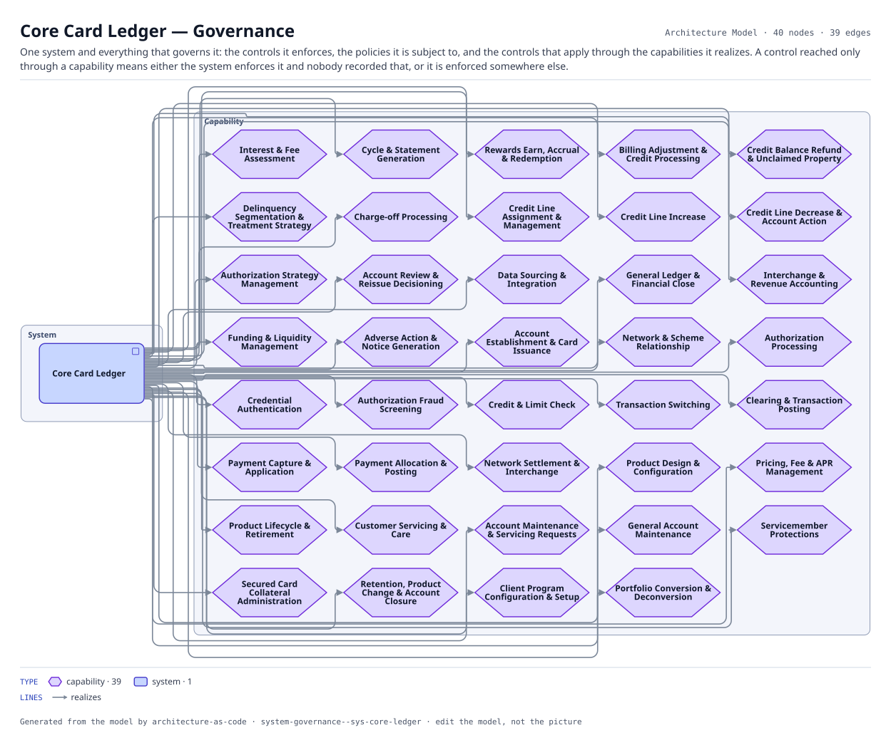

# Core Card Ledger — Governance

One system and everything that governs it: the controls it enforces, the policies it is subject to, and the controls that apply through the capabilities it realizes. A control reached only through a capability means either the system enforces it and nobody recorded that, or it is enforced somewhere else.

```mermaid
%%{init: {'flowchart': {'curve': 'basis'}} }%%
flowchart LR
  %% Core Card Ledger — Governance
  %% Generated from the model by `terrane render`. Do not edit by hand.

  subgraph grp_Capability["Capability"]
    direction LR
    CAP_ORIG_06{{"Account Establishment &<br/>Card Issuance"}}
    CAP_SERV_02{{"Account Maintenance &<br/>Servicing Requests"}}
    CAP_CRED_07{{"Account Review & Reissue<br/>Decisioning"}}
    CAP_ORIG_05{{"Adverse Action & Notice<br/>Generation"}}
    CAP_PAY_01_02{{"Authorization Fraud<br/>Screening"}}
    CAP_PAY_01{{"Authorization Processing"}}
    CAP_CRED_06{{"Authorization Strategy<br/>Management"}}
    CAP_BILL_05{{"Billing Adjustment &<br/>Credit Processing"}}
    CAP_COLL_04{{"Charge-off Processing"}}
    CAP_PAY_02{{"Clearing & Transaction<br/>Posting"}}
    CAP_TPS_01{{"Client Program<br/>Configuration & Setup"}}
    CAP_PAY_01_01{{"Credential Authentication"}}
    CAP_PAY_01_03{{"Credit & Limit Check"}}
    CAP_BILL_06{{"Credit Balance Refund &<br/>Unclaimed Property"}}
    CAP_CRED_03{{"Credit Line Assignment &<br/>Management"}}
    CAP_CRED_03_02{{"Credit Line Decrease &<br/>Account Action"}}
    CAP_CRED_03_01{{"Credit Line Increase"}}
    CAP_SERV{{"Customer Servicing & Care"}}
    CAP_BILL_02{{"Cycle & Statement<br/>Generation"}}
    CAP_DATA_02{{"Data Sourcing &<br/>Integration"}}
    CAP_COLL_01{{"Delinquency Segmentation &<br/>Treatment Strategy"}}
    CAP_FIN_03{{"Funding & Liquidity<br/>Management"}}
    CAP_SERV_02_01{{"General Account<br/>Maintenance"}}
    CAP_FIN_01{{"General Ledger & Financial<br/>Close"}}
    CAP_FIN_02{{"Interchange & Revenue<br/>Accounting"}}
    CAP_BILL_01{{"Interest & Fee Assessment"}}
    CAP_PART_02{{"Network & Scheme<br/>Relationship"}}
    CAP_PAY_05{{"Network Settlement &<br/>Interchange"}}
    CAP_PAY_03_02{{"Payment Allocation &<br/>Posting"}}
    CAP_PAY_03{{"Payment Capture &<br/>Application"}}
    CAP_TPS_02{{"Portfolio Conversion &<br/>Deconversion"}}
    CAP_PROD_02{{"Pricing, Fee & APR<br/>Management"}}
    CAP_PROD_01{{"Product Design &<br/>Configuration"}}
    CAP_PROD_05{{"Product Lifecycle &<br/>Retirement"}}
    CAP_SERV_09{{"Retention, Product Change<br/>& Account Closure"}}
    CAP_BILL_04{{"Rewards Earn, Accrual &<br/>Redemption"}}
    CAP_SERV_02_03{{"Secured Card Collateral<br/>Administration"}}
    CAP_SERV_02_02{{"Servicemember Protections"}}
    CAP_PAY_01_05{{"Transaction Switching"}}
  end

  subgraph grp_System["System"]
    direction LR
    SYS_CORE_LEDGER["Core Card Ledger"]
  end

  SYS_CORE_LEDGER -->|"realizes"| CAP_SERV
  SYS_CORE_LEDGER -->|"realizes"| CAP_ORIG_06
  SYS_CORE_LEDGER -->|"realizes"| CAP_BILL_01
  SYS_CORE_LEDGER -->|"realizes"| CAP_BILL_02
  SYS_CORE_LEDGER -->|"realizes"| CAP_BILL_04
  SYS_CORE_LEDGER -->|"realizes"| CAP_BILL_05
  SYS_CORE_LEDGER -->|"realizes"| CAP_BILL_06
  SYS_CORE_LEDGER -->|"realizes"| CAP_COLL_01
  SYS_CORE_LEDGER -->|"realizes"| CAP_COLL_04
  SYS_CORE_LEDGER -->|"realizes"| CAP_CRED_03
  SYS_CORE_LEDGER -->|"realizes"| CAP_CRED_03_01
  SYS_CORE_LEDGER -->|"realizes"| CAP_CRED_03_02
  SYS_CORE_LEDGER -->|"realizes"| CAP_CRED_06
  SYS_CORE_LEDGER -->|"realizes"| CAP_CRED_07
  SYS_CORE_LEDGER -->|"realizes"| CAP_DATA_02
  SYS_CORE_LEDGER -->|"realizes"| CAP_FIN_01
  SYS_CORE_LEDGER -->|"realizes"| CAP_FIN_02
  SYS_CORE_LEDGER -->|"realizes"| CAP_FIN_03
  SYS_CORE_LEDGER -->|"realizes"| CAP_ORIG_05
  SYS_CORE_LEDGER -->|"realizes"| CAP_PART_02
  SYS_CORE_LEDGER -->|"realizes"| CAP_PAY_01
  SYS_CORE_LEDGER -->|"realizes"| CAP_PAY_01_01
  SYS_CORE_LEDGER -->|"realizes"| CAP_PAY_01_02
  SYS_CORE_LEDGER -->|"realizes"| CAP_PAY_01_03
  SYS_CORE_LEDGER -->|"realizes"| CAP_PAY_01_05
  SYS_CORE_LEDGER -->|"realizes"| CAP_PAY_02
  SYS_CORE_LEDGER -->|"realizes"| CAP_PAY_03
  SYS_CORE_LEDGER -->|"realizes"| CAP_PAY_03_02
  SYS_CORE_LEDGER -->|"realizes"| CAP_PAY_05
  SYS_CORE_LEDGER -->|"realizes"| CAP_PROD_01
  SYS_CORE_LEDGER -->|"realizes"| CAP_PROD_02
  SYS_CORE_LEDGER -->|"realizes"| CAP_PROD_05
  SYS_CORE_LEDGER -->|"realizes"| CAP_SERV_02
  SYS_CORE_LEDGER -->|"realizes"| CAP_SERV_02_01
  SYS_CORE_LEDGER -->|"realizes"| CAP_SERV_02_02
  SYS_CORE_LEDGER -->|"realizes"| CAP_SERV_02_03
  SYS_CORE_LEDGER -->|"realizes"| CAP_SERV_09
  SYS_CORE_LEDGER -->|"realizes"| CAP_TPS_01
  SYS_CORE_LEDGER -->|"realizes"| CAP_TPS_02

  classDef s_capabilities__capabilities fill:#ddd6fe,stroke:#6d28d9,color:#0f172a,stroke-width:1.4px;
  classDef s_systems__systems fill:#c7d6ff,stroke:#4338ca,color:#0f172a,stroke-width:1.4px;
  class CAP_BILL_01,CAP_BILL_02,CAP_BILL_04,CAP_BILL_05,CAP_BILL_06,CAP_COLL_01,CAP_COLL_04,CAP_CRED_03,CAP_CRED_03_01,CAP_CRED_03_02,CAP_CRED_06,CAP_CRED_07,CAP_DATA_02,CAP_FIN_01,CAP_FIN_02,CAP_FIN_03,CAP_ORIG_05,CAP_ORIG_06,CAP_PART_02,CAP_PAY_01,CAP_PAY_01_01,CAP_PAY_01_02,CAP_PAY_01_03,CAP_PAY_01_05,CAP_PAY_02,CAP_PAY_03,CAP_PAY_03_02,CAP_PAY_05,CAP_PROD_01,CAP_PROD_02,CAP_PROD_05,CAP_SERV,CAP_SERV_02,CAP_SERV_02_01,CAP_SERV_02_02,CAP_SERV_02_03,CAP_SERV_09,CAP_TPS_01,CAP_TPS_02 s_capabilities__capabilities;
  class SYS_CORE_LEDGER s_systems__systems;
  classDef boundary1 fill:#f3f5fb,stroke:#8f9bb5,color:#3b4a6b;
  class grp_Capability,grp_System boundary1;
```

The same view as the app draws it, written beside the Mermaid by `terrane render`:

**Hue is the entity type.**

| | Entity type |
|---|---|
| `#6d28d9` | capabilities |
| `#4338ca` | systems |

40 entities, 39 relationships. Generated from the model; edit the model, not this file.

> 73 entities matched; showing the 1 the scope names and the first 39 of the rest by id. Narrow the scope or raise limits.max_nodes.
