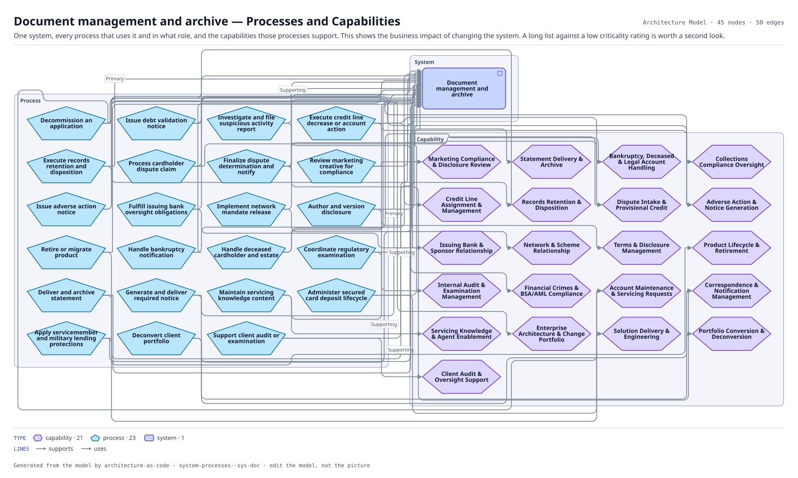

# Document management and archive — Processes and Capabilities

One system, every process that uses it and in what role, and the capabilities those processes support. This shows the business impact of changing the system. A long list against a low criticality rating is worth a second look.

```mermaid
%%{init: {'flowchart': {'curve': 'basis'}} }%%
flowchart LR
  %% Document management and archive — Processes and Capabilities
  %% Generated from the model by `terrane render`. Do not edit by hand.

  subgraph grp_Capability["Capability"]
    direction LR
    CAP_SERV_02{{"Account Maintenance &<br/>Servicing Requests"}}
    CAP_ORIG_05{{"Adverse Action & Notice<br/>Generation"}}
    CAP_COLL_06{{"Bankruptcy, Deceased &<br/>Legal Account Handling"}}
    CAP_TPS_05{{"Client Audit & Oversight<br/>Support"}}
    CAP_COLL_07{{"Collections Compliance<br/>Oversight"}}
    CAP_SERV_04{{"Correspondence &<br/>Notification Management"}}
    CAP_CRED_03{{"Credit Line Assignment &<br/>Management"}}
    CAP_FRAUD_03{{"Dispute Intake &<br/>Provisional Credit"}}
    CAP_STRAT_04{{"Enterprise Architecture &<br/>Change Portfolio"}}
    CAP_RGOV_07{{"Financial Crimes & BSA/AML<br/>Compliance"}}
    CAP_RGOV_05{{"Internal Audit &<br/>Examination Management"}}
    CAP_PART_01{{"Issuing Bank & Sponsor<br/>Relationship"}}
    CAP_ACQ_04{{"Marketing Compliance &<br/>Disclosure Review"}}
    CAP_PART_02{{"Network & Scheme<br/>Relationship"}}
    CAP_TPS_02{{"Portfolio Conversion &<br/>Deconversion"}}
    CAP_PROD_05{{"Product Lifecycle &<br/>Retirement"}}
    CAP_DATA_07{{"Records Retention &<br/>Disposition"}}
    CAP_SERV_06{{"Servicing Knowledge &<br/>Agent Enablement"}}
    CAP_TECH_01{{"Solution Delivery &<br/>Engineering"}}
    CAP_BILL_03{{"Statement Delivery &<br/>Archive"}}
    CAP_PROD_03{{"Terms & Disclosure<br/>Management"}}
  end

  subgraph grp_Process["Process"]
    direction LR
    P_SERVICING_011[\"Administer secured card<br/>deposit lifecycle"/]
    P_SERVICING_012[\"Apply servicemember and<br/>military lending<br/>protections"/]
    P_PRODUCT_002[\"Author and version<br/>disclosure"/]
    P_RISK_003[\"Coordinate regulatory<br/>examination"/]
    P_APPDEV_009[\"Decommission an<br/>application"/]
    P_TPS_003[\"Deconvert client portfolio"/]
    P_SERVICING_002[\"Deliver and archive<br/>statement"/]
    P_CREDIT_004[\"Execute credit line<br/>decrease or account action"/]
    P_DATAGOV_004[\"Execute records retention<br/>and disposition"/]
    P_DISPUTE_004[\"Finalize dispute<br/>determination and notify"/]
    P_PARTNERSHIPS_001[\"Fulfill issuing bank<br/>oversight obligations"/]
    P_SERVICING_007[\"Generate and deliver<br/>required notice"/]
    P_RECOVERY_003[\"Handle bankruptcy<br/>notification"/]
    P_RECOVERY_004[\"Handle deceased cardholder<br/>and estate"/]
    P_PAYMENTS_005[\"Implement network mandate<br/>release"/]
    P_COMPLIANCE_004[\"Investigate and file<br/>suspicious activity report"/]
    P_ORIG_005[\"Issue adverse action<br/>notice"/]
    P_COLLECTIONS_007[\"Issue debt validation<br/>notice"/]
    P_SERVICING_009[\"Maintain servicing<br/>knowledge content"/]
    P_DISPUTE_001[\"Process cardholder dispute<br/>claim"/]
    P_PRODUCT_004[\"Retire or migrate product"/]
    P_MARKETING_004[\"Review marketing creative<br/>for compliance"/]
    P_TPS_007[\"Support client audit or<br/>examination"/]
  end

  subgraph grp_System["System"]
    direction LR
    SYS_DOC["Document management and<br/>archive"]
  end

  P_MARKETING_004 -->|"Supporting"| SYS_DOC
  P_ORIG_005 -->|"Primary"| SYS_DOC
  P_CREDIT_004 -->|"Supporting"| SYS_DOC
  P_PAYMENTS_005 -->|"Supporting"| SYS_DOC
  P_SERVICING_002 -->|"Supporting"| SYS_DOC
  P_SERVICING_007 -->|"Primary"| SYS_DOC
  P_SERVICING_009 -->|"Supporting"| SYS_DOC
  P_DISPUTE_001 -->|"Supporting"| SYS_DOC
  P_DISPUTE_004 -->|"Supporting"| SYS_DOC
  P_COLLECTIONS_007 -->|"Primary"| SYS_DOC
  P_RECOVERY_003 -->|"Supporting"| SYS_DOC
  P_RECOVERY_004 -->|"Supporting"| SYS_DOC
  P_TPS_003 -->|"Supporting"| SYS_DOC
  P_TPS_007 -->|"Supporting"| SYS_DOC
  P_COMPLIANCE_004 -->|"Supporting"| SYS_DOC
  P_RISK_003 -->|"Supporting"| SYS_DOC
  P_DATAGOV_004 -->|"Primary"| SYS_DOC
  P_PRODUCT_002 -->|"Primary"| SYS_DOC
  P_PRODUCT_004 -->|"Supporting"| SYS_DOC
  P_SERVICING_011 -->|"Supporting"| SYS_DOC
  P_SERVICING_012 -->|"Supporting"| SYS_DOC
  P_PARTNERSHIPS_001 -->|"Supporting"| SYS_DOC
  P_APPDEV_009 -->|"Supporting"| SYS_DOC
  P_MARKETING_004 -->|"supports"| CAP_ACQ_04
  P_ORIG_005 -->|"supports"| CAP_ORIG_05
  P_CREDIT_004 -->|"supports"| CAP_CRED_03
  P_CREDIT_004 -->|"supports"| CAP_ORIG_05
  P_PAYMENTS_005 -->|"supports"| CAP_PART_02
  P_SERVICING_002 -->|"supports"| CAP_BILL_03
  P_SERVICING_007 -->|"supports"| CAP_SERV_04
  P_SERVICING_009 -->|"supports"| CAP_SERV_06
  P_DISPUTE_001 -->|"supports"| CAP_FRAUD_03
  P_DISPUTE_004 -->|"supports"| CAP_FRAUD_03
  P_DISPUTE_004 -->|"supports"| CAP_SERV_04
  P_COLLECTIONS_007 -->|"supports"| CAP_COLL_07
  P_RECOVERY_003 -->|"supports"| CAP_COLL_06
  P_RECOVERY_004 -->|"supports"| CAP_COLL_06
  P_TPS_003 -->|"supports"| CAP_TPS_02
  P_TPS_007 -->|"supports"| CAP_TPS_05
  P_COMPLIANCE_004 -->|"supports"| CAP_RGOV_07
  P_RISK_003 -->|"supports"| CAP_RGOV_05
  P_DATAGOV_004 -->|"supports"| CAP_DATA_07
  P_PRODUCT_002 -->|"supports"| CAP_PROD_03
  P_PRODUCT_004 -->|"supports"| CAP_PROD_05
  P_SERVICING_011 -->|"supports"| CAP_SERV_02
  P_SERVICING_012 -->|"supports"| CAP_SERV_02
  P_PARTNERSHIPS_001 -->|"supports"| CAP_PART_01
  P_APPDEV_009 -->|"supports"| CAP_TECH_01
  P_APPDEV_009 -->|"supports"| CAP_STRAT_04
  P_APPDEV_009 -->|"supports"| CAP_DATA_07

  classDef s_capabilities__capabilities fill:#ddd6fe,stroke:#6d28d9,color:#0f172a,stroke-width:1.4px;
  classDef s_processes__processes fill:#bae6fd,stroke:#0369a1,color:#0f172a,stroke-width:1.4px;
  classDef s_systems__systems fill:#c7d6ff,stroke:#4338ca,color:#0f172a,stroke-width:1.4px;
  class CAP_ACQ_04,CAP_BILL_03,CAP_COLL_06,CAP_COLL_07,CAP_CRED_03,CAP_DATA_07,CAP_FRAUD_03,CAP_ORIG_05,CAP_PART_01,CAP_PART_02,CAP_PROD_03,CAP_PROD_05,CAP_RGOV_05,CAP_RGOV_07,CAP_SERV_02,CAP_SERV_04,CAP_SERV_06,CAP_STRAT_04,CAP_TECH_01,CAP_TPS_02,CAP_TPS_05 s_capabilities__capabilities;
  class P_APPDEV_009,P_COLLECTIONS_007,P_COMPLIANCE_004,P_CREDIT_004,P_DATAGOV_004,P_DISPUTE_001,P_DISPUTE_004,P_MARKETING_004,P_ORIG_005,P_PARTNERSHIPS_001,P_PAYMENTS_005,P_PRODUCT_002,P_PRODUCT_004,P_RECOVERY_003,P_RECOVERY_004,P_RISK_003,P_SERVICING_002,P_SERVICING_007,P_SERVICING_009,P_SERVICING_011,P_SERVICING_012,P_TPS_003,P_TPS_007 s_processes__processes;
  class SYS_DOC s_systems__systems;
  classDef boundary1 fill:#f3f5fb,stroke:#8f9bb5,color:#3b4a6b;
  class grp_Capability,grp_Process,grp_System boundary1;
```

The same view as the app draws it, written beside the Mermaid by `terrane render`:

**Hue is the entity type.**

| | Entity type |
|---|---|
| `#6d28d9` | capabilities |
| `#0369a1` | processes |
| `#4338ca` | systems |

45 entities, 50 relationships. Generated from the model; edit the model, not this file.

> 45 entities on an architecture diagram. Past about 40 this has become a landscape: narrow the scope, or mark it `kind: map`.
