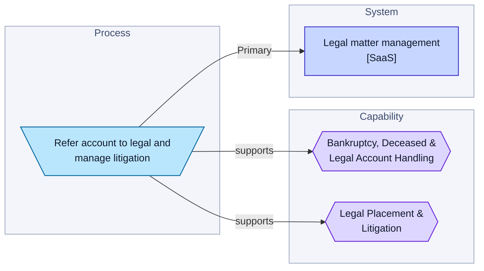
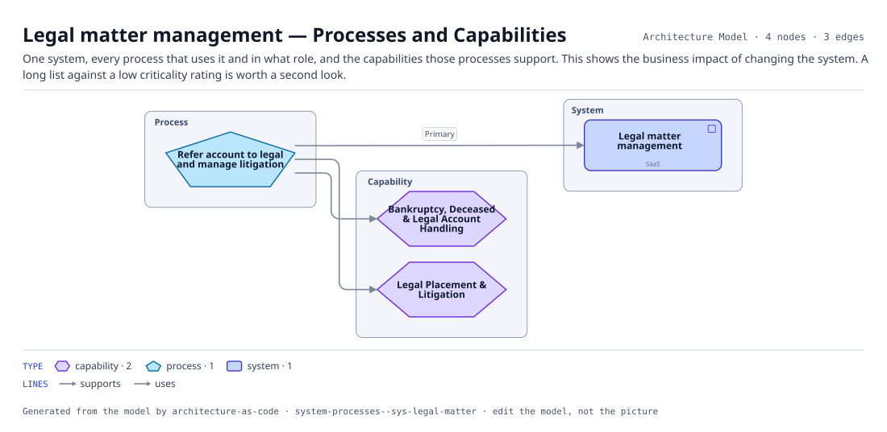

# Legal matter management — Processes and Capabilities

One system, every process that uses it and in what role, and the capabilities those processes support. This shows the business impact of changing the system. A long list against a low criticality rating is worth a second look.

The same view as the app draws it, written beside the Mermaid by `terrane render`:

**Hue is the entity type.**

| | Entity type |
|---|---|
| `#6d28d9` | capabilities |
| `#0369a1` | processes |
| `#4338ca` | systems |

4 entities, 3 relationships. Generated from the model; edit the model, not this file.
