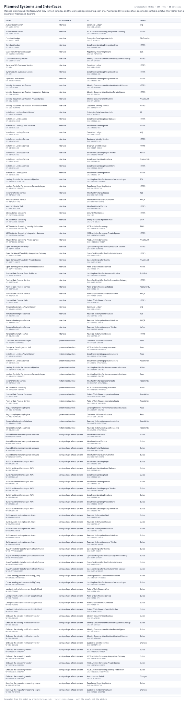

# Planned Systems and Interfaces

Planned systems and interfaces, what they connect to today, and the work package delivering each one. Planned and live entities share one model, so this is a status filter rather than a separately maintained diagram.

| From | | To | Detail |
|---|---|---|---|
| Authorization Switch  `SYS-AUTH-SWITCH` | interface | Core Card Ledger  `SYS-CORE-LEDGER` | MQ |
| Authorization Switch  `SYS-AUTH-SWITCH` | interface | NICE Actimize Screening Integration Gateway  `SYS-SCREENING-GATEWAY` | HTTPS |
| Core Card Ledger  `SYS-CORE-LEDGER` | interface | Enterprise Data Ingestion Hub  `SYS-DATA-INGEST` | FileTransfer |
| Core Card Ledger  `SYS-CORE-LEDGER` | interface | Installment Lending Integration Hub  `SYS-LENDING-HUB` | HTTPS |
| Customer 360 Semantic Layer  `SYS-CUST360-SEMANTIC` | interface | Regulatory Reporting Engine  `SYS-REG-REPORTING` | SQL |
| Customer Identity Service  `SYS-IDENTITY-SVC` | interface | Identity Document Verification Integration Gateway  `SYS-IDV-GATEWAY` | HTTPS |
| Dynamics 365 Customer Service  `SYS-CRM` | interface | Core Card Ledger  `SYS-CORE-LEDGER` | HTTPS |
| Dynamics 365 Customer Service  `SYS-CRM` | interface | Installment Lending Integration Hub  `SYS-LENDING-HUB` | HTTPS |
| Experian Credit Bureau  `SYS-CREDIT-BUREAU` | interface | Installment Lending Integration Hub  `SYS-LENDING-HUB` | HTTPS |
| Identity Document Verification  `SYS-IDV-VENDOR` | interface | Identity Document Verification Webhook Listener  `SYS-IDV-WEBHOOKS` | HTTPS |
| Identity Document Verification Integration Gateway  `SYS-IDV-GATEWAY` | interface | Identity Document Verification Private Egress  `SYS-IDV-EGRESS` | HTTPS |
| Identity Document Verification Private Egress  `SYS-IDV-EGRESS` | interface | Identity Document Verification  `SYS-IDV-VENDOR` | PrivateLink |
| Identity Document Verification Webhook Listener  `SYS-IDV-WEBHOOKS` | interface | Customer Identity Service  `SYS-IDENTITY-SVC` | HTTPS |
| Installment Lending Async Worker  `SYS-LENDING-WORKER` | interface | Enterprise Data Ingestion Hub  `SYS-DATA-INGEST` | S3 |
| Installment Lending Edge  `SYS-LENDING-EDGE` | interface | Installment Lending Load Balancer  `SYS-LENDING-ALB` | HTTPS |
| Installment Lending Load Balancer  `SYS-LENDING-ALB` | interface | Installment Lending Web  `SYS-LENDING-WEB` | HTTPS |
| Installment Lending Service  `SYS-LENDING-API` | interface | Core Card Ledger  `SYS-CORE-LEDGER` | MQ |
| Installment Lending Service  `SYS-LENDING-API` | interface | Customer Identity Service  `SYS-IDENTITY-SVC` | HTTPS |
| Installment Lending Service  `SYS-LENDING-API` | interface | Experian Credit Bureau  `SYS-CREDIT-BUREAU` | HTTPS |
| Installment Lending Service  `SYS-LENDING-API` | interface | Installment Lending Async Worker  `SYS-LENDING-WORKER` | Kafka |
| Installment Lending Service  `SYS-LENDING-API` | interface | Installment Lending Database  `SYS-LENDING-DB` | PostgreSQL |
| Installment Lending Service  `SYS-LENDING-API` | interface | Installment Lending Object Store  `SYS-LENDING-BUCKET` | HTTPS |
| Installment Lending Web  `SYS-LENDING-WEB` | interface | Installment Lending Service  `SYS-LENDING-API` | HTTPS |
| Lending Portfolio Performance Pipeline  `SYS-LENDPERF-PIPELINE` | interface | Lending Portfolio Performance Semantic Layer  `SYS-LENDPERF-SEMANTIC` | SQL |
| Lending Portfolio Performance Semantic Layer  `SYS-LENDPERF-SEMANTIC` | interface | Regulatory Reporting Engine  `SYS-REG-REPORTING` | HTTPS |
| Merchant Portal Service  `SYS-MERCHANT-API` | interface | Merchant Portal Database  `SYS-MERCHANT-STORE` | TDS |
| Merchant Portal Service  `SYS-MERCHANT-API` | interface | Merchant Portal Event Publisher  `SYS-MERCHANT-EVENTS` | AMQP |
| Merchant Portal Web  `SYS-MERCHANT-WEB` | interface | Merchant Portal Service  `SYS-MERCHANT-API` | HTTPS |
| NICE Actimize Screening  `SYS-SCREENING-VENDOR` | interface | Security Monitoring  `SYS-SIEM` | HTTPS |
| NICE Actimize Screening  `SYS-SCREENING-VENDOR` | interface | Enterprise Data Ingestion Hub  `SYS-DATA-INGEST` | SFTP |
| NICE Actimize Screening Identity Federation  `SYS-SCREENING-FEDERATION` | interface | NICE Actimize Screening  `SYS-SCREENING-VENDOR` | SAML |
| NICE Actimize Screening Integration Gateway  `SYS-SCREENING-GATEWAY` | interface | NICE Actimize Screening Private Egress  `SYS-SCREENING-EGRESS` | HTTPS |
| NICE Actimize Screening Private Egress  `SYS-SCREENING-EGRESS` | interface | NICE Actimize Screening  `SYS-SCREENING-VENDOR` | PrivateLink |
| Open Banking Affordability  `SYS-OBAFF-VENDOR` | interface | Open Banking Affordability Webhook Listener  `SYS-OBAFF-WEBHOOKS` | HTTPS |
| Open Banking Affordability Integration Gateway  `SYS-OBAFF-GATEWAY` | interface | Open Banking Affordability Private Egress  `SYS-OBAFF-EGRESS` | HTTPS |
| Open Banking Affordability Private Egress  `SYS-OBAFF-EGRESS` | interface | Open Banking Affordability  `SYS-OBAFF-VENDOR` | PrivateLink |
| Open Banking Affordability Webhook Listener  `SYS-OBAFF-WEBHOOKS` | interface | Point-of-Sale Finance Service  `SYS-POSFIN-API` | HTTPS |
| Point-of-Sale Finance Event Publisher  `SYS-POSFIN-EVENTS` | interface | Lending Portfolio Performance Pipeline  `SYS-LENDPERF-PIPELINE` | Pub/Sub |
| Point-of-Sale Finance Service  `SYS-POSFIN-API` | interface | Open Banking Affordability Integration Gateway  `SYS-OBAFF-GATEWAY` | HTTPS |
| Point-of-Sale Finance Service  `SYS-POSFIN-API` | interface | Point-of-Sale Finance Database  `SYS-POSFIN-DB` | PostgreSQL |
| Point-of-Sale Finance Service  `SYS-POSFIN-API` | interface | Point-of-Sale Finance Event Publisher  `SYS-POSFIN-EVENTS` | AMQP |
| Point-of-Sale Finance Web  `SYS-POSFIN-WEB` | interface | Point-of-Sale Finance Service  `SYS-POSFIN-API` | HTTPS |
| Rewards Redemption Async Worker  `SYS-REWARDS-WORKER` | interface | Core Card Ledger  `SYS-CORE-LEDGER` | MQ |
| Rewards Redemption Service  `SYS-REWARDS-API` | interface | Rewards Redemption Database  `SYS-REWARDS-STORE` | TDS |
| Rewards Redemption Service  `SYS-REWARDS-API` | interface | Rewards Redemption Event Publisher  `SYS-REWARDS-EVENTS` | AMQP |
| Rewards Redemption Service  `SYS-REWARDS-API` | interface | Rewards Redemption Async Worker  `SYS-REWARDS-WORKER` | Kafka |
| Rewards Redemption Web  `SYS-REWARDS-WEB` | interface | Rewards Redemption Service  `SYS-REWARDS-API` | HTTPS |
| Customer 360 Semantic Layer  `SYS-CUST360-SEMANTIC` | system reads writes | Customer 360 curated dataset  `DA-CUST360-CURATED` | Read |
| Enterprise Data Ingestion Hub  `SYS-DATA-INGEST` | system reads writes | NICE Actimize Screening outcomes  `DA-SCREENING-OUTCOMES` | Read |
| Installment Lending Async Worker  `SYS-LENDING-WORKER` | system reads writes | Installment Lending operational data  `DA-LENDING-OPERATIONAL` | Read |
| Installment Lending Service  `SYS-LENDING-API` | system reads writes | Installment Lending operational data  `DA-LENDING-OPERATIONAL` | ReadWrite |
| Lending Portfolio Performance Pipeline  `SYS-LENDPERF-PIPELINE` | system reads writes | Lending Portfolio Performance curated dataset  `DA-LENDPERF-CURATED` | Write |
| Lending Portfolio Performance Semantic Layer  `SYS-LENDPERF-SEMANTIC` | system reads writes | Lending Portfolio Performance curated dataset  `DA-LENDPERF-CURATED` | Read |
| Merchant Portal Service  `SYS-MERCHANT-API` | system reads writes | Merchant Portal operational data  `DA-MERCHANT-OPERATIONAL` | ReadWrite |
| NICE Actimize Screening  `SYS-SCREENING-VENDOR` | system reads writes | NICE Actimize Screening outcomes  `DA-SCREENING-OUTCOMES` | Write |
| Point-of-Sale Finance Database  `SYS-POSFIN-DB` | system reads writes | Point-of-Sale Finance operational data  `DA-POSFIN-OPERATIONAL` | ReadWrite |
| Point-of-Sale Finance Service  `SYS-POSFIN-API` | system reads writes | Point-of-Sale Finance operational data  `DA-POSFIN-OPERATIONAL` | ReadWrite |
| Regulatory Reporting Engine  `SYS-REG-REPORTING` | system reads writes | Lending Portfolio Performance curated dataset  `DA-LENDPERF-CURATED` | Read |
| Regulatory Reporting Engine  `SYS-REG-REPORTING` | system reads writes | Customer 360 curated dataset  `DA-CUST360-CURATED` | Read |
| Rewards Redemption Database  `SYS-REWARDS-STORE` | system reads writes | Rewards Redemption operational data  `DA-REWARDS-OPERATIONAL` | ReadWrite |
| Rewards Redemption Service  `SYS-REWARDS-API` | system reads writes | Rewards Redemption operational data  `DA-REWARDS-OPERATIONAL` | ReadWrite |
| Assemble the merchant portal on Azure  `WP-MERCHANT-PORTAL` | work package affects system | Merchant Portal Web  `SYS-MERCHANT-WEB` | Builds |
| Assemble the merchant portal on Azure  `WP-MERCHANT-PORTAL` | work package affects system | Merchant Portal Service  `SYS-MERCHANT-API` | Builds |
| Assemble the merchant portal on Azure  `WP-MERCHANT-PORTAL` | work package affects system | Merchant Portal Database  `SYS-MERCHANT-STORE` | Builds |
| Assemble the merchant portal on Azure  `WP-MERCHANT-PORTAL` | work package affects system | Merchant Portal Event Publisher  `SYS-MERCHANT-EVENTS` | Builds |
| Build installment lending on AWS  `WP-LENDING-AWS` | work package affects system | Installment Lending Edge  `SYS-LENDING-EDGE` | Builds |
| Build installment lending on AWS  `WP-LENDING-AWS` | work package affects system | Installment Lending Load Balancer  `SYS-LENDING-ALB` | Builds |
| Build installment lending on AWS  `WP-LENDING-AWS` | work package affects system | Installment Lending Web  `SYS-LENDING-WEB` | Builds |
| Build installment lending on AWS  `WP-LENDING-AWS` | work package affects system | Installment Lending Service  `SYS-LENDING-API` | Builds |
| Build installment lending on AWS  `WP-LENDING-AWS` | work package affects system | Installment Lending Async Worker  `SYS-LENDING-WORKER` | Builds |
| Build installment lending on AWS  `WP-LENDING-AWS` | work package affects system | Installment Lending Database  `SYS-LENDING-DB` | Builds |
| Build installment lending on AWS  `WP-LENDING-AWS` | work package affects system | Installment Lending Object Store  `SYS-LENDING-BUCKET` | Builds |
| Build installment lending on AWS  `WP-LENDING-AWS` | work package affects system | Installment Lending Integration Hub  `SYS-LENDING-HUB` | Builds |
| Build rewards redemption on Azure  `WP-REWARDS-BUILD` | work package affects system | Rewards Redemption Web  `SYS-REWARDS-WEB` | Builds |
| Build rewards redemption on Azure  `WP-REWARDS-BUILD` | work package affects system | Rewards Redemption Service  `SYS-REWARDS-API` | Builds |
| Build rewards redemption on Azure  `WP-REWARDS-BUILD` | work package affects system | Rewards Redemption Database  `SYS-REWARDS-STORE` | Builds |
| Build rewards redemption on Azure  `WP-REWARDS-BUILD` | work package affects system | Rewards Redemption Event Publisher  `SYS-REWARDS-EVENTS` | Builds |
| Build rewards redemption on Azure  `WP-REWARDS-BUILD` | work package affects system | Rewards Redemption Async Worker  `SYS-REWARDS-WORKER` | Builds |
| Buy affordability data for point-of-sale finance  `WP-OB-AFFORDABILITY` | work package affects system | Open Banking Affordability  `SYS-OBAFF-VENDOR` | Builds |
| Buy affordability data for point-of-sale finance  `WP-OB-AFFORDABILITY` | work package affects system | Open Banking Affordability Integration Gateway  `SYS-OBAFF-GATEWAY` | Builds |
| Buy affordability data for point-of-sale finance  `WP-OB-AFFORDABILITY` | work package affects system | Open Banking Affordability Private Egress  `SYS-OBAFF-EGRESS` | Builds |
| Buy affordability data for point-of-sale finance  `WP-OB-AFFORDABILITY` | work package affects system | Open Banking Affordability Webhook Listener  `SYS-OBAFF-WEBHOOKS` | Builds |
| Curate lending performance in BigQuery  `WP-LENDING-PERFORMANCE` | work package affects system | Lending Portfolio Performance Pipeline  `SYS-LENDPERF-PIPELINE` | Builds |
| Curate lending performance in BigQuery  `WP-LENDING-PERFORMANCE` | work package affects system | Lending Portfolio Performance Semantic Layer  `SYS-LENDPERF-SEMANTIC` | Builds |
| Land point-of-sale finance on Google Cloud  `WP-POS-FINANCE` | work package affects system | Point-of-Sale Finance Web  `SYS-POSFIN-WEB` | Builds |
| Land point-of-sale finance on Google Cloud  `WP-POS-FINANCE` | work package affects system | Point-of-Sale Finance Service  `SYS-POSFIN-API` | Builds |
| Land point-of-sale finance on Google Cloud  `WP-POS-FINANCE` | work package affects system | Point-of-Sale Finance Database  `SYS-POSFIN-DB` | Builds |
| Land point-of-sale finance on Google Cloud  `WP-POS-FINANCE` | work package affects system | Point-of-Sale Finance Event Publisher  `SYS-POSFIN-EVENTS` | Builds |
| Onboard the identity verification vendor  `WP-IDV-ONBOARD` | work package affects system | Identity Document Verification  `SYS-IDV-VENDOR` | Builds |
| Onboard the identity verification vendor  `WP-IDV-ONBOARD` | work package affects system | Identity Document Verification Integration Gateway  `SYS-IDV-GATEWAY` | Builds |
| Onboard the identity verification vendor  `WP-IDV-ONBOARD` | work package affects system | Identity Document Verification Private Egress  `SYS-IDV-EGRESS` | Builds |
| Onboard the identity verification vendor  `WP-IDV-ONBOARD` | work package affects system | Identity Document Verification Webhook Listener  `SYS-IDV-WEBHOOKS` | Builds |
| Onboard the identity verification vendor  `WP-IDV-ONBOARD` | work package affects system | Customer Identity Service  `SYS-IDENTITY-SVC` | Changes |
| Onboard the screening vendor  `WP-SCREENING-ONBOARD` | work package affects system | NICE Actimize Screening  `SYS-SCREENING-VENDOR` | Builds |
| Onboard the screening vendor  `WP-SCREENING-ONBOARD` | work package affects system | NICE Actimize Screening Integration Gateway  `SYS-SCREENING-GATEWAY` | Builds |
| Onboard the screening vendor  `WP-SCREENING-ONBOARD` | work package affects system | NICE Actimize Screening Private Egress  `SYS-SCREENING-EGRESS` | Builds |
| Onboard the screening vendor  `WP-SCREENING-ONBOARD` | work package affects system | NICE Actimize Screening Identity Federation  `SYS-SCREENING-FEDERATION` | Builds |
| Onboard the screening vendor  `WP-SCREENING-ONBOARD` | work package affects system | Authorization Switch  `SYS-AUTH-SWITCH` | Changes |
| Stand up the regulatory reporting engine  `WP-REG-REPORTING` | work package affects system | Regulatory Reporting Engine  `SYS-REG-REPORTING` | Builds |
| Stand up the regulatory reporting engine  `WP-REG-REPORTING` | work package affects system | Customer 360 Semantic Layer  `SYS-CUST360-SEMANTIC` | Changes |

100 relationships across 60 entities. Generated from the model; this is a report rather than a diagram, so it is a table.
