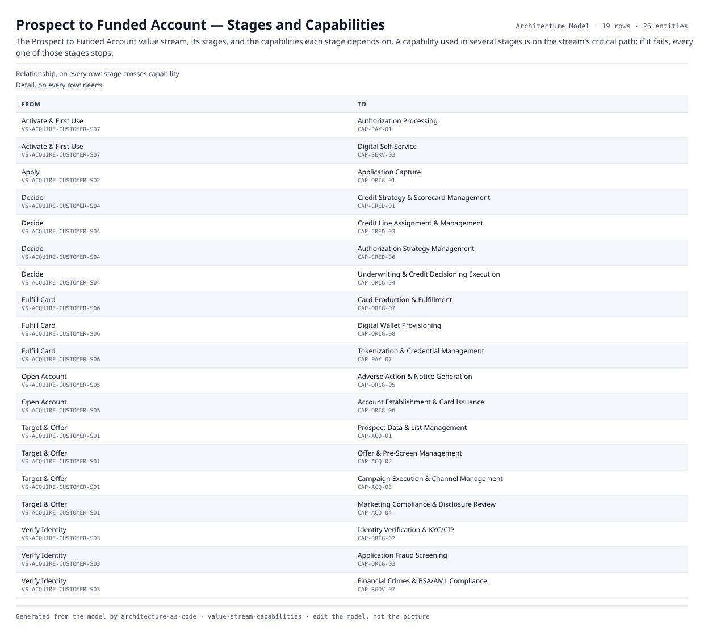

# Prospect to Funded Account — Stages and Capabilities

The Prospect to Funded Account value stream, its stages, and the capabilities each stage depends on. A capability used in several stages is on the stream's critical path: if it fails, every one of those stages stops.

| From | | To | Detail |
|---|---|---|---|
| Activate & First Use  `VS-ACQUIRE-CUSTOMER-S07` | stage crosses capability | Authorization Processing  `CAP-PAY-01` | needs |
| Activate & First Use  `VS-ACQUIRE-CUSTOMER-S07` | stage crosses capability | Digital Self-Service  `CAP-SERV-03` | needs |
| Apply  `VS-ACQUIRE-CUSTOMER-S02` | stage crosses capability | Application Capture  `CAP-ORIG-01` | needs |
| Decide  `VS-ACQUIRE-CUSTOMER-S04` | stage crosses capability | Credit Strategy & Scorecard Management  `CAP-CRED-01` | needs |
| Decide  `VS-ACQUIRE-CUSTOMER-S04` | stage crosses capability | Credit Line Assignment & Management  `CAP-CRED-03` | needs |
| Decide  `VS-ACQUIRE-CUSTOMER-S04` | stage crosses capability | Authorization Strategy Management  `CAP-CRED-06` | needs |
| Decide  `VS-ACQUIRE-CUSTOMER-S04` | stage crosses capability | Underwriting & Credit Decisioning Execution  `CAP-ORIG-04` | needs |
| Fulfill Card  `VS-ACQUIRE-CUSTOMER-S06` | stage crosses capability | Card Production & Fulfillment  `CAP-ORIG-07` | needs |
| Fulfill Card  `VS-ACQUIRE-CUSTOMER-S06` | stage crosses capability | Digital Wallet Provisioning  `CAP-ORIG-08` | needs |
| Fulfill Card  `VS-ACQUIRE-CUSTOMER-S06` | stage crosses capability | Tokenization & Credential Management  `CAP-PAY-07` | needs |
| Open Account  `VS-ACQUIRE-CUSTOMER-S05` | stage crosses capability | Adverse Action & Notice Generation  `CAP-ORIG-05` | needs |
| Open Account  `VS-ACQUIRE-CUSTOMER-S05` | stage crosses capability | Account Establishment & Card Issuance  `CAP-ORIG-06` | needs |
| Target & Offer  `VS-ACQUIRE-CUSTOMER-S01` | stage crosses capability | Prospect Data & List Management  `CAP-ACQ-01` | needs |
| Target & Offer  `VS-ACQUIRE-CUSTOMER-S01` | stage crosses capability | Offer & Pre-Screen Management  `CAP-ACQ-02` | needs |
| Target & Offer  `VS-ACQUIRE-CUSTOMER-S01` | stage crosses capability | Campaign Execution & Channel Management  `CAP-ACQ-03` | needs |
| Target & Offer  `VS-ACQUIRE-CUSTOMER-S01` | stage crosses capability | Marketing Compliance & Disclosure Review  `CAP-ACQ-04` | needs |
| Verify Identity  `VS-ACQUIRE-CUSTOMER-S03` | stage crosses capability | Identity Verification & KYC/CIP  `CAP-ORIG-02` | needs |
| Verify Identity  `VS-ACQUIRE-CUSTOMER-S03` | stage crosses capability | Application Fraud Screening  `CAP-ORIG-03` | needs |
| Verify Identity  `VS-ACQUIRE-CUSTOMER-S03` | stage crosses capability | Financial Crimes & BSA/AML Compliance  `CAP-RGOV-07` | needs |

19 relationships across 26 entities. Generated from the model; this is a report rather than a diagram, so it is a table.
