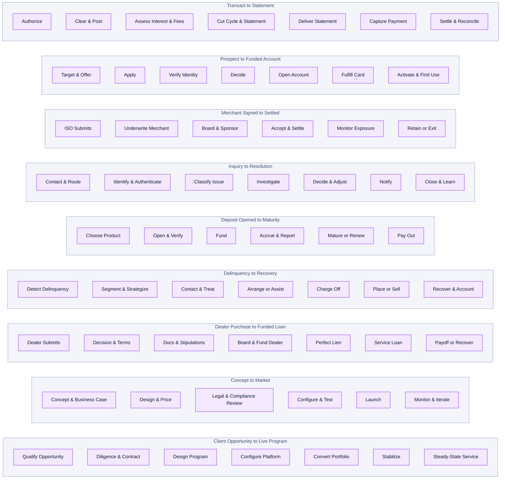
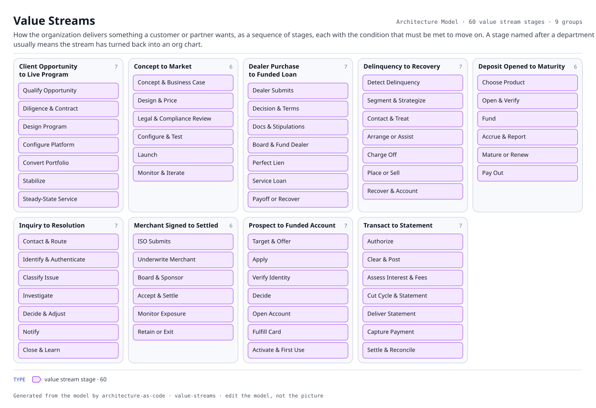

# Value Streams

How the organization delivers something a customer or partner wants, as a sequence of stages, each with the condition that must be met to move on. A stage named after a department usually means the stream has turned back into an org chart.

The same view as the app draws it, written beside the Mermaid by `terrane render`:

**value stream id** is the boundary each node sits in.

60 entities, 0 relationships. Generated from the model; edit the model, not this file.

> No edges connected the selected entities.
