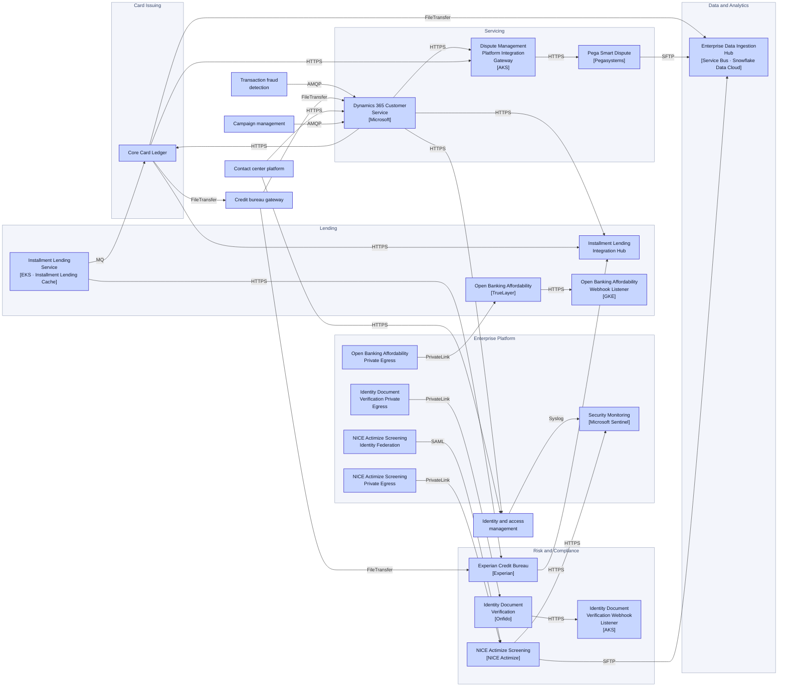
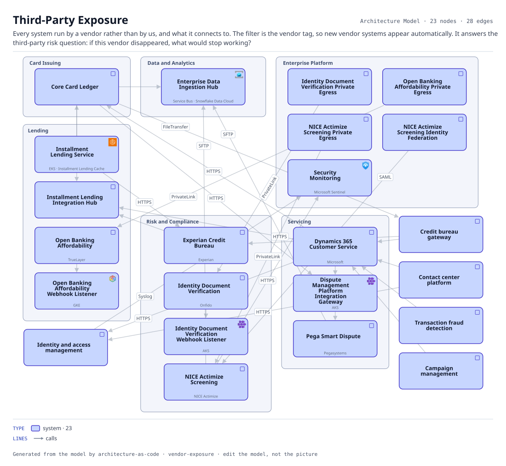

# Third-Party Exposure

Every system run by a vendor rather than by us, and what it connects to. The filter is the vendor tag, so new vendor systems appear automatically. It answers the third-party risk question: if this vendor disappeared, what would stop working?

The same view as the app draws it, written beside the Mermaid by `terrane render`:

## Flows across this diagram

Each flow is a recorded sequence of interfaces. The steps drawn on this diagram are numbered; a step whose interface is not on it is marked.

**Dispute and Chargeback**: A cardholder disputes a transaction. Raised in the contact center, handled in the vendor platform, settled back through the ledger.

1. Dynamics 365 Customer Service → Core Card Ledger (HTTPS)
2. Core Card Ledger → Dispute Management Platform Integration Gateway (HTTPS)
3. Dispute Management Platform Integration Gateway → Pega Smart Dispute (HTTPS)
4. Pega Smart Dispute → Enterprise Data Ingestion Hub (SFTP)

**Installment Loan Application**: An applicant applies for point-of-sale credit. Bureau search, affordability and a decision, with referral to an underwriter when the automated decision declines to take it.

1. Installment Lending Edge → Installment Lending Load Balancer (HTTPS) — not on this diagram
2. Installment Lending Load Balancer → Installment Lending Web (HTTPS) — not on this diagram
3. Installment Lending Web → Installment Lending Service (HTTPS) — not on this diagram
4. Installment Lending Service → Customer Identity Service (HTTPS) — not on this diagram
5. Installment Lending Service → Experian Credit Bureau (HTTPS)
6. Installment Lending Service → Installment Lending Database (PostgreSQL) — not on this diagram
7. Installment Lending Service → Core Card Ledger (MQ)
8. Installment Lending Service → Installment Lending Async Worker (Kafka) — not on this diagram

**Card Authorization**: A card presented at a merchant, authorized or declined inside the scheme timeout. The tightest latency budget in the estate, and the reason the screening call has a circuit breaker rather than a retry.

1. Authorization Switch → NICE Actimize Screening Integration Gateway (HTTPS) — not on this diagram
2. NICE Actimize Screening Integration Gateway → NICE Actimize Screening Private Egress (HTTPS) — not on this diagram
3. NICE Actimize Screening Private Egress → NICE Actimize Screening (PrivateLink)
4. Authorization Switch → Core Card Ledger (MQ) — not on this diagram

**Regulatory Return**: The monthly supervisory return. Entirely batch, and the only flow whose deadline is external and non-negotiable.

1. Core Card Ledger → Enterprise Data Ingestion Hub (FileTransfer)
2. Enterprise Data Ingestion Hub → Customer 360 Pipeline (Snowpipe) — not on this diagram
3. Customer 360 Pipeline → Customer 360 Semantic Layer (SQL) — not on this diagram
4. Customer 360 Semantic Layer → Regulatory Reporting Engine (SQL) — not on this diagram

23 entities, 28 relationships. Generated from the model; edit the model, not this file.
