# Building blocks

The handfuls of components that always arrive together, and what each cloud calls them. No block names a vendor; the provider columns are what the same block resolves to on each. Generated from `26_BLOCKS/` and `25_COMPONENTS/` by `terrane render`; edit those, not this.

| Block | Category | Components | In patterns |
|---|---|---|---|
| [Contact channel](#contact-channel) | Communications | 3 | Contact center through the servicing gateway |
| [Document services](#document-services) | Communications | 4 | Customer communications through one archive |
| [Batch tier](#batch-tier) | Compute | 3 | Regulatory file furnishing with reconciliation, Windowed batch |
| [Stateless service](#stateless-service) | Compute | 3 | Stateless request service, Strangler facade over a system being replaced |
| [Analytics platform](#analytics-platform) | Data | 4 | Analytics landing zone |
| [Data governance](#data-governance) | Data | 2 | Analytics landing zone, Governed model lifecycle |
| [Transactional store](#transactional-store) | Data | 3 | Payment capture and same-day posting, Shared database integration, Stateless request service |
| [Model platform](#model-platform) | Decisioning | 4 | Governed model lifecycle |
| [Real-time decision](#realtime-decision) | Decisioning | 4 | Inline risk decision in the transaction path |
| [Event tier](#event-tier) | Integration | 3 | Event fan-out |
| [File exchange](#file-exchange) | Integration | 3 | Partner file exchange, Regulatory file furnishing with reconciliation |
| [Private egress to SaaS](#private-egress-to-saas) | Integration | 3 | Private egress to a bought service |
| [Account baseline](#account-baseline) | Network | 5 | Workload account baseline |
| [Hybrid connectivity](#hybrid-connectivity) | Network | 2 | Hybrid return path |
| [Public API tier](#public-api-tier) | Network | 3 | API front door, Strangler facade over a system being replaced |
| [Public web tier](#public-web-tier) | Network | 4 | Public web entry |
| [Change evidence](#change-evidence) | Operations | 4 | Change evidence read off the systems |
| [Delivery pipeline](#delivery-pipeline) | Operations | 3 | Workload account baseline |
| [Observability stack](#observability-stack) | Operations | 4 | Observed service |
| [Payment capture](#payment-capture) | Payments | 4 | Payment capture and same-day posting |
| [Identity governance](#identity-governance) | Security | 4 | Workforce identity from the people system |
| [Security baseline](#security-baseline) | Security | 4 | Secrets and keys from the baseline, Workload account baseline |
| [Token vault](#token-vault) | Security | 4 | Tokenized card data |

## Contact channel

`contact-channel` · Communications

The voice self-service in front of the contact center, the gateway through which it and the agent desktop reach the servicing systems, and the bus the contact outcomes are published to. The gateway is in the block because a contact center that reaches the ledger directly is the integration nobody can turn off.

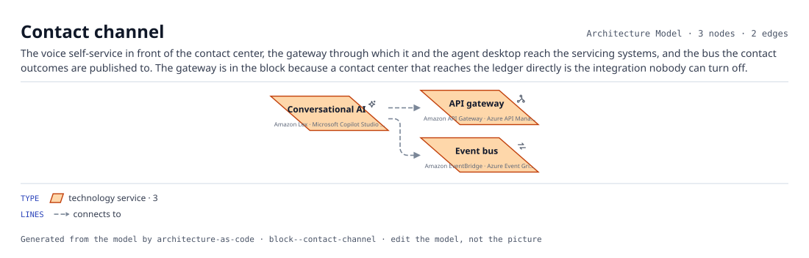

*The block's components, each with the services it resolves to, and the connections between them.*

| Component | AWS | Azure | GCP | On-prem | SaaS |
|---|---|---|---|---|---|
| Conversational AI (`conversational-ai`) | Amazon Lex | Microsoft Copilot Studio | Dialogflow CX and Customer Engagement Suite |  | Kore.ai |
| API gateway (`api-gateway`) | Amazon API Gateway | Azure API Management | Apigee |  |  |
| Event bus (`event-bus`) | Amazon EventBridge | Azure Event Grid | Eventarc |  |  |

**Connections.** Conversational AI → API gateway; Conversational AI → Event bus.

**Defaults.** `network_zone: Private-App`.

## Document services

`document-services` · Communications

The orchestration that decides what goes out and when, the rendering service that produces it from a governed template, the store it lands in and the archive it is kept in for as long as the retention schedule says. The archive is the point: a notice that cannot be produced on request was never sent, as far as an examiner is concerned.

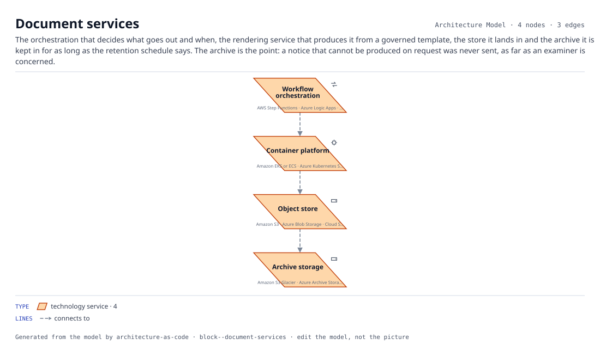

*The block's components, each with the services it resolves to, and the connections between them.*

| Component | AWS | Azure | GCP | On-prem | SaaS |
|---|---|---|---|---|---|
| Workflow orchestration (`workflow`) | AWS Step Functions | Azure Logic Apps | Workflows |  | Temporal |
| Container platform (`container-platform`) | Amazon EKS or ECS | Azure Kubernetes Service | Google Kubernetes Engine | OpenShift |  |
| Object store (`object-store`) | Amazon S3 | Azure Blob Storage | Cloud Storage | MinIO or a NAS |  |
| Archive storage (`archive`) | Amazon S3 Glacier | Azure Archive Storage | Archive class |  |  |

**Connections.** Workflow orchestration → Container platform; Container platform → Object store; Object store → Archive storage.

**Defaults.** `network_zone: Shared-Services`.

## Batch tier

`batch-tier` · Compute

Scheduled work with a window, its object staging area, and orchestration. The deadline is usually external, which makes this the tier where lateness is a business event rather than a metric.

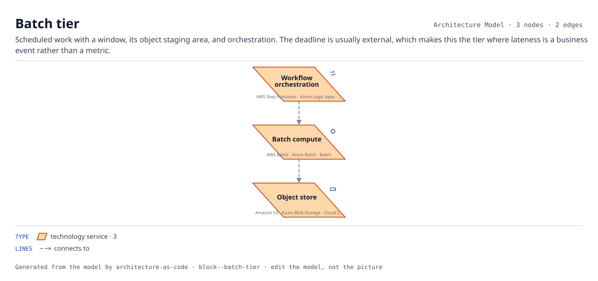

*The block's components, each with the services it resolves to, and the connections between them.*

| Component | AWS | Azure | GCP | On-prem | SaaS |
|---|---|---|---|---|---|
| Batch compute (`batch-compute`) | AWS Batch | Azure Batch | Batch |  |  |
| Object store (`object-store`) | Amazon S3 | Azure Blob Storage | Cloud Storage | MinIO or a NAS |  |
| Workflow orchestration (`workflow`) | AWS Step Functions | Azure Logic Apps | Workflows |  | Temporal |

**Connections.** Workflow orchestration → Batch compute; Batch compute → Object store.

**Defaults.** `network_zone: Private-App`.

## Stateless service

`stateless-service` · Compute

A container platform, its cache, and the observability to know it is alive. Stateless is the claim; the cache is where that claim usually turns out to be false.

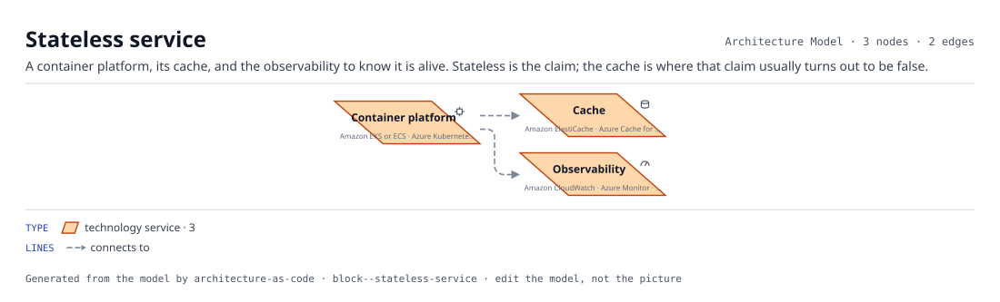

*The block's components, each with the services it resolves to, and the connections between them.*

| Component | AWS | Azure | GCP | On-prem | SaaS |
|---|---|---|---|---|---|
| Container platform (`container-platform`) | Amazon EKS or ECS | Azure Kubernetes Service | Google Kubernetes Engine | OpenShift |  |
| Cache (`cache`) | Amazon ElastiCache | Azure Cache for Redis | Memorystore |  |  |
| Observability (`observability`) | Amazon CloudWatch | Azure Monitor | Cloud Operations |  | Datadog or Grafana |

**Connections.** Container platform → Cache; Container platform → Observability.

**Defaults.** `network_zone: Private-App`.

## Analytics platform

`analytics-platform` · Data

Landing, pipeline, warehouse and the reporting on top. Four components because the boundary between them is where lineage is either recorded or lost.

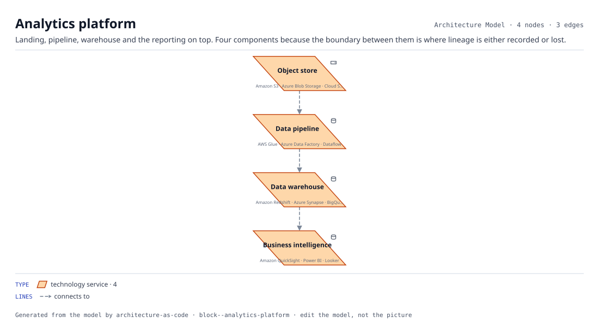

*The block's components, each with the services it resolves to, and the connections between them.*

| Component | AWS | Azure | GCP | On-prem | SaaS |
|---|---|---|---|---|---|
| Object store (`object-store`) | Amazon S3 | Azure Blob Storage | Cloud Storage | MinIO or a NAS |  |
| Data pipeline (`etl`) | AWS Glue | Azure Data Factory | Dataflow |  | dbt or Fivetran |
| Data warehouse (`warehouse`) | Amazon Redshift | Azure Synapse | BigQuery |  | Snowflake |
| Business intelligence (`bi`) | Amazon QuickSight | Power BI | Looker |  |  |

**Connections.** Object store → Data pipeline; Data pipeline → Data warehouse; Data warehouse → Business intelligence.

**Defaults.** `network_zone: Private-Data`.

## Data governance

`data-governance` · Data

A catalog and the key management behind it. Small, and the difference between a data platform and a data liability.

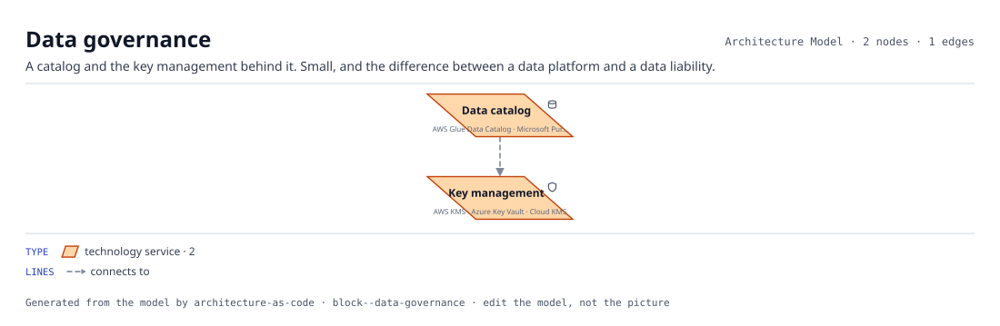

*The block's components, each with the services it resolves to, and the connections between them.*

| Component | AWS | Azure | GCP | On-prem | SaaS |
|---|---|---|---|---|---|
| Data catalog (`catalog`) | AWS Glue Data Catalog | Microsoft Purview | Dataplex |  | Collibra |
| Key management (`kms`) | AWS KMS | Azure Key Vault | Cloud KMS |  |  |

**Connections.** Data catalog → Key management.

**Defaults.** `network_zone: Shared-Services`.

## Transactional store

`transactional-store` · Data

A relational database with backup and key management. The three arrive together because a database without the other two is a recovery objective nobody can meet and an encryption claim nobody can support.

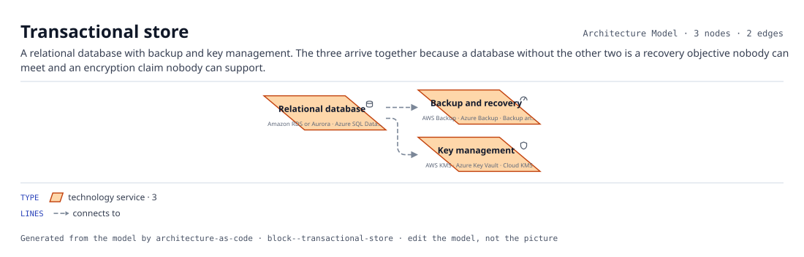

*The block's components, each with the services it resolves to, and the connections between them.*

| Component | AWS | Azure | GCP | On-prem | SaaS |
|---|---|---|---|---|---|
| Relational database (`relational-db`) | Amazon RDS or Aurora | Azure SQL Database | Cloud SQL | PostgreSQL or Oracle |  |
| Backup and recovery (`backup`) | AWS Backup | Azure Backup | Backup and DR Service |  |  |
| Key management (`kms`) | AWS KMS | Azure Key Vault | Cloud KMS |  |  |

**Connections.** Relational database → Backup and recovery; Relational database → Key management.

**Defaults.** `network_zone: Private-Data`.

## Model platform

`model-platform` · Decisioning

Where models are trained, registered, served and watched: the platform, the store that holds every version and its training data, the catalog that says what each model is for and what fed it, and the monitoring that notices drift before a regulator does.

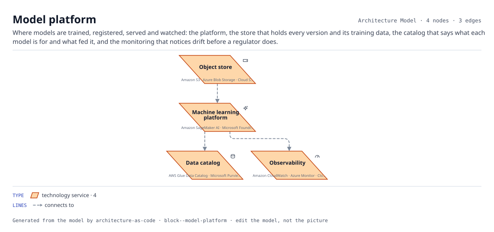

*The block's components, each with the services it resolves to, and the connections between them.*

| Component | AWS | Azure | GCP | On-prem | SaaS |
|---|---|---|---|---|---|
| Machine learning platform (`ml-platform`) | Amazon SageMaker AI | Microsoft Foundry (Azure Machine Learning) | Gemini Enterprise Agent Platform (formerly Vertex AI) |  | Databricks Mosaic AI |
| Object store (`object-store`) | Amazon S3 | Azure Blob Storage | Cloud Storage | MinIO or a NAS |  |
| Data catalog (`catalog`) | AWS Glue Data Catalog | Microsoft Purview | Dataplex |  | Collibra |
| Observability (`observability`) | Amazon CloudWatch | Azure Monitor | Cloud Operations |  | Datadog or Grafana |

**Connections.** Object store → Machine learning platform; Machine learning platform → Data catalog; Machine learning platform → Observability.

**Defaults.** `network_zone: Private-Data`.

## Real-time decision

`realtime-decision` · Decisioning

A stream of events to score, a feature cache warm enough to answer inside the time budget, the model serving that scores them, and the observability that says when the budget is being missed. Nothing durable: the decision is written back by whatever asked for it.

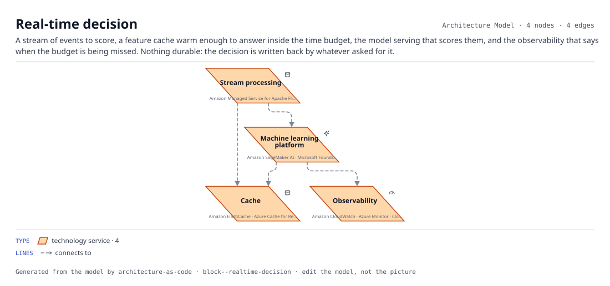

*The block's components, each with the services it resolves to, and the connections between them.*

| Component | AWS | Azure | GCP | On-prem | SaaS |
|---|---|---|---|---|---|
| Stream processing (`stream-processing`) | Amazon Managed Service for Apache Flink | Azure Stream Analytics | Dataflow |  | Confluent or Databricks |
| Cache (`cache`) | Amazon ElastiCache | Azure Cache for Redis | Memorystore |  |  |
| Machine learning platform (`ml-platform`) | Amazon SageMaker AI | Microsoft Foundry (Azure Machine Learning) | Gemini Enterprise Agent Platform (formerly Vertex AI) |  | Databricks Mosaic AI |
| Observability (`observability`) | Amazon CloudWatch | Azure Monitor | Cloud Operations |  | Datadog or Grafana |

**Connections.** Stream processing → Cache; Stream processing → Machine learning platform; Machine learning platform → Cache; Machine learning platform → Observability.

**Defaults.** `network_zone: Private-App`.

## Event tier

`event-tier` · Integration

A stream, a bus and the functions that react. What changes here is ownership: once a consumer reads the stream, the producer no longer controls who depends on it.

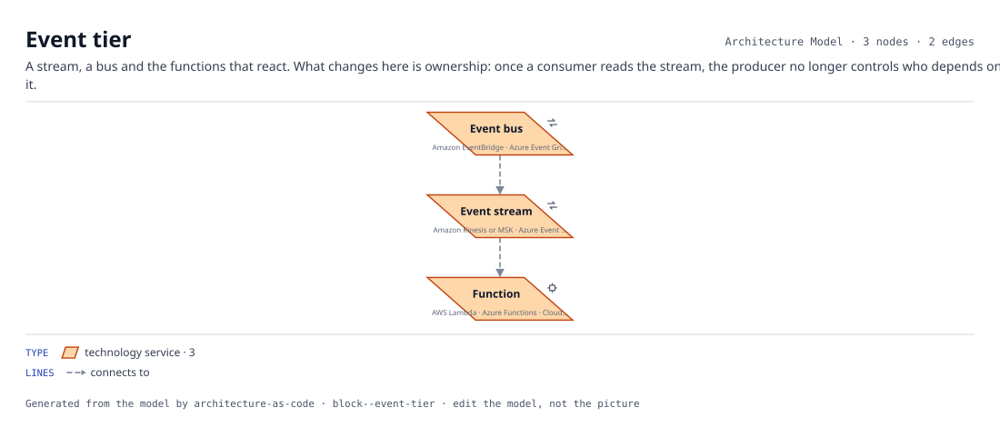

*The block's components, each with the services it resolves to, and the connections between them.*

| Component | AWS | Azure | GCP | On-prem | SaaS |
|---|---|---|---|---|---|
| Event stream (`event-stream`) | Amazon Kinesis or MSK | Azure Event Hubs | Pub/Sub |  | Confluent Kafka |
| Event bus (`event-bus`) | Amazon EventBridge | Azure Event Grid | Eventarc |  |  |
| Function (`function`) | AWS Lambda | Azure Functions | Cloud Functions |  |  |

**Connections.** Event bus → Event stream; Event stream → Function.

**Defaults.** `network_zone: Private-App`.

## File exchange

`file-exchange` · Integration

Scheduled files with a party who was never going to build an API. Older than every other block here and still the way most inter-company data actually moves.

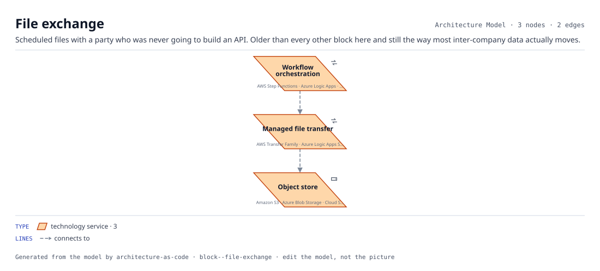

*The block's components, each with the services it resolves to, and the connections between them.*

| Component | AWS | Azure | GCP | On-prem | SaaS |
|---|---|---|---|---|---|
| Managed file transfer (`file-transfer`) | AWS Transfer Family | Azure Logic Apps SFTP |  | Managed file transfer appliance |  |
| Object store (`object-store`) | Amazon S3 | Azure Blob Storage | Cloud Storage | MinIO or a NAS |  |
| Workflow orchestration (`workflow`) | AWS Step Functions | Azure Logic Apps | Workflows |  | Temporal |

**Connections.** Managed file transfer → Object store; Workflow orchestration → Managed file transfer.

**Defaults.** `network_zone: Edge`.

## Private egress to SaaS

`private-egress-to-saas` · Integration

A gateway of ours, a private path out, and federated identity. This is the whole of what we own when we buy something: the vendor runs the software, we run the boundary.

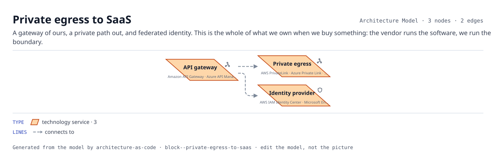

*The block's components, each with the services it resolves to, and the connections between them.*

| Component | AWS | Azure | GCP | On-prem | SaaS |
|---|---|---|---|---|---|
| API gateway (`api-gateway`) | Amazon API Gateway | Azure API Management | Apigee |  |  |
| Private egress (`private-egress`) | AWS PrivateLink | Azure Private Link | Private Service Connect |  |  |
| Identity provider (`identity-provider`) | AWS IAM Identity Center | Microsoft Entra ID | Cloud Identity |  | Okta or Ping Identity |

**Connections.** API gateway → Private egress; API gateway → Identity provider.

**Defaults.** `network_zone: Private-App`.

## Account baseline

`account-baseline` · Network

The network, its tiers, and the services every workload in the account needs whether or not anybody asked for them. What onboarding actually creates before a line of application code lands.

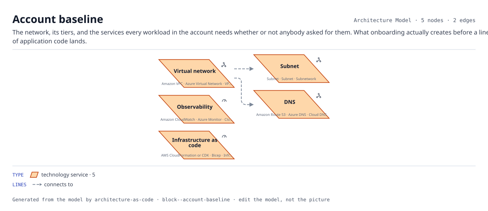

*The block's components, each with the services it resolves to, and the connections between them.*

| Component | AWS | Azure | GCP | On-prem | SaaS |
|---|---|---|---|---|---|
| Virtual network (`vpc`) | Amazon VPC | Azure Virtual Network | VPC network |  |  |
| Subnet (`subnet`) | Subnet | Subnet | Subnetwork |  |  |
| DNS (`dns`) | Amazon Route 53 | Azure DNS | Cloud DNS |  |  |
| Observability (`observability`) | Amazon CloudWatch | Azure Monitor | Cloud Operations |  | Datadog or Grafana |
| Infrastructure as code (`iac`) | AWS CloudFormation or CDK | Bicep | Infrastructure Manager |  | Terraform or Pulumi |

**Connections.** Virtual network → Subnet; Virtual network → DNS.

**Defaults.** `network_zone: Shared-Services`.

## Hybrid connectivity

`hybrid-connectivity` · Network

The paths back to the data center. There are always two, and the failover between them is the thing nobody has tested.

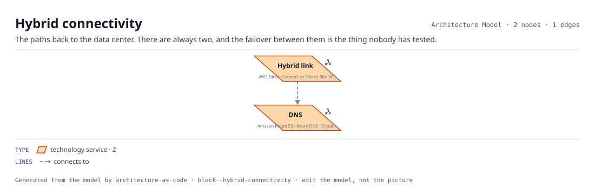

*The block's components, each with the services it resolves to, and the connections between them.*

| Component | AWS | Azure | GCP | On-prem | SaaS |
|---|---|---|---|---|---|
| Hybrid link (`hybrid-link`) | AWS Direct Connect or Site-to-Site VPN | ExpressRoute | Cloud Interconnect |  |  |
| DNS (`dns`) | Amazon Route 53 | Azure DNS | Cloud DNS |  |  |

**Connections.** Hybrid link → DNS.

**Defaults.** `network_zone: Shared-Services`.

## Public API tier

`public-api-tier` · Network

A programmatic front door. The gateway is where authentication, throttling and versioning live, and where teams route around when it is slow -- which is the thing to watch for.

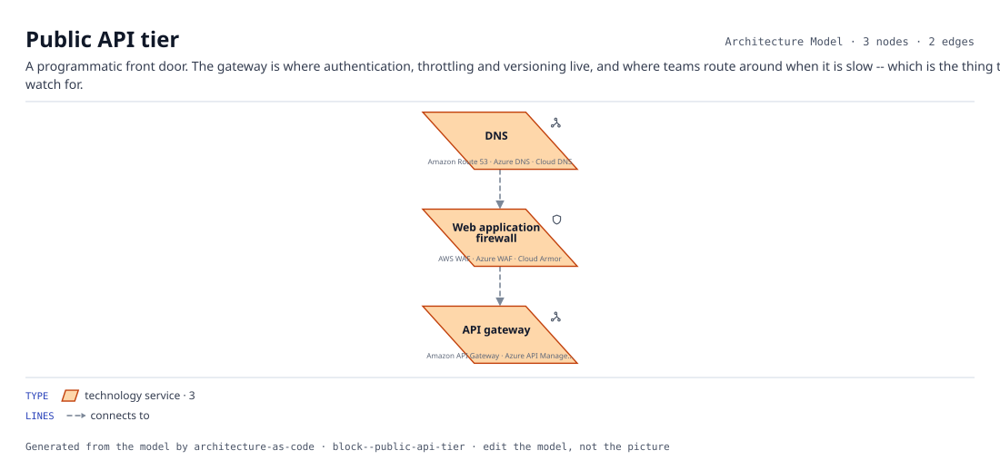

*The block's components, each with the services it resolves to, and the connections between them.*

| Component | AWS | Azure | GCP | On-prem | SaaS |
|---|---|---|---|---|---|
| DNS (`dns`) | Amazon Route 53 | Azure DNS | Cloud DNS |  |  |
| Web application firewall (`waf`) | AWS WAF | Azure WAF | Cloud Armor |  | Cloudflare |
| API gateway (`api-gateway`) | Amazon API Gateway | Azure API Management | Apigee |  |  |

**Connections.** DNS → Web application firewall; Web application firewall → API gateway.

**Defaults.** `network_zone: Edge`.

## Public web tier

`public-web-tier` · Network

Everything between the internet and an application. A load balancer with no WAF in front of it is a different risk posture, and naming the tier is what makes that visible instead of remembered.

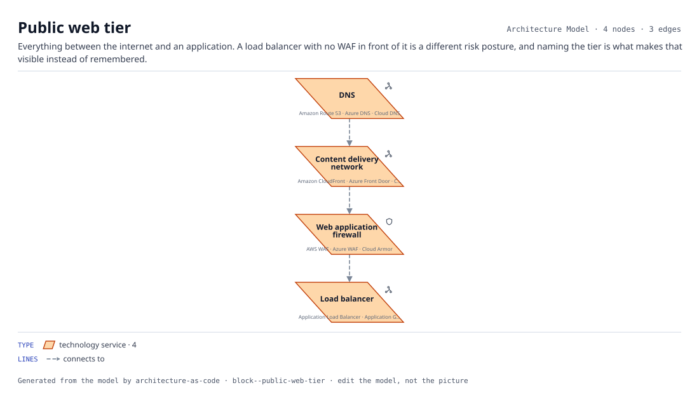

*The block's components, each with the services it resolves to, and the connections between them.*

| Component | AWS | Azure | GCP | On-prem | SaaS |
|---|---|---|---|---|---|
| Content delivery network (`cdn`) | Amazon CloudFront | Azure Front Door | Cloud CDN |  |  |
| Web application firewall (`waf`) | AWS WAF | Azure WAF | Cloud Armor |  | Cloudflare |
| Load balancer (`load-balancer`) | Application Load Balancer | Application Gateway | Cloud Load Balancing |  |  |
| DNS (`dns`) | Amazon Route 53 | Azure DNS | Cloud DNS |  |  |

**Connections.** DNS → Content delivery network; Content delivery network → Web application firewall; Web application firewall → Load balancer.

**Defaults.** `network_zone: Edge`.

## Change evidence

`change-evidence` · Operations

Source control, the pipeline that builds from it, the registry that holds what it built, and the service management that records the change the build was deployed under. Every link is a system writing to another system; the moment a person retypes a change number, the chain is a story. The risk register the evidence lands in is an application and sits above the block.

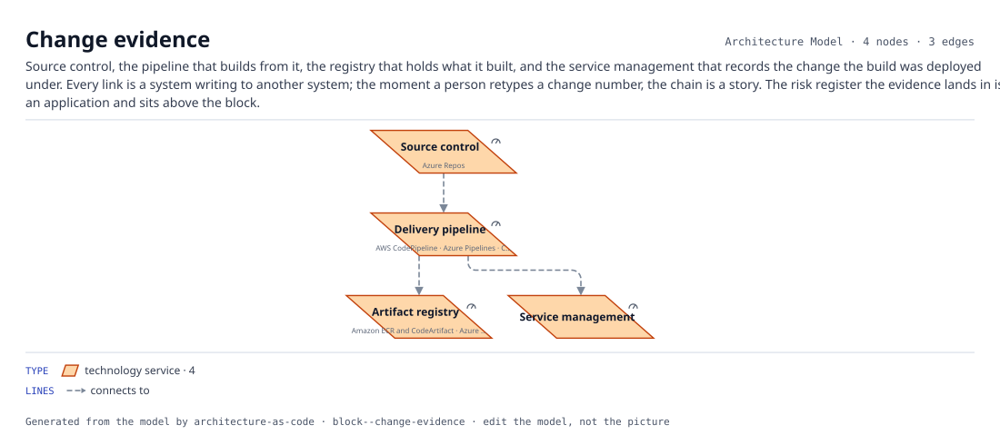

*The block's components, each with the services it resolves to, and the connections between them.*

| Component | AWS | Azure | GCP | On-prem | SaaS |
|---|---|---|---|---|---|
| Source control (`source-control`) |  | Azure Repos |  |  | GitHub or GitLab |
| Delivery pipeline (`ci-cd`) | AWS CodePipeline | Azure Pipelines | Cloud Build |  | GitHub Actions, GitLab CI or Jenkins |
| Artifact registry (`artifact-registry`) | Amazon ECR and CodeArtifact | Azure Container Registry | Artifact Registry |  | JFrog Artifactory |
| Service management (`itsm`) |  |  |  |  | ServiceNow ITSM, Jira Service Management or BMC Helix |

**Connections.** Source control → Delivery pipeline; Delivery pipeline → Artifact registry; Delivery pipeline → Service management.

**Defaults.** `network_zone: Shared-Services`.

## Delivery pipeline

`delivery-pipeline` · Operations

Build, infrastructure definition, and the service management record of what changed. A production dependency whether or not anybody has drawn it as one.

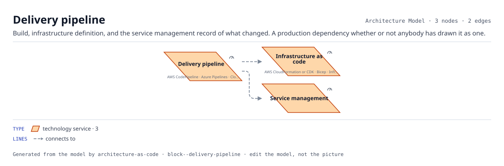

*The block's components, each with the services it resolves to, and the connections between them.*

| Component | AWS | Azure | GCP | On-prem | SaaS |
|---|---|---|---|---|---|
| Delivery pipeline (`ci-cd`) | AWS CodePipeline | Azure Pipelines | Cloud Build |  | GitHub Actions, GitLab CI or Jenkins |
| Infrastructure as code (`iac`) | AWS CloudFormation or CDK | Bicep | Infrastructure Manager |  | Terraform or Pulumi |
| Service management (`itsm`) |  |  |  |  | ServiceNow ITSM, Jira Service Management or BMC Helix |

**Connections.** Delivery pipeline → Infrastructure as code; Delivery pipeline → Service management.

**Defaults.** `network_zone: Shared-Services`.

## Observability stack

`observability-stack` · Operations

Telemetry from every service, security monitoring beside it, the on-call that is paged from both, and the service management that records what happened. One chain, so an incident has one timeline whether it started as an outage or an intrusion.

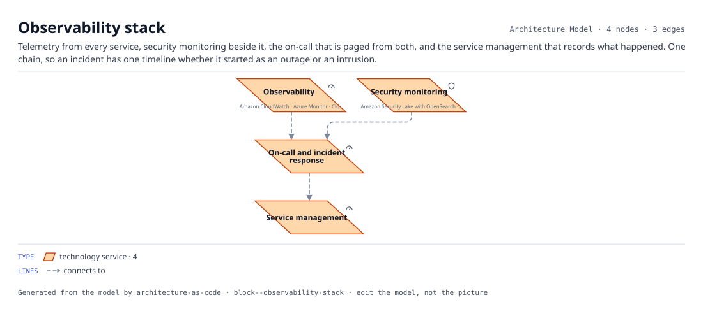

*The block's components, each with the services it resolves to, and the connections between them.*

| Component | AWS | Azure | GCP | On-prem | SaaS |
|---|---|---|---|---|---|
| Observability (`observability`) | Amazon CloudWatch | Azure Monitor | Cloud Operations |  | Datadog or Grafana |
| Security monitoring (`siem`) | Amazon Security Lake with OpenSearch | Microsoft Sentinel | Google Security Operations (formerly Chronicle) |  | Splunk or Elastic Security |
| On-call and incident response (`incident-management`) |  |  |  |  | PagerDuty or incident.io |
| Service management (`itsm`) |  |  |  |  | ServiceNow ITSM, Jira Service Management or BMC Helix |

**Connections.** Observability → On-call and incident response; Security monitoring → On-call and incident response; On-call and incident response → Service management.

**Defaults.** `network_zone: Shared-Services`.

## Payment capture

`payment-capture` · Payments

A gateway for the channels that call, a file transfer for the channels that send batches, a queue that makes both one ordered stream of instructions, and the store that remembers every instruction until the ledger has acknowledged it. The queue is the pattern's whole point: posting is idempotent only if something upstream of the ledger owns the sequence.

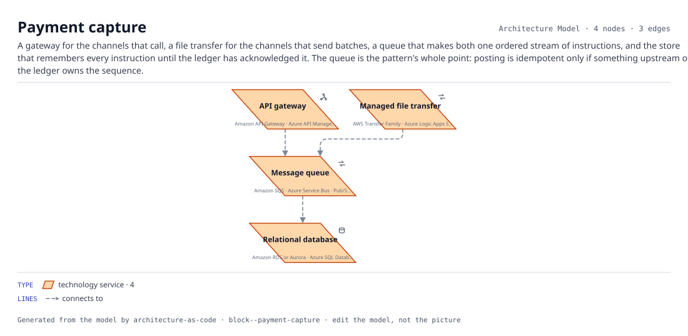

*The block's components, each with the services it resolves to, and the connections between them.*

| Component | AWS | Azure | GCP | On-prem | SaaS |
|---|---|---|---|---|---|
| API gateway (`api-gateway`) | Amazon API Gateway | Azure API Management | Apigee |  |  |
| Managed file transfer (`file-transfer`) | AWS Transfer Family | Azure Logic Apps SFTP |  | Managed file transfer appliance |  |
| Message queue (`message-queue`) | Amazon SQS | Azure Service Bus | Pub/Sub | IBM MQ |  |
| Relational database (`relational-db`) | Amazon RDS or Aurora | Azure SQL Database | Cloud SQL | PostgreSQL or Oracle |  |

**Connections.** API gateway → Message queue; Managed file transfer → Message queue; Message queue → Relational database.

**Defaults.** `network_zone: Private-App`.

## Identity governance

`identity-governance` · Security

The identity provider and the three things that make it governable: a joiner-mover-leaver process that drives it from the people system, a privileged-access vault for the accounts that can do damage, and security monitoring reading every authentication.

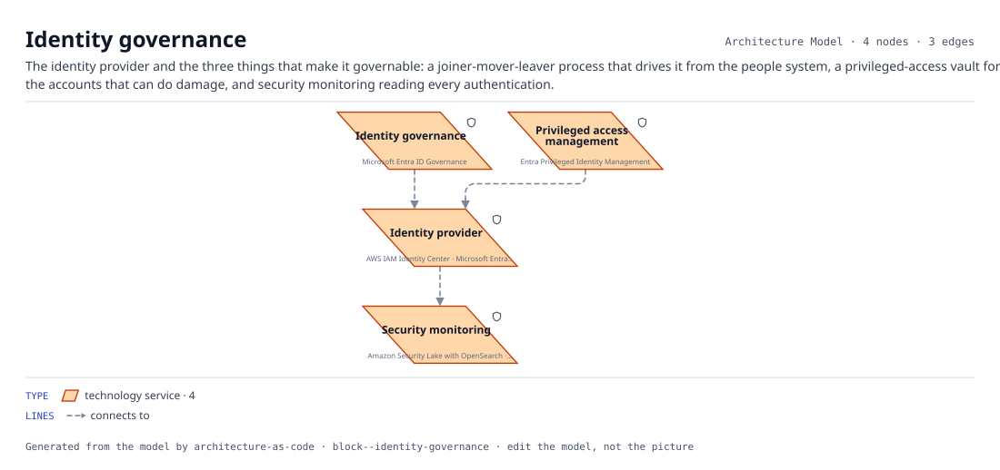

*The block's components, each with the services it resolves to, and the connections between them.*

| Component | AWS | Azure | GCP | On-prem | SaaS |
|---|---|---|---|---|---|
| Identity provider (`identity-provider`) | AWS IAM Identity Center | Microsoft Entra ID | Cloud Identity |  | Okta or Ping Identity |
| Identity governance (`identity-governance`) |  | Microsoft Entra ID Governance |  |  | SailPoint or Saviynt |
| Privileged access management (`privileged-access`) |  | Entra Privileged Identity Management |  |  | CyberArk or BeyondTrust |
| Security monitoring (`siem`) | Amazon Security Lake with OpenSearch | Microsoft Sentinel | Google Security Operations (formerly Chronicle) |  | Splunk or Elastic Security |

**Connections.** Identity governance → Identity provider; Privileged access management → Identity provider; Identity provider → Security monitoring.

**Defaults.** `network_zone: Shared-Services`.

## Security baseline

`security-baseline` · Security

Identity, secrets, keys and detection. Four components that are each somebody's whole job at scale, and are each a checkbox at the start.

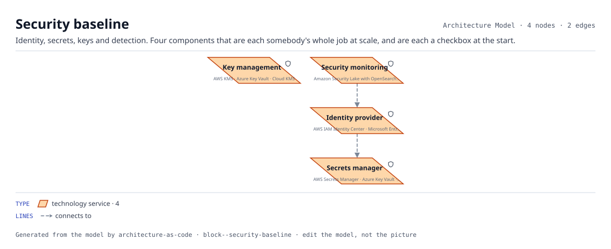

*The block's components, each with the services it resolves to, and the connections between them.*

| Component | AWS | Azure | GCP | On-prem | SaaS |
|---|---|---|---|---|---|
| Identity provider (`identity-provider`) | AWS IAM Identity Center | Microsoft Entra ID | Cloud Identity |  | Okta or Ping Identity |
| Secrets manager (`secrets-manager`) | AWS Secrets Manager | Azure Key Vault | Secret Manager |  | HashiCorp Vault |
| Key management (`kms`) | AWS KMS | Azure Key Vault | Cloud KMS |  |  |
| Security monitoring (`siem`) | Amazon Security Lake with OpenSearch | Microsoft Sentinel | Google Security Operations (formerly Chronicle) |  | Splunk or Elastic Security |

**Connections.** Identity provider → Secrets manager; Security monitoring → Identity provider.

**Defaults.** `network_zone: Shared-Services`.

## Token vault

`token-vault` · Security

A service that exchanges a card number for a token and back, the store it keeps the pairing in, the key management the store is encrypted under, and the certificates callers must present. The one place in the estate that is in cardholder-data scope on purpose.

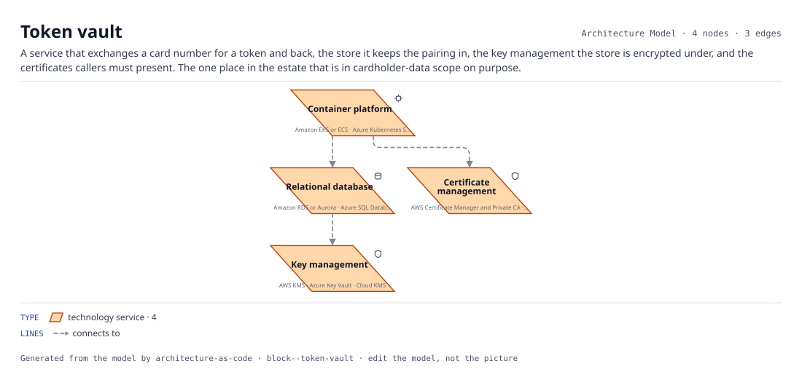

*The block's components, each with the services it resolves to, and the connections between them.*

| Component | AWS | Azure | GCP | On-prem | SaaS |
|---|---|---|---|---|---|
| Container platform (`container-platform`) | Amazon EKS or ECS | Azure Kubernetes Service | Google Kubernetes Engine | OpenShift |  |
| Relational database (`relational-db`) | Amazon RDS or Aurora | Azure SQL Database | Cloud SQL | PostgreSQL or Oracle |  |
| Key management (`kms`) | AWS KMS | Azure Key Vault | Cloud KMS |  |  |
| Certificate management (`certificate-management`) | AWS Certificate Manager and Private CA | Azure Key Vault certificates | Certificate Authority Service |  | DigiCert or Venafi |

**Connections.** Container platform → Relational database; Relational database → Key management; Container platform → Certificate management.

**Defaults.** `network_zone: Private-Data`.
