# Parts

The parts a shape is composed from: what each provides, what it needs from the shape, the kinds of shared service it runs on, and where it is used. No part names a cloud; a kind resolves to the landing zone of whichever shape composes it. Generated from `28_MODULES/` by `terrane render`; edit that, not this.

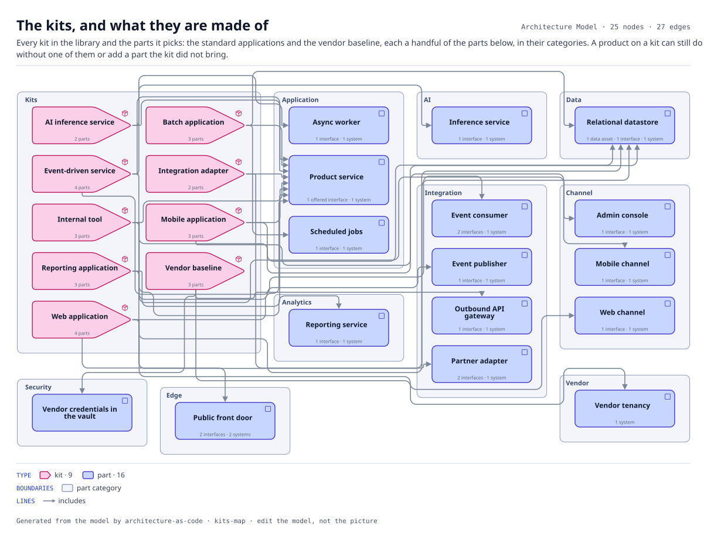

*Every kit and the parts it picks, in their categories.*

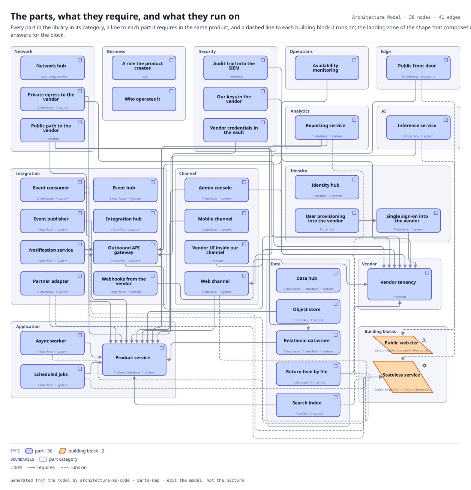

*Every part in its category, the parts it requires, and the building blocks it runs on.*

| Part | Category | Provides | Needs | Kinds | Used by |
|---|---|---|---|---|---|
| [Inference service](#ml-inference-service) | AI | 1 interfaces, 1 systems | `product_name`, `slug` | `foundation-model-service` | kit ml-service-baseline, type AI inference service, type Customer-facing digital product, type Internal platform service |
| [Reporting service](#report-service) | Analytics | 1 interfaces, 1 systems | `product_name`, `slug` | — | kit reporting-baseline, type Internal tool, type Batch application, type Reporting application, type Web application, type Customer-facing digital product |
| [AI inference service](#ml-service-baseline) *(kit)* | Application | 1 interfaces, 1 offered interfaces, 2 systems | — | — | type AI inference service |
| [Async worker](#async-worker) | Application | 1 interfaces, 1 systems | `product_name`, `slug` | `event-stream` | kit event-service-baseline, AWS product onboarding, type Mobile application, type Event-driven service, type AI inference service, type Web application, type Customer-facing digital product, type Internal platform service |
| [Batch application](#batch-app-baseline) *(kit)* | Application | 1 data assets, 2 interfaces, 1 offered interfaces, 3 systems | — | — | type Batch application |
| [Event-driven service](#event-service-baseline) *(kit)* | Application | 4 interfaces, 1 offered interfaces, 4 systems | — | — | type Event-driven service |
| [Integration adapter](#adapter-baseline) *(kit)* | Application | 2 interfaces, 1 offered interfaces, 2 systems | — | — | type Integration adapter |
| [Internal tool](#internal-tool-baseline) *(kit)* | Application | 1 data assets, 2 interfaces, 1 offered interfaces, 3 systems | — | — | type Internal tool |
| [Mobile application](#mobile-app-baseline) *(kit)* | Application | 1 data assets, 2 interfaces, 1 offered interfaces, 3 systems | — | — | type Mobile application |
| [Product service](#api-service) | Application | 1 offered interfaces, 1 systems | `product_name`, `slug` | — | kit web-app-baseline, kit mobile-app-baseline, kit internal-tool-baseline, kit event-service-baseline, kit batch-app-baseline, kit adapter-baseline, kit ml-service-baseline, kit reporting-baseline, AWS product onboarding, Azure digital product, Google Cloud digital product, Merchant Portal (assembled), type Internal tool, type Mobile application, type Event-driven service, type Batch application, type Integration adapter, type AI inference service, type Reporting application, type Web application, type Customer-facing digital product, type Internal platform service |
| [Reporting application](#reporting-baseline) *(kit)* | Application | 1 data assets, 2 interfaces, 1 offered interfaces, 3 systems | — | — | type Reporting application |
| [Scheduled jobs](#scheduled-job) | Application | 1 interfaces, 1 systems | `product_name`, `slug` | — | kit batch-app-baseline, type Internal tool, type Event-driven service, type Batch application, type Integration adapter, type Reporting application, type Web application, type Customer-facing digital product, type Internal platform service |
| [Web application](#web-app-baseline) *(kit)* | Application | 1 data assets, 4 interfaces, 1 offered interfaces, 5 systems | — | — | type Web application |
| [A role the product creates](#operator-role) | Business | 1 actors | `owner_org` | — | Merchant Portal (assembled), type Internal tool, type Web application, type Customer-facing digital product, type Internal platform service, type Bought SaaS capability |
| [Who operates it](#operator-access) | Business | — | `slug` | — | type Internal tool, type Web application, type Customer-facing digital product, type Bought SaaS capability |
| [Admin console](#admin-console) | Channel | 1 interfaces, 1 systems | `product_name`, `slug` | `identity-provider` | kit internal-tool-baseline, type Internal tool, type Reporting application, type Web application, type Customer-facing digital product, type Internal platform service |
| [Mobile channel](#mobile-channel) | Channel | 1 interfaces, 1 systems | `product_name`, `slug` | `api-gateway` | kit mobile-app-baseline, type Mobile application, type Web application, type Customer-facing digital product |
| [Vendor UI inside our channel](#embedded-ui) | Channel | 1 interfaces | `product_name`, `slug` | — | type Bought SaaS capability |
| [Web channel](#web-channel) | Channel | 1 interfaces, 1 systems | `product_name`, `slug` | — | kit web-app-baseline, AWS product onboarding, Azure digital product, Google Cloud digital product, Merchant Portal (assembled), type Mobile application, type Web application, type Customer-facing digital product |
| [Data hub](#data-hub) | Data | 1 data assets, 1 interfaces, 1 systems | `classification`, `owner_org`, `product_name`, `slug` | — | type Batch data product, type Shared hub |
| [Object store](#object-store) | Data | 1 interfaces, 1 systems | `product_name`, `slug` | — | AWS product onboarding, type Internal tool, type Mobile application, type Batch application, type AI inference service, type Web application, type Customer-facing digital product |
| [Relational datastore](#relational-datastore) | Data | 1 data assets, 1 interfaces, 1 systems | `classification`, `owner_org`, `product_name`, `slug` | — | kit web-app-baseline, kit mobile-app-baseline, kit internal-tool-baseline, kit batch-app-baseline, kit reporting-baseline, AWS product onboarding, Azure digital product, Google Cloud digital product, Merchant Portal (assembled), type Internal tool, type Mobile application, type Event-driven service, type Batch application, type Integration adapter, type AI inference service, type Reporting application, type Web application, type Customer-facing digital product, type Internal platform service |
| [Return feed by file](#sftp-return-feed) | Data | 1 data assets, 1 interfaces | `classification`, `owner_org`, `product_name`, `slug`, `vendor` | — | SaaS onboarding (slot return), Vendor SaaS service on Google Cloud (slot return), Vendor SaaS service (slot return), type Bought SaaS capability |
| [Search index](#search-index) | Data | 1 interfaces, 1 systems | `product_name`, `slug` | — | type Internal tool, type Mobile application, type Event-driven service, type AI inference service, type Reporting application, type Web application, type Customer-facing digital product |
| [Public front door](#public-web-entry) | Edge | 2 interfaces, 2 systems | `product_name`, `slug` | — | kit web-app-baseline, AWS product onboarding, type Mobile application, type Web application, type Customer-facing digital product |
| [Identity hub](#identity-hub) | Identity | 1 interfaces, 1 systems | `product_name`, `slug` | `identity-provider` | type Shared hub |
| [Single sign-on into the vendor](#sso-federation) | Identity | 1 interfaces, 1 systems | `product_name`, `slug`, `vendor` | `identity-provider` | SaaS onboarding, type Bought SaaS capability |
| [User provisioning into the vendor](#scim-provisioning) | Identity | 1 interfaces | `slug`, `vendor` | — | type Bought SaaS capability |
| [Event consumer](#event-consumer) | Integration | 2 interfaces, 1 systems | `product_name`, `slug` | `message-queue` | kit event-service-baseline, type Event-driven service, type AI inference service, type Customer-facing digital product, type Internal platform service |
| [Event hub](#event-hub) | Integration | 2 interfaces, 1 systems | `product_name`, `slug` | `message-queue` | type Shared hub |
| [Event publisher](#event-publisher) | Integration | 1 interfaces, 1 systems | `product_name`, `slug` | `message-queue` | kit event-service-baseline, Azure digital product, Google Cloud digital product, Merchant Portal (assembled), type Internal tool, type Mobile application, type Event-driven service, type Batch application, type Integration adapter, type Web application, type Customer-facing digital product, type Internal platform service |
| [Integration hub](#integration-hub) | Integration | 1 interfaces, 1 systems | `product_name`, `slug` | — | type Shared hub |
| [Notification service](#notification-service) | Integration | 1 interfaces, 1 systems | `product_name`, `slug` | `message-queue` | type Internal tool, type Mobile application, type Event-driven service, type Batch application, type Web application, type Customer-facing digital product, type Internal platform service |
| [Outbound API gateway](#api-outbound) | Integration | 1 interfaces, 1 systems | `product_name`, `slug`, `vendor` | `api-gateway`, `container-platform` | kit vendor-baseline, SaaS onboarding, Vendor SaaS service on Google Cloud, Vendor SaaS service, type Bought SaaS capability |
| [Partner adapter](#partner-adapter) | Integration | 2 interfaces, 1 systems | `product_name`, `slug` | `secrets-manager` | kit adapter-baseline, type Integration adapter, type Customer-facing digital product, type Internal platform service |
| [Webhooks from the vendor](#webhook-inbound) | Integration | 2 interfaces, 1 systems | `product_name`, `slug`, `vendor` | `api-gateway`, `container-platform` | SaaS onboarding (slot return), Vendor SaaS service on Google Cloud (slot return), Vendor SaaS service (slot return), type Bought SaaS capability |
| [Network hub](#network-hub) | Network | 1 tech services | `product_name`, `slug` | — | type Shared hub |
| [Private egress to the vendor](#private-egress) | Network | 2 interfaces, 1 systems | `product_name`, `slug`, `vendor` | `private-egress`, `transit-gateway` | SaaS onboarding (slot reach), Vendor SaaS service on Google Cloud (slot reach), Vendor SaaS service (slot reach), type Bought SaaS capability |
| [Public path to the vendor](#public-call) | Network | 1 interfaces | `product_name`, `slug`, `vendor` | — | SaaS onboarding (slot reach), Vendor SaaS service on Google Cloud (slot reach), Vendor SaaS service (slot reach), type Bought SaaS capability |
| [Availability monitoring](#vendor-monitoring) | Operations | — | `slug` | `observability` | SaaS onboarding, type Bought SaaS capability |
| [Audit trail into the SIEM](#audit-forwarding) | Security | 1 interfaces | `slug`, `vendor` | — | SaaS onboarding, type Bought SaaS capability |
| [Our keys in the vendor](#byok-encryption) | Security | — | `slug` | `kms` | type Bought SaaS capability |
| [Vendor credentials in the vault](#secrets-management) | Security | — | `slug` | `secrets-manager` | kit vendor-baseline, SaaS onboarding, Vendor SaaS service on Google Cloud, Vendor SaaS service, type Bought SaaS capability |
| [Vendor baseline](#vendor-baseline) *(kit)* | Vendor | 1 interfaces, 2 systems | — | — | SaaS onboarding, Vendor SaaS service on Google Cloud, Vendor SaaS service, type Bought SaaS capability |
| [Vendor tenancy](#vendor-tenancy) | Vendor | 1 systems | `product_name`, `slug` | — | kit vendor-baseline, SaaS onboarding, Vendor SaaS service on Google Cloud, Vendor SaaS service, type Bought SaaS capability |

## Inference service

`ml-inference-service` · AI · optional

The service that calls a model on the product's behalf: prompt assembly, retrieval, guardrails and the log of what was asked, in one place rather than in every caller. Runs against the landing zone's foundation model service.

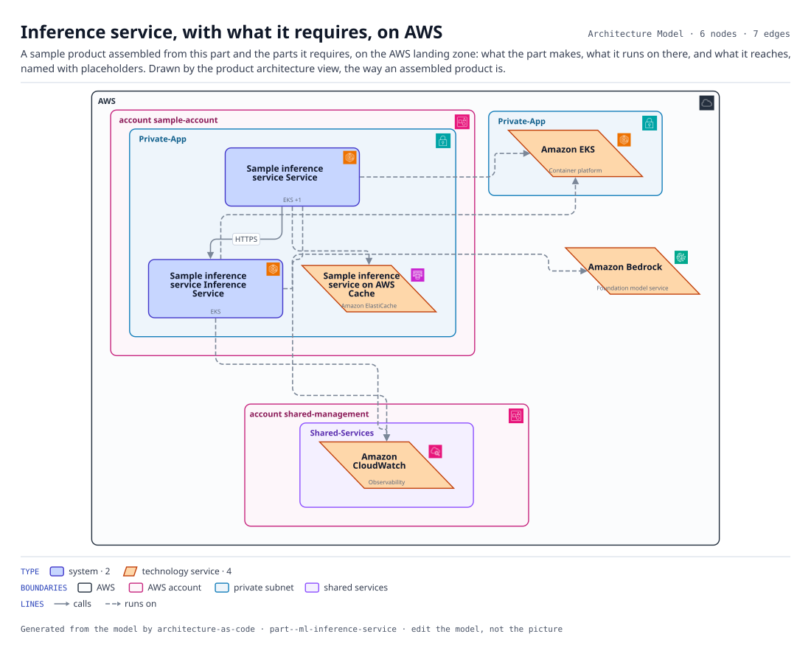

*A sample product assembled from this part and the parts it requires, drawn by the product architecture view; the names are placeholders. With `api-service`.*

**Provides.** 1 interfaces, 1 systems.
**Needs from the shape.** `product_name`, `slug`.
**Kinds.** `models` is of kind `foundation-model-service`.
**Parameters.** `runs_on` (default `['stateless-service.container-platform', 'stateless-service.observability']`).
**Requires.** `api-service`.
**Used by.** kit ml-service-baseline, type AI inference service, type Customer-facing digital product, type Internal platform service.

## Reporting service

`report-service` · Analytics · optional

The product's own reports and extracts, read from its operational data. Separate from the API so a long report never holds up a transaction.

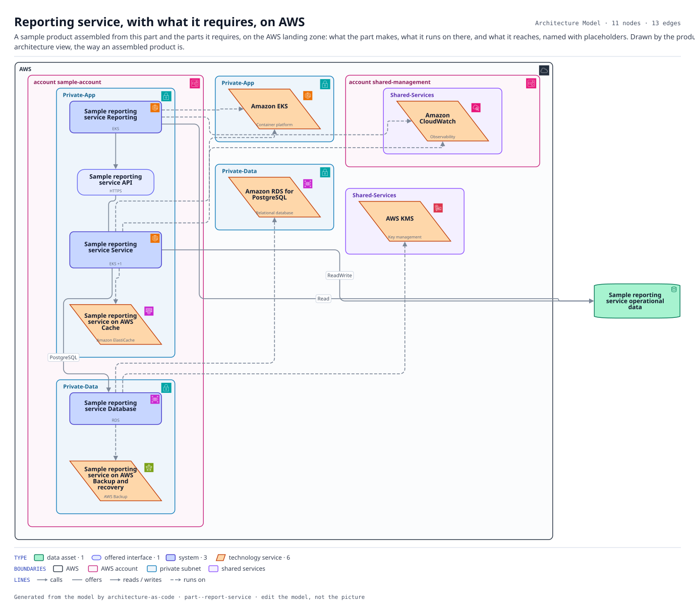

*A sample product assembled from this part and the parts it requires, drawn by the product architecture view; the names are placeholders. With `api-service`, `relational-datastore`.*

**Provides.** 1 interfaces, 1 systems.
**Needs from the shape.** `product_name`, `slug`.
**Parameters.** `runs_on` (default `['stateless-service.container-platform', 'stateless-service.observability']`).
**Requires.** `api-service`, `relational-datastore`.
**Used by.** kit reporting-baseline, type Internal tool, type Batch application, type Reporting application, type Web application, type Customer-facing digital product.

## AI inference service

`ml-service-baseline` · Application · optional · kit of `api-service`, `ml-inference-service`

The standard AI service: an inference service that calls the landing zone's foundation model service, with prompts, retrieval, guardrails and the audit log in one place, and the API in front of it.

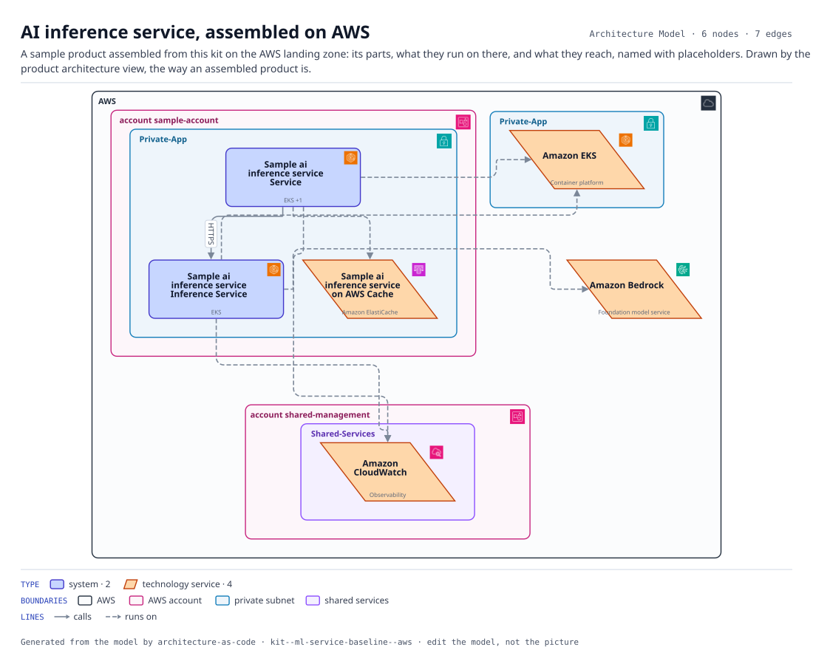

*A sample product assembled from the kit on AWS, drawn by the product architecture view; the names are placeholders. Also on [Azure](svg/kit--ml-service-baseline--azure.svg) and [GCP](svg/kit--ml-service-baseline--gcp.svg).*

**Provides.** 1 interfaces, 1 offered interfaces, 2 systems.
**Used by.** type AI inference service.

## Async worker

`async-worker` · Application · optional

Consumes the product's domain events and drives the long-running work a request cannot wait for. Drop it for a product with nothing to do after the response.

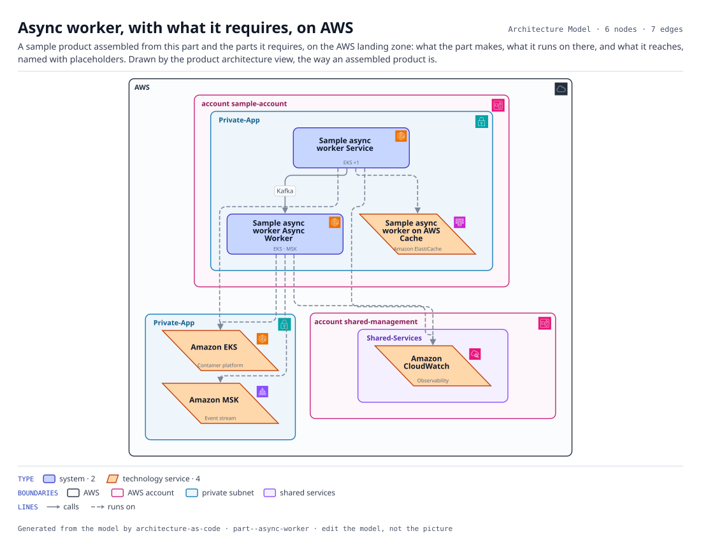

*A sample product assembled from this part and the parts it requires, drawn by the product architecture view; the names are placeholders. With `api-service`.*

**Provides.** 1 interfaces, 1 systems.
**Needs from the shape.** `product_name`, `slug`.
**Kinds.** `stream` is of kind `event-stream`.
**Parameters.** `runs_on` (default `['stateless-service.container-platform', 'stateless-service.observability']`); `protocol` (default `Kafka`).
**Requires.** `api-service`.
**Applies.** `event-fanout`.
**Used by.** kit event-service-baseline, AWS product onboarding, type Mobile application, type Event-driven service, type AI inference service, type Web application, type Customer-facing digital product, type Internal platform service.

## Batch application

`batch-app-baseline` · Application · optional · kit of `api-service`, `scheduled-job`, `relational-datastore`

The standard batch application: scheduled jobs with a window, the API they call, and the operational database they work over.

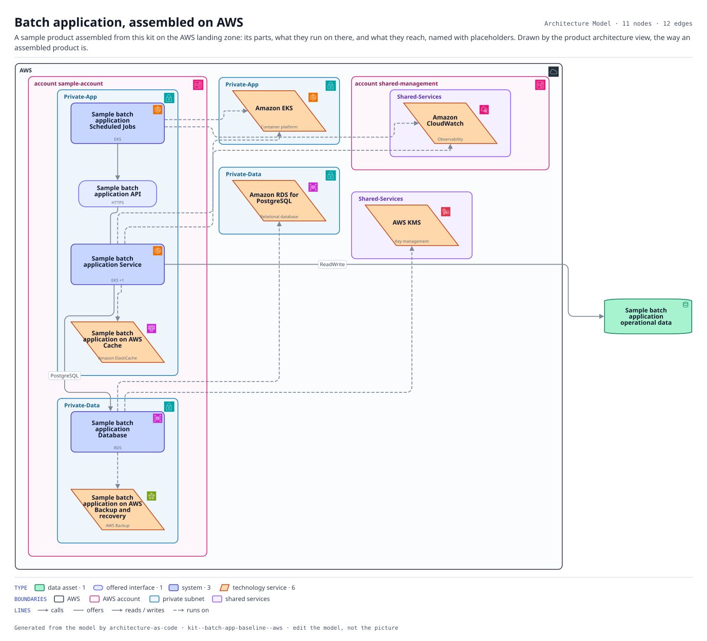

*A sample product assembled from the kit on AWS, drawn by the product architecture view; the names are placeholders. Also on [Azure](svg/kit--batch-app-baseline--azure.svg) and [GCP](svg/kit--batch-app-baseline--gcp.svg).*

**Provides.** 1 data assets, 2 interfaces, 1 offered interfaces, 3 systems.
**Used by.** type Batch application.

## Event-driven service

`event-service-baseline` · Application · optional · kit of `api-service`, `event-consumer`, `async-worker`, `event-publisher`

The standard event-driven service: consumes another system's events, does the work in a worker, and publishes its own events for whoever is next. An API for whatever still has to be asked directly.

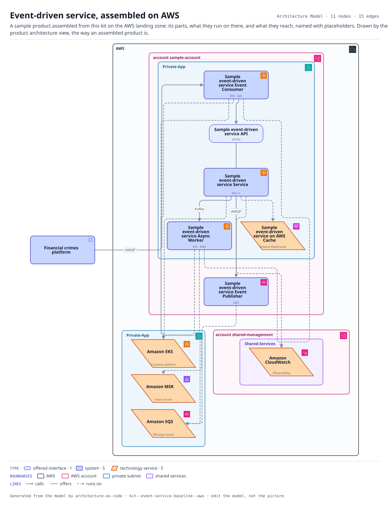

*A sample product assembled from the kit on AWS, drawn by the product architecture view; the names are placeholders. Also on [Azure](svg/kit--event-service-baseline--azure.svg) and [GCP](svg/kit--event-service-baseline--gcp.svg).*

**Provides.** 4 interfaces, 1 offered interfaces, 4 systems.
**Parameters.** `source_system` (required).
**Used by.** type Event-driven service.

## Integration adapter

`adapter-baseline` · Application · optional · kit of `api-service`, `partner-adapter`

The standard integration with a partner system: an adapter that owns the mapping, retry and credentials, and the API it serves.

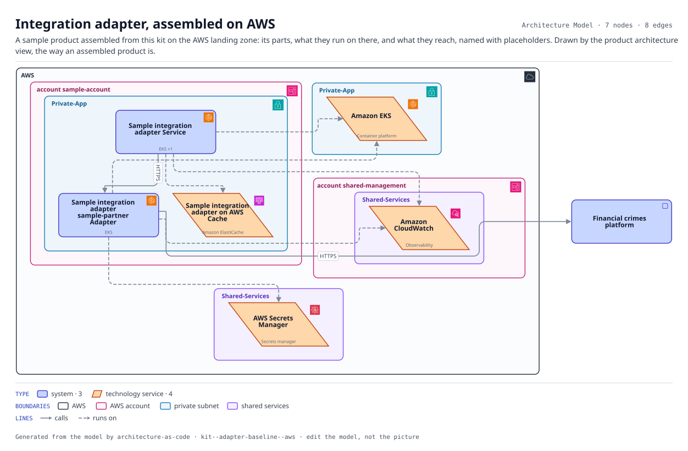

*A sample product assembled from the kit on AWS, drawn by the product architecture view; the names are placeholders. Also on [Azure](svg/kit--adapter-baseline--azure.svg) and [GCP](svg/kit--adapter-baseline--gcp.svg).*

**Provides.** 2 interfaces, 1 offered interfaces, 2 systems.
**Parameters.** `partner` (required); `target_system` (required).
**Used by.** type Integration adapter.

## Internal tool

`internal-tool-baseline` · Application · optional · kit of `api-service`, `admin-console`, `relational-datastore`

The standard internal tool: a console behind workforce sign-on, the API behind it, and the operational database. No public front door.

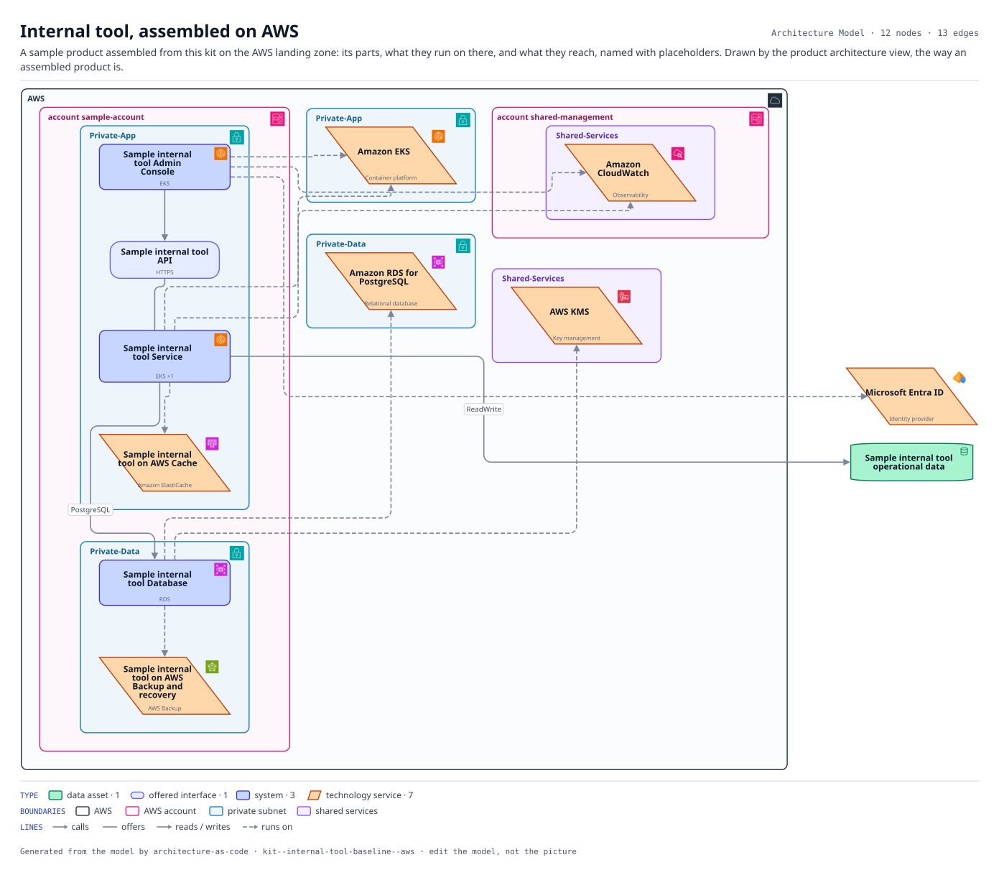

*A sample product assembled from the kit on AWS, drawn by the product architecture view; the names are placeholders. Also on [Azure](svg/kit--internal-tool-baseline--azure.svg) and [GCP](svg/kit--internal-tool-baseline--gcp.svg).*

**Provides.** 1 data assets, 2 interfaces, 1 offered interfaces, 3 systems.
**Used by.** type Internal tool.

## Mobile application

`mobile-app-baseline` · Application · optional · kit of `api-service`, `mobile-channel`, `relational-datastore`

The standard mobile application: the app in the stores, the API it calls through the shared gateway, and the operational database.

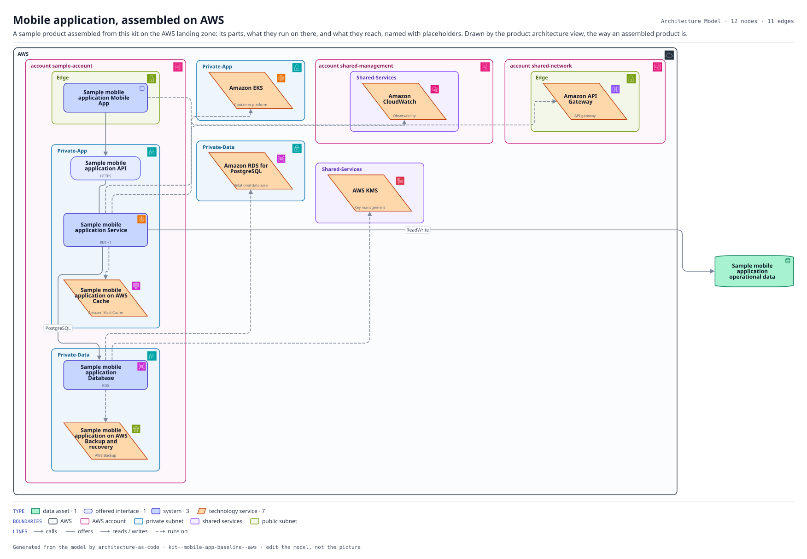

*A sample product assembled from the kit on AWS, drawn by the product architecture view; the names are placeholders. Also on [Azure](svg/kit--mobile-app-baseline--azure.svg) and [GCP](svg/kit--mobile-app-baseline--gcp.svg).*

**Provides.** 1 data assets, 2 interfaces, 1 offered interfaces, 3 systems.
**Used by.** type Mobile application.

## Product service

`api-service` · Application · always present

The domain service the product is built around, and the API it offers. Every other part of a built product wires to it, so it cannot be dropped. The service is what is deployed and runs; the API is its door, a record of its own that every caller's connection goes through. The system keeps the id it had when it was named for the API, because the estate's connections, flows and processes point at it.

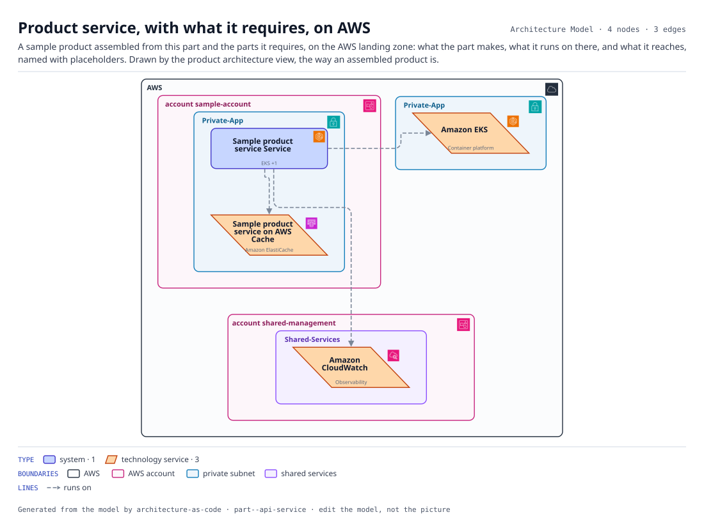

*A sample product assembled from this part and the parts it requires, drawn by the product architecture view; the names are placeholders.*

**Provides.** 1 offered interfaces, 1 systems.
**Needs from the shape.** `product_name`, `slug`.
**Parameters.** `runs_on` (default `['stateless-service']`); `uses` (default `[]`).
**Used by.** kit web-app-baseline, kit mobile-app-baseline, kit internal-tool-baseline, kit event-service-baseline, kit batch-app-baseline, kit adapter-baseline, kit ml-service-baseline, kit reporting-baseline, AWS product onboarding, Azure digital product, Google Cloud digital product, Merchant Portal (assembled), type Internal tool, type Mobile application, type Event-driven service, type Batch application, type Integration adapter, type AI inference service, type Reporting application, type Web application, type Customer-facing digital product, type Internal platform service.

## Reporting application

`reporting-baseline` · Application · optional · kit of `api-service`, `relational-datastore`, `report-service`

The standard reporting application: reports and extracts over an operational database, behind an API, and never in the transaction path.

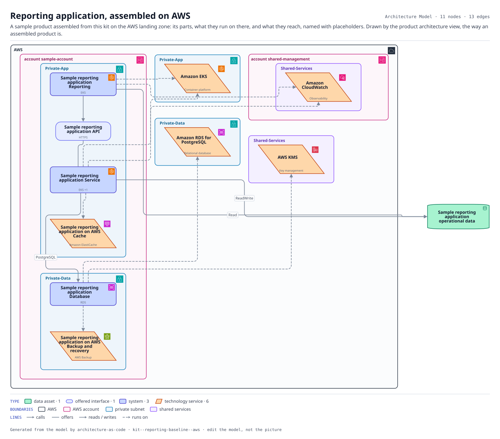

*A sample product assembled from the kit on AWS, drawn by the product architecture view; the names are placeholders. Also on [Azure](svg/kit--reporting-baseline--azure.svg) and [GCP](svg/kit--reporting-baseline--gcp.svg).*

**Provides.** 1 data assets, 2 interfaces, 1 offered interfaces, 3 systems.
**Used by.** type Reporting application.

## Scheduled jobs

`scheduled-job` · Application · optional

The product's batch work: the nightly run, the month-end extract, the retry sweep. A deadline that is external and usually non-negotiable, so it is a system with an owner rather than a cron entry nobody can find.

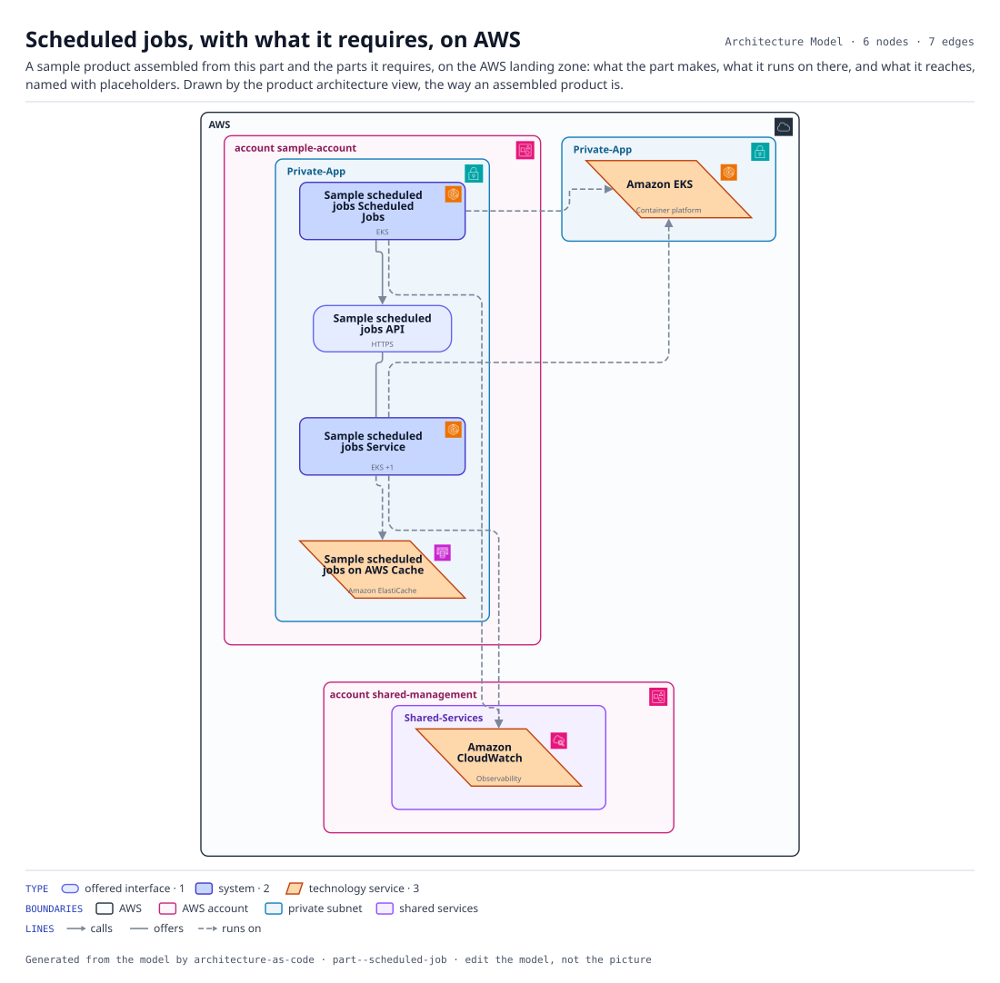

*A sample product assembled from this part and the parts it requires, drawn by the product architecture view; the names are placeholders. With `api-service`.*

**Provides.** 1 interfaces, 1 systems.
**Needs from the shape.** `product_name`, `slug`.
**Parameters.** `runs_on` (default `['stateless-service.container-platform', 'stateless-service.observability']`); `schedule` (default `daily`).
**Requires.** `api-service`.
**Used by.** kit batch-app-baseline, type Internal tool, type Event-driven service, type Batch application, type Integration adapter, type Reporting application, type Web application, type Customer-facing digital product, type Internal platform service.

## Web application

`web-app-baseline` · Application · optional · kit of `api-service`, `web-channel`, `public-web-entry`, `relational-datastore`

The standard web application: a browser front end behind the public front door, the API behind it, and the operational database. The parts every one of these starts with, picked in one go.

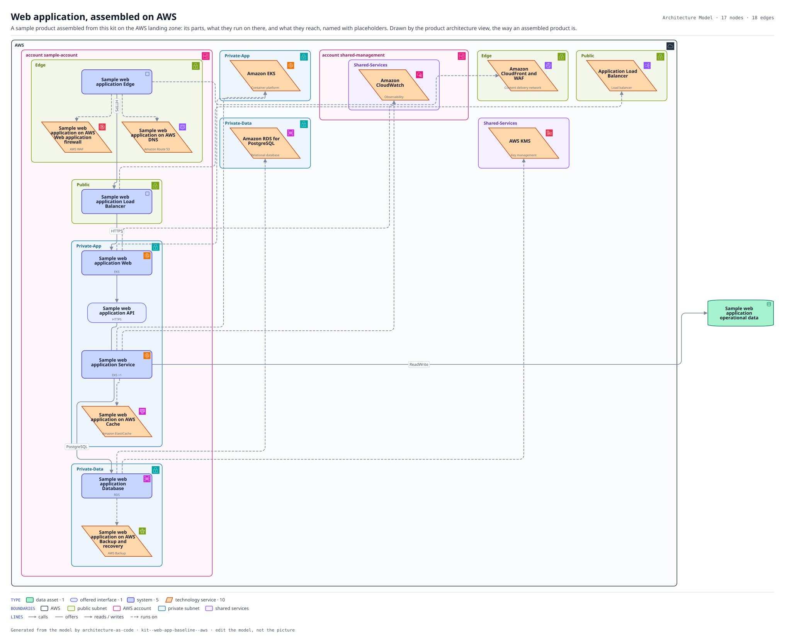

*A sample product assembled from the kit on AWS, drawn by the product architecture view; the names are placeholders. Also on [Azure](svg/kit--web-app-baseline--azure.svg) and [GCP](svg/kit--web-app-baseline--gcp.svg).*

**Provides.** 1 data assets, 4 interfaces, 1 offered interfaces, 5 systems.
**Used by.** type Web application.

## A role the product creates

`operator-role` · Business · optional

An operating role that exists because the product does. Most operators are already in the model and `operator-access` names one of them; this is for the roles a product brings with it -- the analyst who works a queue that was nobody's job until the thing was bought.

**No picture on** AWS: view product-architecture selected no entities.

**Provides.** 1 actors.
**Needs from the shape.** `owner_org`.
**Parameters.** `roles` (required); `system` (required).
**Used by.** Merchant Portal (assembled), type Internal tool, type Web application, type Customer-facing digital product, type Internal platform service, type Bought SaaS capability.

## Who operates it

`operator-access` · Business · optional

The people who work in the vendor's system, so it appears on the system context diagram with them attached rather than floating outside the estate.

**No picture on** AWS: view product-architecture selected no entities.

**Provides.** —.
**Needs from the shape.** `slug`.
**Parameters.** `actor` (required); `interaction` (default `Operates`); `system` (default `SYS-{slug|upper}-VENDOR`).
**Used by.** type Internal tool, type Web application, type Customer-facing digital product, type Bought SaaS capability.

## Admin console

`admin-console` · Channel · optional

The internal web application staff use to operate the product, behind the workforce identity provider rather than the public front door.

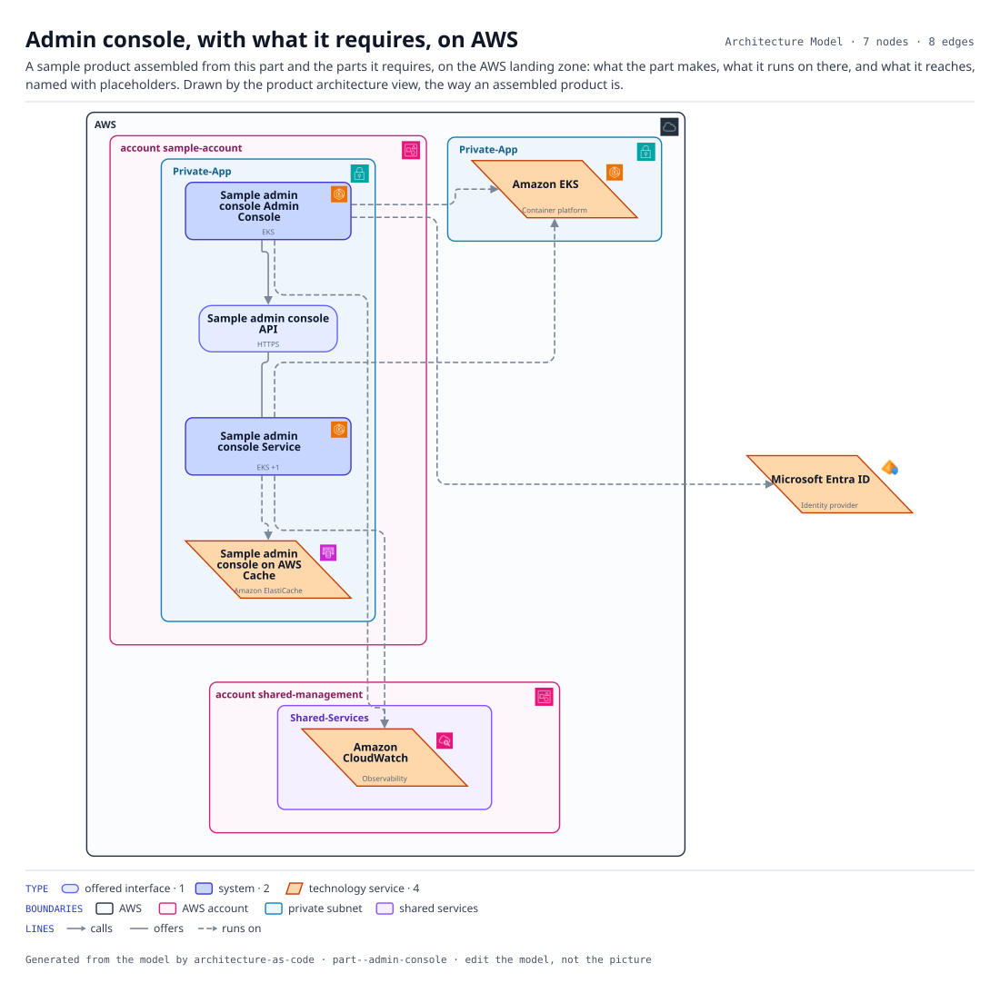

*A sample product assembled from this part and the parts it requires, drawn by the product architecture view; the names are placeholders. With `api-service`.*

**Provides.** 1 interfaces, 1 systems.
**Needs from the shape.** `product_name`, `slug`.
**Kinds.** `idp` is of kind `identity-provider`.
**Parameters.** `runs_on` (default `['stateless-service.container-platform', 'stateless-service.observability']`).
**Requires.** `api-service`.
**Used by.** kit internal-tool-baseline, type Internal tool, type Reporting application, type Web application, type Customer-facing digital product, type Internal platform service.

## Mobile channel

`mobile-channel` · Channel · optional

The product's mobile app, calling the product API through the shared API gateway. A published app has a release cycle you do not control and versions you cannot retire, so it is a system of its own.

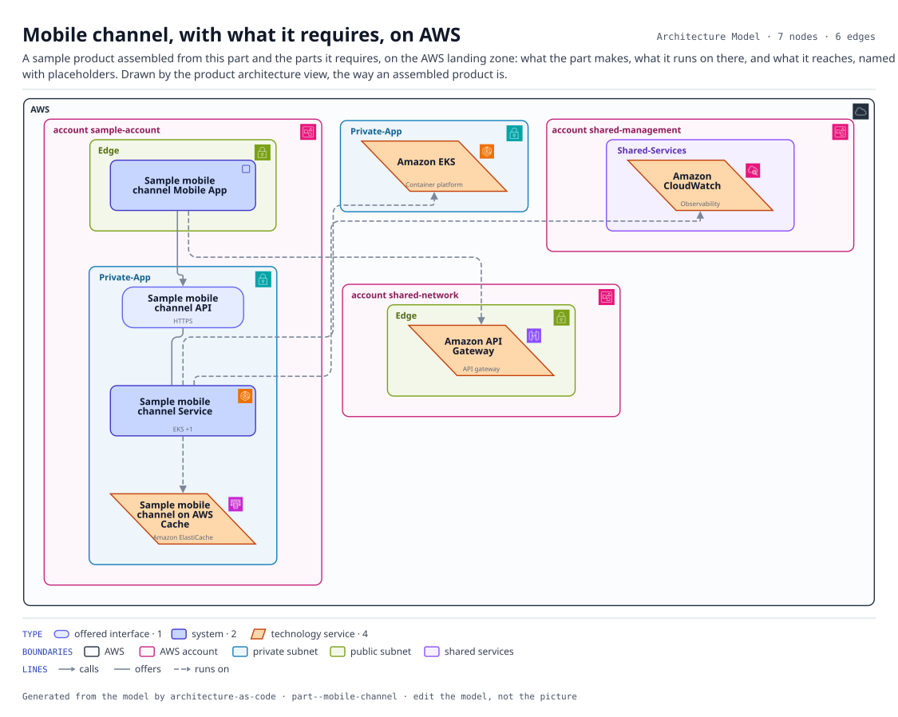

*A sample product assembled from this part and the parts it requires, drawn by the product architecture view; the names are placeholders. With `api-service`.*

**Provides.** 1 interfaces, 1 systems.
**Needs from the shape.** `product_name`, `slug`.
**Kinds.** `front_door` is of kind `api-gateway`.
**Requires.** `api-service`.
**Used by.** kit mobile-app-baseline, type Mobile application, type Web application, type Customer-facing digital product.

## Vendor UI inside our channel

`embedded-ui` · Channel · optional

A channel of ours opens the vendor's screens for the user, by deep link or embedded frame, signed in through federation. Where the vendor is used by customers as well as staff, this is how they reach it.

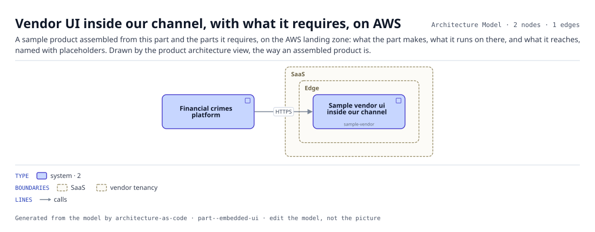

*A sample product assembled from this part and the parts it requires, drawn by the product architecture view; the names are placeholders. With `vendor-tenancy`.*

**Provides.** 1 interfaces.
**Needs from the shape.** `product_name`, `slug`.
**Parameters.** `channel_system` (required).
**Requires.** `vendor-tenancy`.
**Used by.** type Bought SaaS capability.

## Web channel

`web-channel` · Channel · optional

The customer-facing front end, calling the product API. Drop it for a product with no screens of its own.

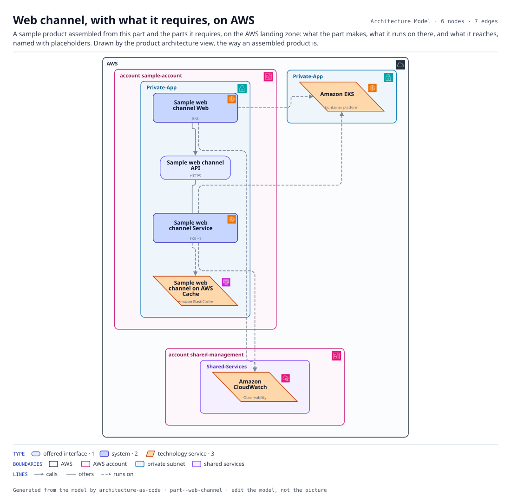

*A sample product assembled from this part and the parts it requires, drawn by the product architecture view; the names are placeholders. With `api-service`.*

**Provides.** 1 interfaces, 1 systems.
**Needs from the shape.** `product_name`, `slug`.
**Parameters.** `runs_on` (default `['stateless-service.container-platform', 'stateless-service.observability']`); `uses` (default `[]`).
**Requires.** `api-service`.
**Used by.** kit web-app-baseline, AWS product onboarding, Azure digital product, Google Cloud digital product, Merchant Portal (assembled), type Mobile application, type Web application, type Customer-facing digital product.

## Data hub

`data-hub` · Data · optional

A consolidation point. Every source feeds one hub, the hub masters one consolidated dataset, and whoever needs the data reads it there rather than from each source. The sources are named on the instance.

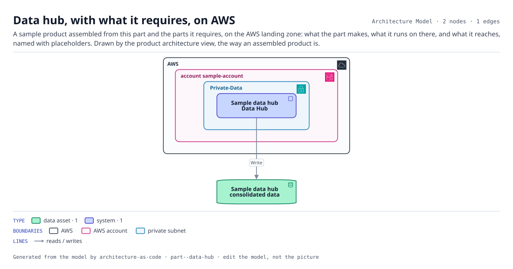

*A sample product assembled from this part and the parts it requires, drawn by the product architecture view; the names are placeholders.*

**Provides.** 1 data assets, 1 interfaces, 1 systems.
**Needs from the shape.** `classification`, `owner_org`, `product_name`, `slug`.
**Parameters.** `spokes` (required); `protocol` (default `SFTP`); `frequency` (default `Daily`).
**Used by.** type Batch data product, type Shared hub.

## Object store

`object-store` · Data · optional

A bucket of the product's own, for documents and extracts, encrypted with the customer managed key. Drop it for a product that holds no files.

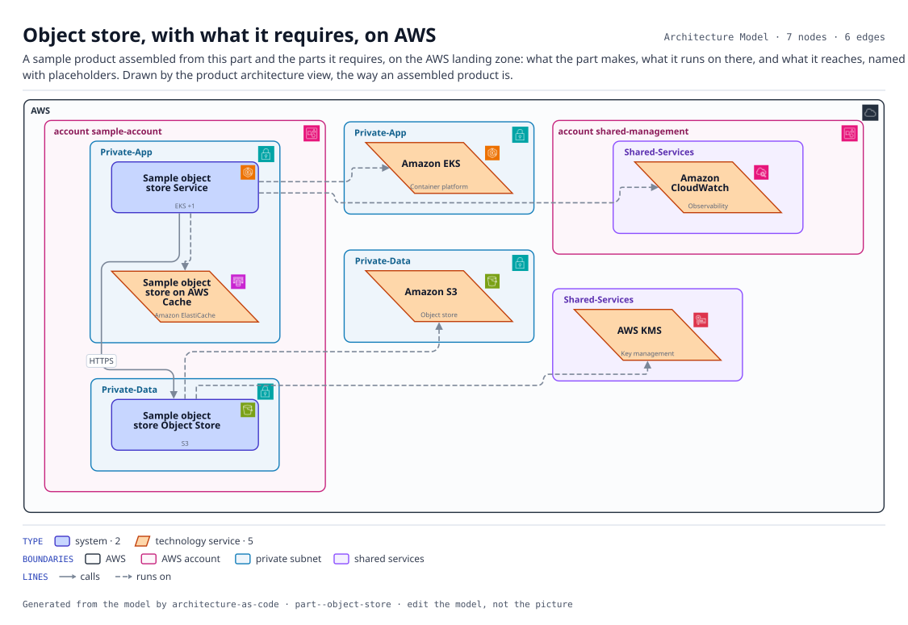

*A sample product assembled from this part and the parts it requires, drawn by the product architecture view; the names are placeholders. With `api-service`.*

**Provides.** 1 interfaces, 1 systems.
**Needs from the shape.** `product_name`, `slug`.
**Parameters.** `uses` (default `['object-store', 'kms']`).
**Requires.** `api-service`.
**Used by.** AWS product onboarding, type Internal tool, type Mobile application, type Batch application, type AI inference service, type Web application, type Customer-facing digital product.

## Relational datastore

`relational-datastore` · Data · optional

The product's operational database and the data asset it masters, with the API reading and writing it. Runs on the transactional store block, which is where the backup plan and the key come from.

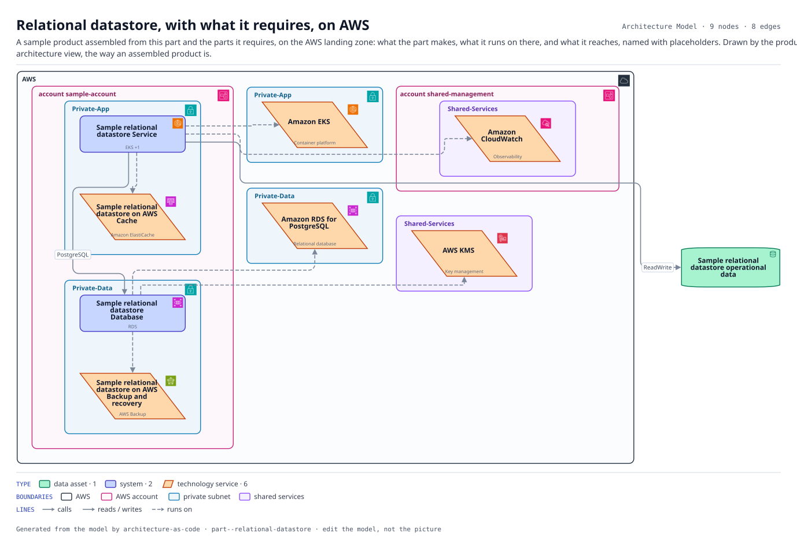

*A sample product assembled from this part and the parts it requires, drawn by the product architecture view; the names are placeholders. With `api-service`.*

**Provides.** 1 data assets, 1 interfaces, 1 systems.
**Needs from the shape.** `classification`, `owner_org`, `product_name`, `slug`.
**Parameters.** `runs_on` (default `['transactional-store']`); `protocol` (default `PostgreSQL`); `system_suffix` (default `DB`); `risk_level` (default `High`); `data_org` (the estate's answer).
**Requires.** `api-service`.
**Applies.** `stateless-request-service`.
**Used by.** kit web-app-baseline, kit mobile-app-baseline, kit internal-tool-baseline, kit batch-app-baseline, kit reporting-baseline, AWS product onboarding, Azure digital product, Google Cloud digital product, Merchant Portal (assembled), type Internal tool, type Mobile application, type Event-driven service, type Batch application, type Integration adapter, type AI inference service, type Reporting application, type Web application, type Customer-facing digital product, type Internal platform service.

## Return feed by file

`sftp-return-feed` · Data · optional

A nightly extract from the vendor, landed through the shared ingestion hub for reconciliation and for the model risk work that has to explain their decisions. What the vendor decided and why, held our side, because a decision we cannot explain is a decision we cannot defend.

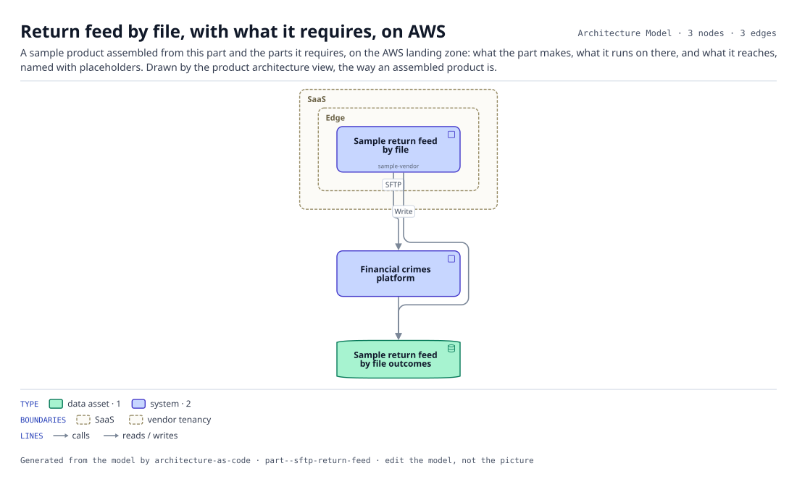

*A sample product assembled from this part and the parts it requires, drawn by the product architecture view; the names are placeholders. With `vendor-tenancy`.*

**Provides.** 1 data assets, 1 interfaces.
**Needs from the shape.** `classification`, `owner_org`, `product_name`, `slug`, `vendor`.
**Parameters.** `ingest_system` (the estate's answer); `data_org` (the estate's answer); `landed_data_controls` (the estate's answer, else `[]`); `landed_data_policies` (the estate's answer, else `[]`).
**Requires.** `vendor-tenancy`.
**Applies.** `partner-file-exchange`.
**Used by.** SaaS onboarding (slot return), Vendor SaaS service on Google Cloud (slot return), Vendor SaaS service (slot return), type Bought SaaS capability.

## Search index

`search-index` · Data · optional

A search index over the product's records, fed from the API and read by it. An index is a copy, so it is a datastore with a source and never the source itself.

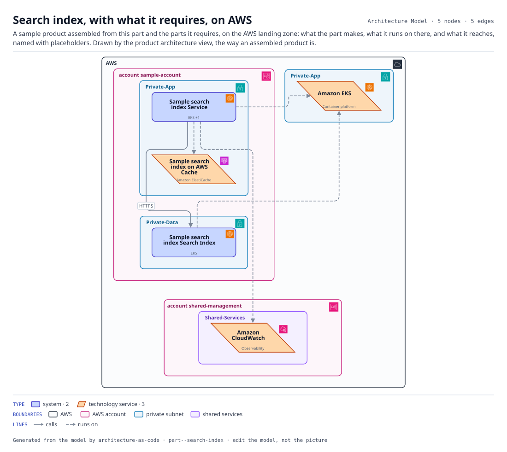

*A sample product assembled from this part and the parts it requires, drawn by the product architecture view; the names are placeholders. With `api-service`.*

**Provides.** 1 interfaces, 1 systems.
**Needs from the shape.** `product_name`, `slug`.
**Parameters.** `runs_on` (default `['stateless-service.container-platform']`).
**Requires.** `api-service`.
**Used by.** type Internal tool, type Mobile application, type Event-driven service, type AI inference service, type Reporting application, type Web application, type Customer-facing digital product.

## Public front door

`public-web-entry` · Edge · optional

The edge in front of a public web channel: a CDN distribution with a WAF ruleset, and a load balancer terminating TLS. Runs on the public web tier block, which is where the ruleset and the hostname are created.

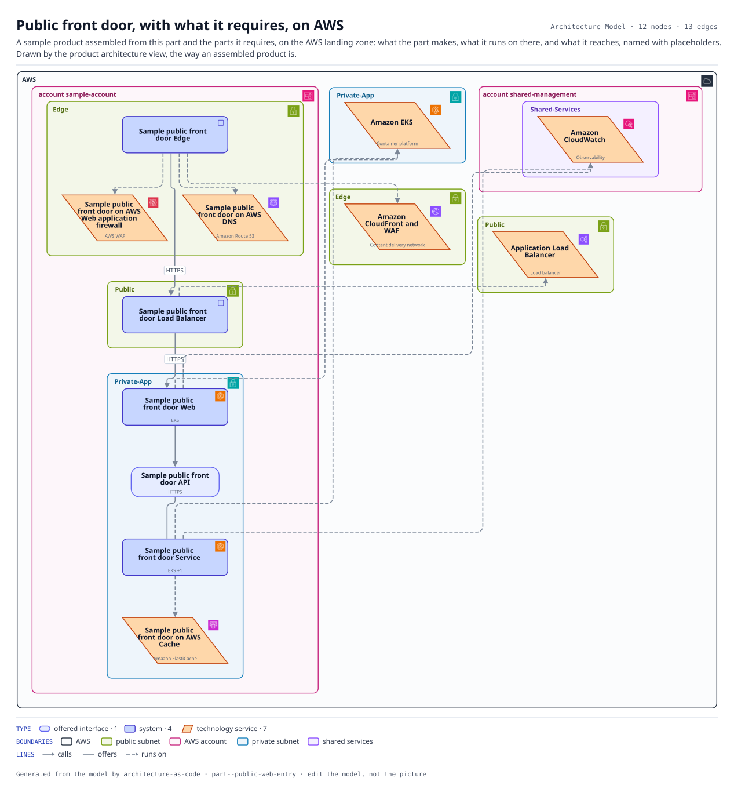

*A sample product assembled from this part and the parts it requires, drawn by the product architecture view; the names are placeholders. With `web-channel`.*

**Provides.** 2 interfaces, 2 systems.
**Needs from the shape.** `product_name`, `slug`.
**Requires.** `web-channel`.
**Applies.** `public-web-entry`.
**Used by.** kit web-app-baseline, AWS product onboarding, type Mobile application, type Web application, type Customer-facing digital product.

## Identity hub

`identity-hub` · Identity · optional

One identity provider that every application federates to. Users sign on once; the applications are named on the instance and each gets its federation link.

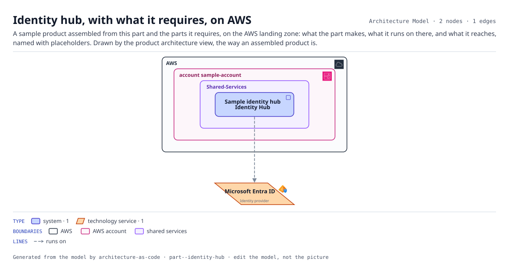

*A sample product assembled from this part and the parts it requires, drawn by the product architecture view; the names are placeholders.*

**Provides.** 1 interfaces, 1 systems.
**Needs from the shape.** `product_name`, `slug`.
**Kinds.** `idp` is of kind `identity-provider`.
**Parameters.** `spokes` (required); `protocol` (default `SAML`); `access_controls` (the estate's answer, else `[]`); `access_policies` (the estate's answer, else `[]`).
**Used by.** type Shared hub.

## Single sign-on into the vendor

`sso-federation` · Identity · optional

Our people reach the vendor through our identity provider, not with passwords the vendor holds. Onboarding creates it; leavers make it matter.

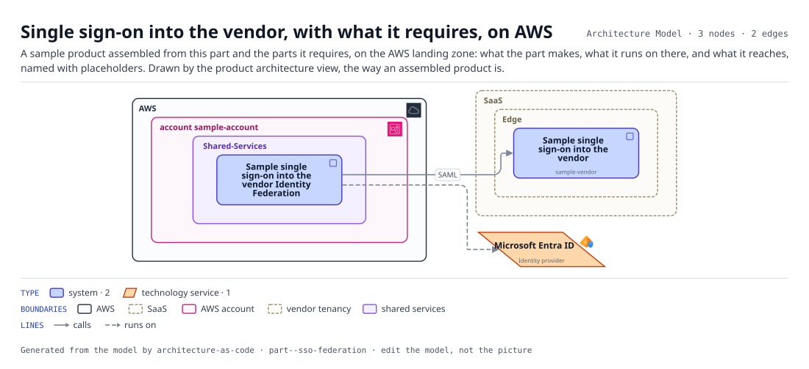

*A sample product assembled from this part and the parts it requires, drawn by the product architecture view; the names are placeholders. With `vendor-tenancy`.*

**Provides.** 1 interfaces, 1 systems.
**Needs from the shape.** `product_name`, `slug`, `vendor`.
**Kinds.** `idp` is of kind `identity-provider`.
**Parameters.** `protocol` (default `SAML`); `platform_org` (the estate's answer); `access_controls` (the estate's answer, else `[]`); `access_policies` (the estate's answer, else `[]`).
**Requires.** `vendor-tenancy`.
**Used by.** SaaS onboarding, type Bought SaaS capability.

## User provisioning into the vendor

`scim-provisioning` · Identity · optional

Accounts in the vendor are created and removed from our directory rather than by hand: joiners appear, leavers disappear, and the quarterly access review has something to reconcile against.

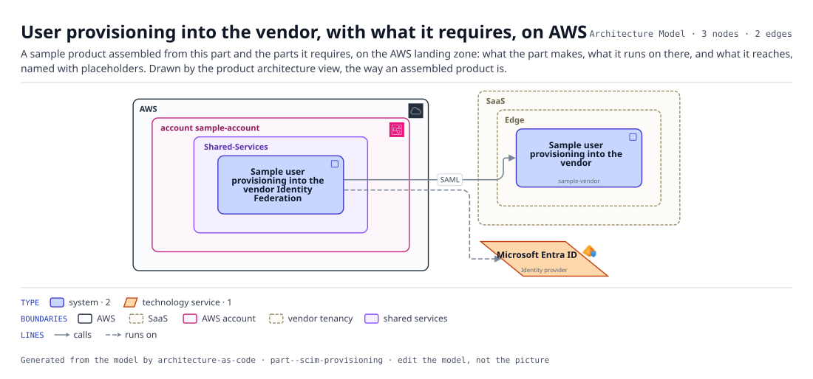

*A sample product assembled from this part and the parts it requires, drawn by the product architecture view; the names are placeholders. With `sso-federation`.*

**Provides.** 1 interfaces.
**Needs from the shape.** `slug`, `vendor`.
**Parameters.** `platform_org` (the estate's answer).
**Requires.** `sso-federation`.
**Used by.** type Bought SaaS capability.

## Event consumer

`event-consumer` · Integration · optional

Consumes another system's events from the enterprise bus and hands them to the product API. The part that lets this product react to something without being called.

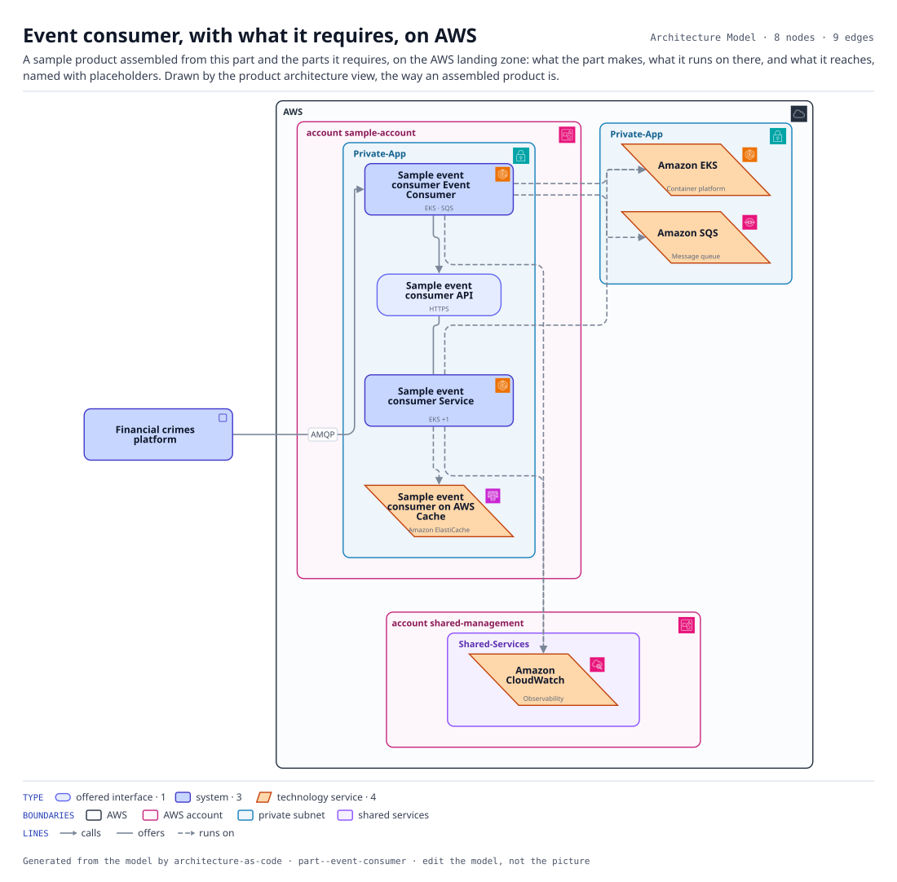

*A sample product assembled from this part and the parts it requires, drawn by the product architecture view; the names are placeholders. With `api-service`.*

**Provides.** 2 interfaces, 1 systems.
**Needs from the shape.** `product_name`, `slug`.
**Kinds.** `bus` is of kind `message-queue`.
**Parameters.** `source_system` (required); `runs_on` (default `['stateless-service.container-platform', 'stateless-service.observability']`); `protocol` (default `AMQP`).
**Requires.** `api-service`.
**Applies.** `event-fanout`.
**Used by.** kit event-service-baseline, type Event-driven service, type AI inference service, type Customer-facing digital product, type Internal platform service.

## Event hub

`event-hub` · Integration · optional

A bus in the middle. Publishers put domain events on it and subscribers take what they want, and neither side knows the other. The publishers and the subscribers are named on the instance; each gets one interface to or from the bus.

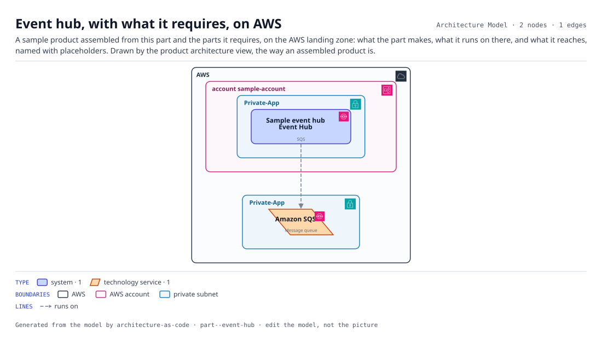

*A sample product assembled from this part and the parts it requires, drawn by the product architecture view; the names are placeholders.*

**Provides.** 2 interfaces, 1 systems.
**Needs from the shape.** `product_name`, `slug`.
**Kinds.** `bus` is of kind `message-queue`.
**Parameters.** `spokes` (required); `subscribers` (default `[]`); `protocol` (default `AMQP`).
**Used by.** type Shared hub.

## Event publisher

`event-publisher` · Integration · optional

Publishes the product's domain events onto the enterprise bus for whoever subscribes. The part that lets other products react without calling this one.

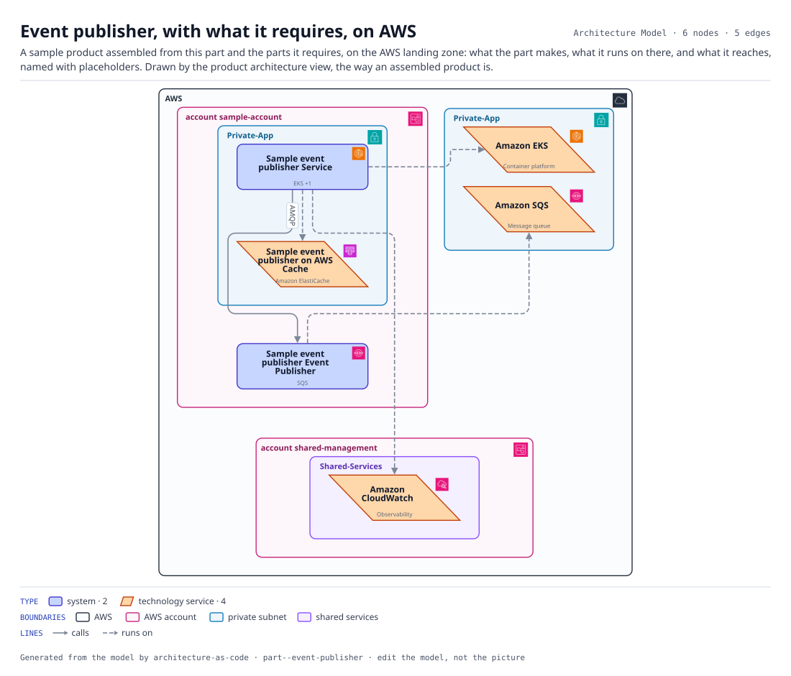

*A sample product assembled from this part and the parts it requires, drawn by the product architecture view; the names are placeholders. With `api-service`.*

**Provides.** 1 interfaces, 1 systems.
**Needs from the shape.** `product_name`, `slug`.
**Kinds.** `bus` is of kind `message-queue`.
**Parameters.** `protocol` (default `AMQP`).
**Requires.** `api-service`.
**Applies.** `event-fanout`.
**Used by.** kit event-service-baseline, Azure digital product, Google Cloud digital product, Merchant Portal (assembled), type Internal tool, type Mobile application, type Event-driven service, type Batch application, type Integration adapter, type Web application, type Customer-facing digital product, type Internal platform service.

## Integration hub

`integration-hub` · Integration · optional

One system in the middle that every spoke talks through: mapping, routing, retries and the audit trail in one place instead of in every pair. The spokes are named on the instance; the hub gets one interface per spoke.

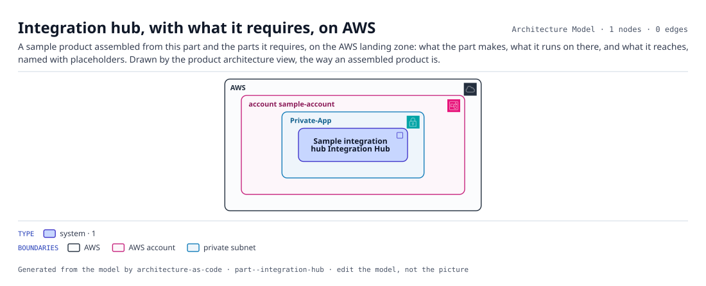

*A sample product assembled from this part and the parts it requires, drawn by the product architecture view; the names are placeholders.*

**Provides.** 1 interfaces, 1 systems.
**Needs from the shape.** `product_name`, `slug`.
**Parameters.** `spokes` (required); `hub_suffix` (default `HUB`); `protocol` (default `HTTPS`); `change_controls` (the estate's answer, else `[]`); `change_policies` (the estate's answer, else `[]`).
**Used by.** type Shared hub.

## Notification service

`notification-service` · Integration · optional

Turns the product's events into email, text and push messages to the people who asked for them. Kept apart from the API so a slow mail provider slows nothing else.

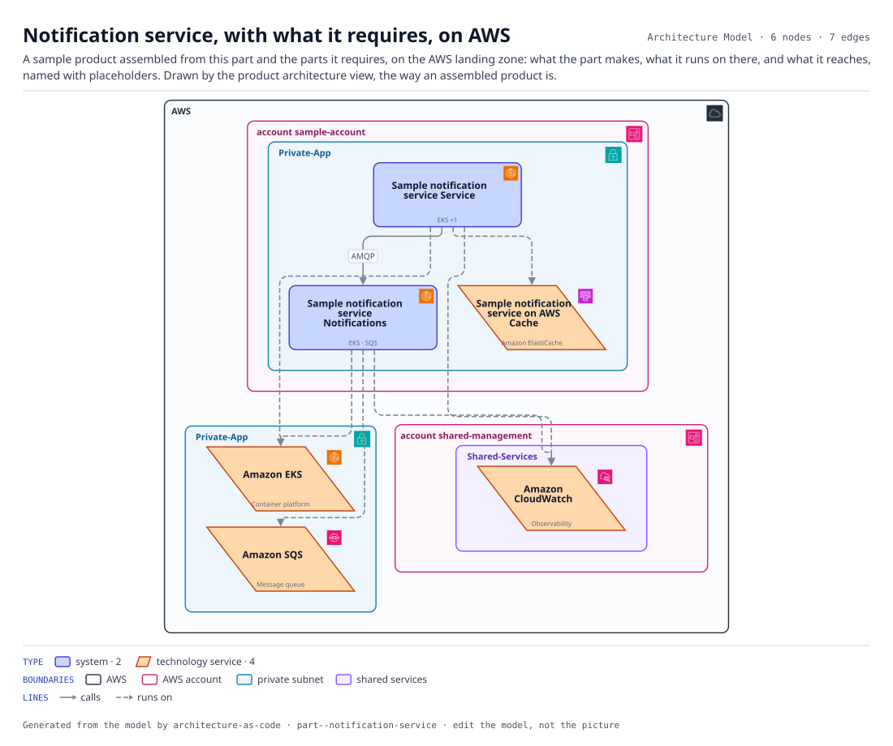

*A sample product assembled from this part and the parts it requires, drawn by the product architecture view; the names are placeholders. With `api-service`.*

**Provides.** 1 interfaces, 1 systems.
**Needs from the shape.** `product_name`, `slug`.
**Kinds.** `bus` is of kind `message-queue`.
**Parameters.** `runs_on` (default `['stateless-service.container-platform', 'stateless-service.observability']`); `protocol` (default `AMQP`).
**Requires.** `api-service`.
**Used by.** type Internal tool, type Mobile application, type Event-driven service, type Batch application, type Web application, type Customer-facing digital product, type Internal platform service.

## Outbound API gateway

`api-outbound` · Integration · optional

Our side of the integration: a gateway that owns request mapping, retry and back-off, circuit breaking when the vendor is down, and the audit trail of what we sent them. The system that calls the vendor calls this.

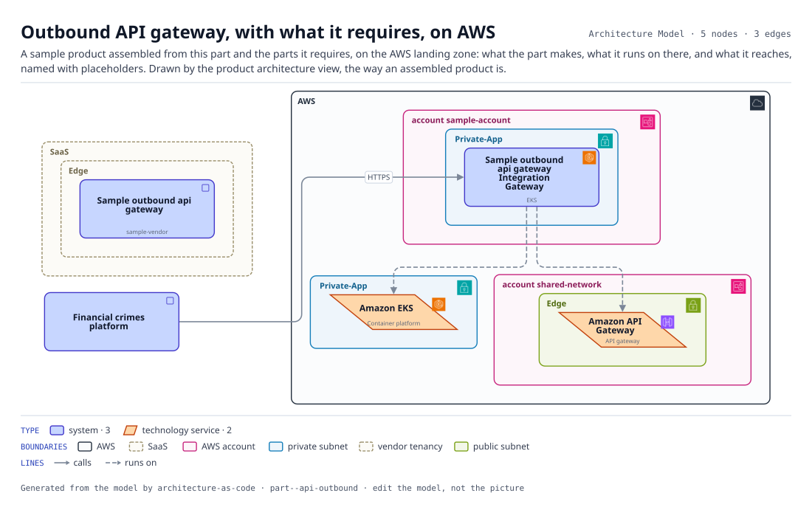

*A sample product assembled from this part and the parts it requires, drawn by the product architecture view; the names are placeholders. With `vendor-tenancy`.*

**Provides.** 1 interfaces, 1 systems.
**Needs from the shape.** `product_name`, `slug`, `vendor`.
**Kinds.** `platform` is of kind `container-platform`; `front_door` is of kind `api-gateway`.
**Parameters.** `caller_system` (required).
**Requires.** `vendor-tenancy`.
**Used by.** kit vendor-baseline, SaaS onboarding, Vendor SaaS service on Google Cloud, Vendor SaaS service, type Bought SaaS capability.

## Partner adapter

`partner-adapter` · Integration · optional

Our side of an integration with a system we do not run and did not buy as a product: mapping, retry and the credentials, so the API never carries another party's protocol. One adapter per partner.

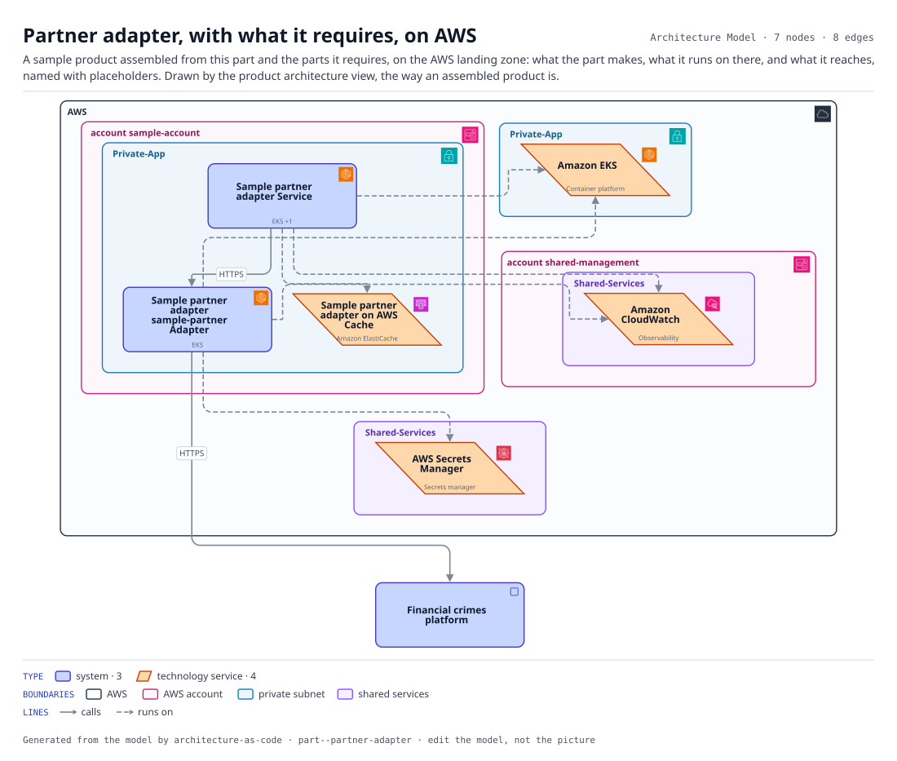

*A sample product assembled from this part and the parts it requires, drawn by the product architecture view; the names are placeholders. With `api-service`.*

**Provides.** 2 interfaces, 1 systems.
**Needs from the shape.** `product_name`, `slug`.
**Kinds.** `secrets` is of kind `secrets-manager`.
**Parameters.** `partner` (required); `target_system` (required); `adapter_suffix` (default `ADAPTER`); `runs_on` (default `['stateless-service.container-platform', 'stateless-service.observability']`).
**Requires.** `api-service`.
**Used by.** kit adapter-baseline, type Integration adapter, type Customer-facing digital product, type Internal platform service.

## Webhooks from the vendor

`webhook-inbound` · Integration · optional

The vendor calls us back. A listener of ours on the public tier, behind the shared API gateway, verifies the signature and hands the event to the system that wants it. Without this part, a vendor event is a poll.

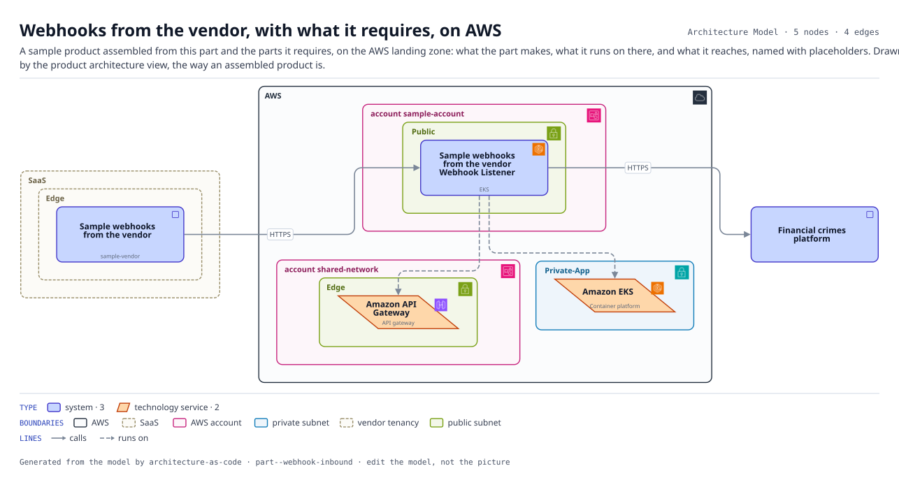

*A sample product assembled from this part and the parts it requires, drawn by the product architecture view; the names are placeholders. With `vendor-tenancy`.*

**Provides.** 2 interfaces, 1 systems.
**Needs from the shape.** `product_name`, `slug`, `vendor`.
**Kinds.** `platform` is of kind `container-platform`; `front_door` is of kind `api-gateway`.
**Parameters.** `consumer_system` (required).
**Requires.** `vendor-tenancy`.
**Used by.** SaaS onboarding (slot return), Vendor SaaS service on Google Cloud (slot return), Vendor SaaS service (slot return), type Bought SaaS capability.

## Network hub

`network-hub` · Network · optional

A transit hub that every network attaches to, so any two of them reach each other through the hub rather than through a mesh of peerings. The networks are named on the instance, as technology service ids.

**No picture on** AWS: view product-architecture selected no entities.

**Provides.** 1 tech services.
**Needs from the shape.** `product_name`, `slug`.
**Parameters.** `spokes` (required).
**Used by.** type Shared hub.

## Private egress to the vendor

`private-egress` · Network · optional

A private endpoint and an egress allow-list, so the only path our data takes to the vendor never touches the public internet. The control a security review asks to see first. Needs a vendor that offers private connectivity; where there is none, use the public path instead.

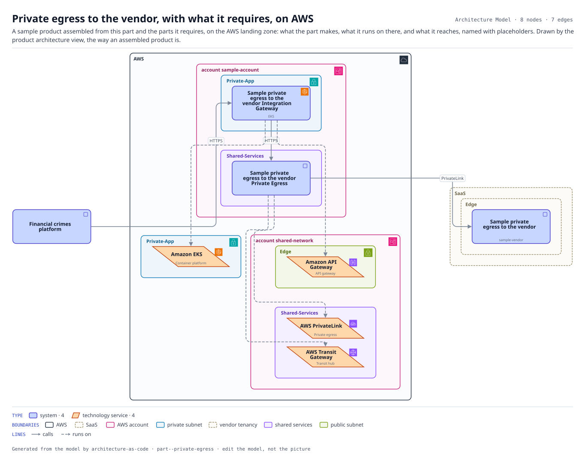

*A sample product assembled from this part and the parts it requires, drawn by the product architecture view; the names are placeholders. With `vendor-tenancy`, `api-outbound`.*

**Provides.** 2 interfaces, 1 systems.
**Needs from the shape.** `product_name`, `slug`, `vendor`.
**Kinds.** `private_link` is of kind `private-egress`; `transit` is of kind `transit-gateway`.
**Parameters.** `platform_org` (the estate's answer).
**Requires.** `vendor-tenancy`, `api-outbound`.
**Applies.** `private-egress-to-saas`.
**Used by.** SaaS onboarding (slot reach), Vendor SaaS service on Google Cloud (slot reach), Vendor SaaS service (slot reach), type Bought SaaS capability.

## Public path to the vendor

`public-call` · Network · optional

The gateway calls the vendor over the public internet, with mutual TLS and an allow-listed egress address. The honest shape where the vendor offers no private connectivity, and the one to replace with private egress when they do.

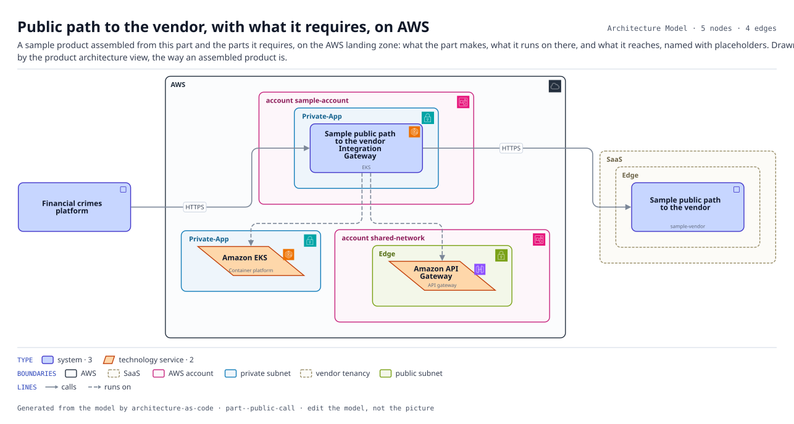

*A sample product assembled from this part and the parts it requires, drawn by the product architecture view; the names are placeholders. With `vendor-tenancy`, `api-outbound`.*

**Provides.** 1 interfaces.
**Needs from the shape.** `product_name`, `slug`, `vendor`.
**Requires.** `vendor-tenancy`, `api-outbound`.
**Used by.** SaaS onboarding (slot reach), Vendor SaaS service on Google Cloud (slot reach), Vendor SaaS service (slot reach), type Bought SaaS capability.

## Availability monitoring

`vendor-monitoring` · Operations · optional

Synthetic checks through the gateway and the vendor's status signals, in our observability rather than in an inbox. When the vendor is down, we know before the customer does.

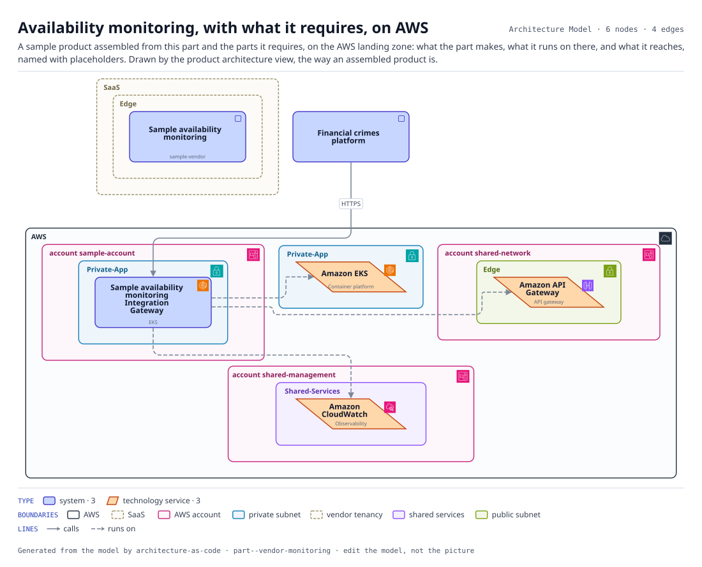

*A sample product assembled from this part and the parts it requires, drawn by the product architecture view; the names are placeholders. With `api-outbound`.*

**Provides.** —.
**Needs from the shape.** `slug`.
**Kinds.** `observability` is of kind `observability`.
**Requires.** `api-outbound`.
**Used by.** SaaS onboarding, type Bought SaaS capability.

## Audit trail into the SIEM

`audit-forwarding` · Security · optional

The vendor's audit log streams into our security monitoring, so what our people did in their system is investigable from ours. The part the incident response playbook assumes exists.

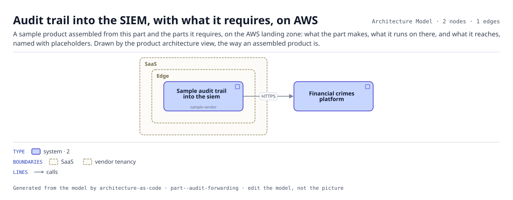

*A sample product assembled from this part and the parts it requires, drawn by the product architecture view; the names are placeholders. With `vendor-tenancy`.*

**Provides.** 1 interfaces.
**Needs from the shape.** `slug`, `vendor`.
**Parameters.** `siem_system` (the estate's answer); `security_org` (the estate's answer).
**Requires.** `vendor-tenancy`.
**Used by.** SaaS onboarding, type Bought SaaS capability.

## Our keys in the vendor

`byok-encryption` · Security · optional

The vendor encrypts our data with a key we hold and can revoke. Not every vendor offers it; where one does, this is the difference between leaving and leaving our data behind.

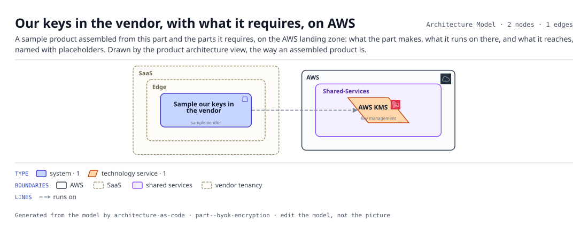

*A sample product assembled from this part and the parts it requires, drawn by the product architecture view; the names are placeholders. With `vendor-tenancy`.*

**Provides.** —.
**Needs from the shape.** `slug`.
**Kinds.** `kms` is of kind `kms`.
**Requires.** `vendor-tenancy`.
**Used by.** type Bought SaaS capability.

## Vendor credentials in the vault

`secrets-management` · Security · optional

The API keys and certificates the vendor issues us live in the secrets manager, rotated there, and the gateway reads them at runtime. Without this part they end up in a config file.

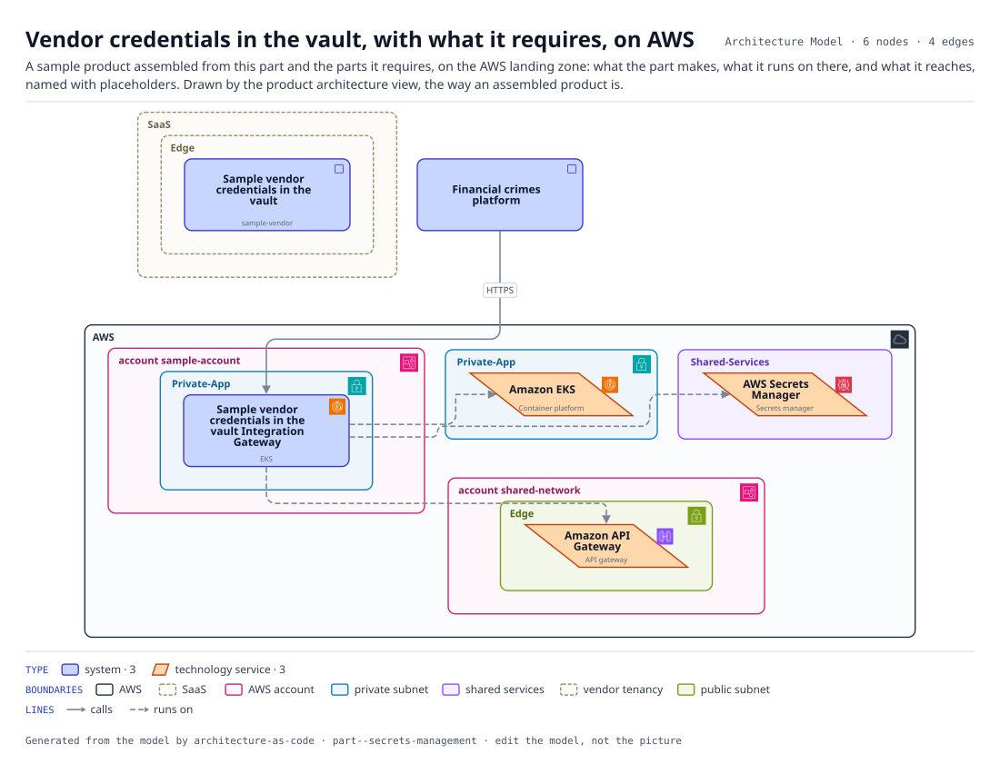

*A sample product assembled from this part and the parts it requires, drawn by the product architecture view; the names are placeholders. With `api-outbound`.*

**Provides.** —.
**Needs from the shape.** `slug`.
**Kinds.** `vault` is of kind `secrets-manager`.
**Requires.** `api-outbound`.
**Used by.** kit vendor-baseline, SaaS onboarding, Vendor SaaS service on Google Cloud, Vendor SaaS service, type Bought SaaS capability.

## Vendor baseline

`vendor-baseline` · Vendor · always present · kit of `vendor-tenancy`, `api-outbound`, `secrets-management`

What every vendor onboarding starts with, however our side reaches the vendor and whatever comes back: the tenancy, the gateway that calls it and owns the retries and the audit, and the vault the credentials live in. Named so the two vendor shapes can share it by reference rather than by copy, which is how they came to differ in a binding nobody meant. What it runs on is the shape's to say, by kind.

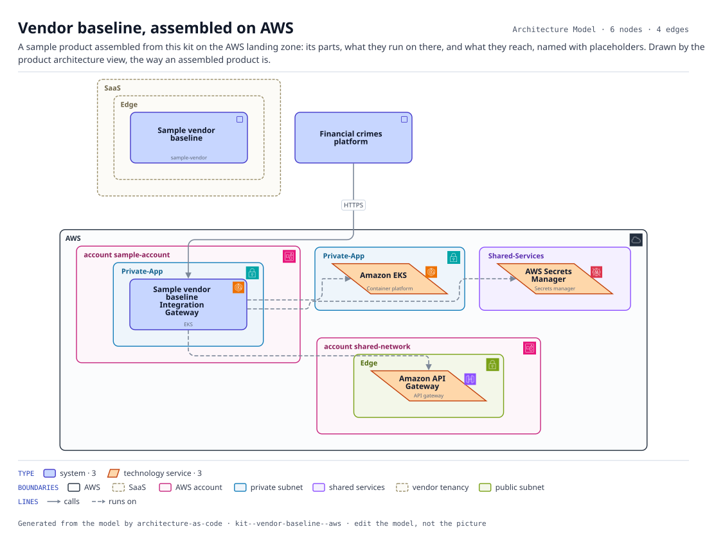

*A sample product assembled from the kit on AWS, drawn by the product architecture view; the names are placeholders. Also on [Azure](svg/kit--vendor-baseline--azure.svg) and [GCP](svg/kit--vendor-baseline--gcp.svg).*

**Provides.** 1 interfaces, 2 systems.
**Parameters.** `vendor` (required); `vendor_region` (default `eu-west-1`); `caller_system` (required).
**Used by.** SaaS onboarding, Vendor SaaS service on Google Cloud, Vendor SaaS service, type Bought SaaS capability.

## Vendor tenancy

`vendor-tenancy` · Vendor · always present

The vendor's system, in their tenancy, drawn outside our boundaries. We hold a contract and a data processing agreement, not a deployment. Every other part of an onboarding wires to this one, so it cannot be dropped.

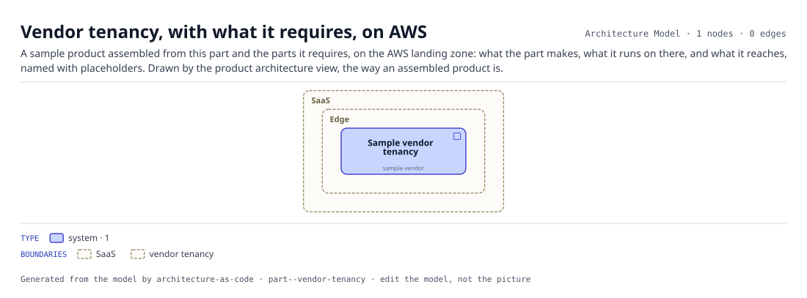

*A sample product assembled from this part and the parts it requires, drawn by the product architecture view; the names are placeholders.*

**Provides.** 1 systems.
**Needs from the shape.** `product_name`, `slug`.
**Parameters.** `vendor` (required); `vendor_region` (default `eu-west-1`); `vendor_controls` (the estate's answer, else `[]`); `vendor_policies` (the estate's answer, else `[]`).
**Used by.** kit vendor-baseline, SaaS onboarding, Vendor SaaS service on Google Cloud, Vendor SaaS service, type Bought SaaS capability.
