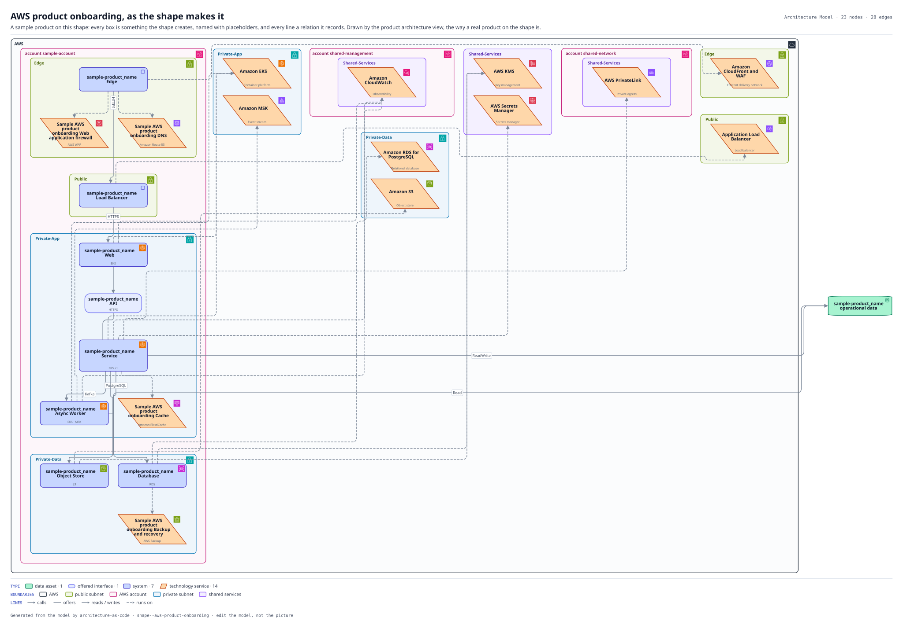
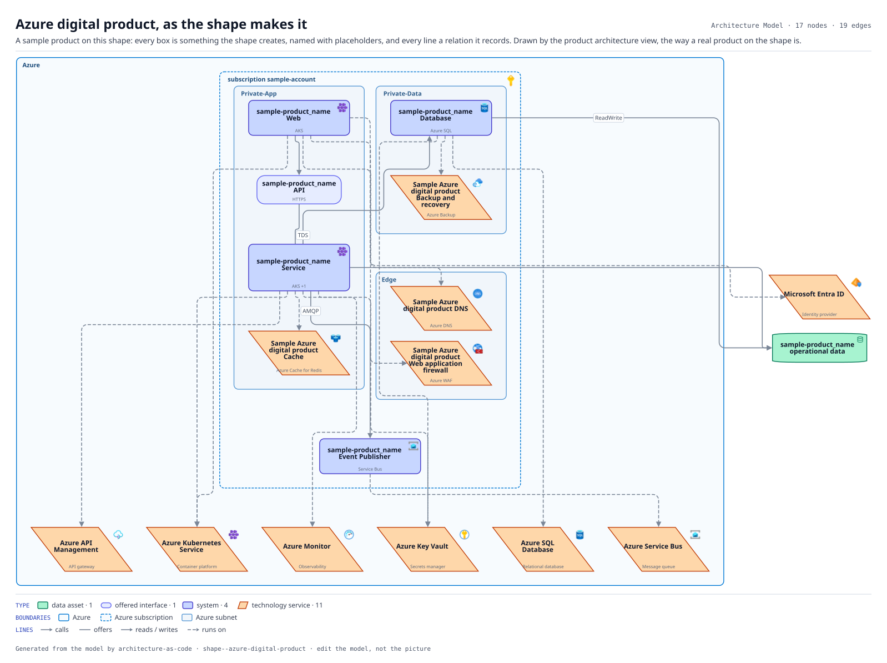
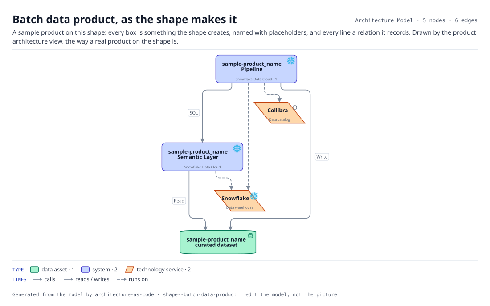
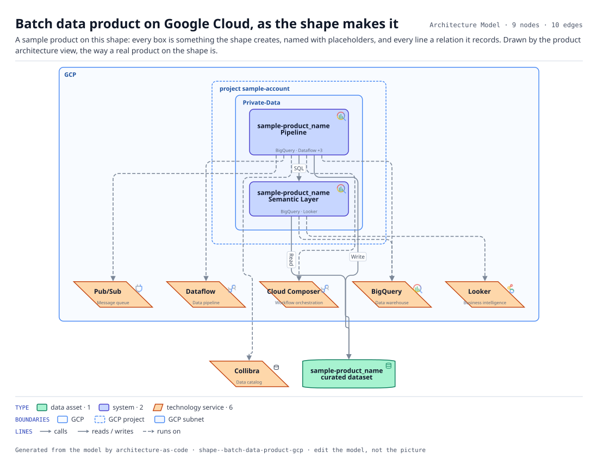
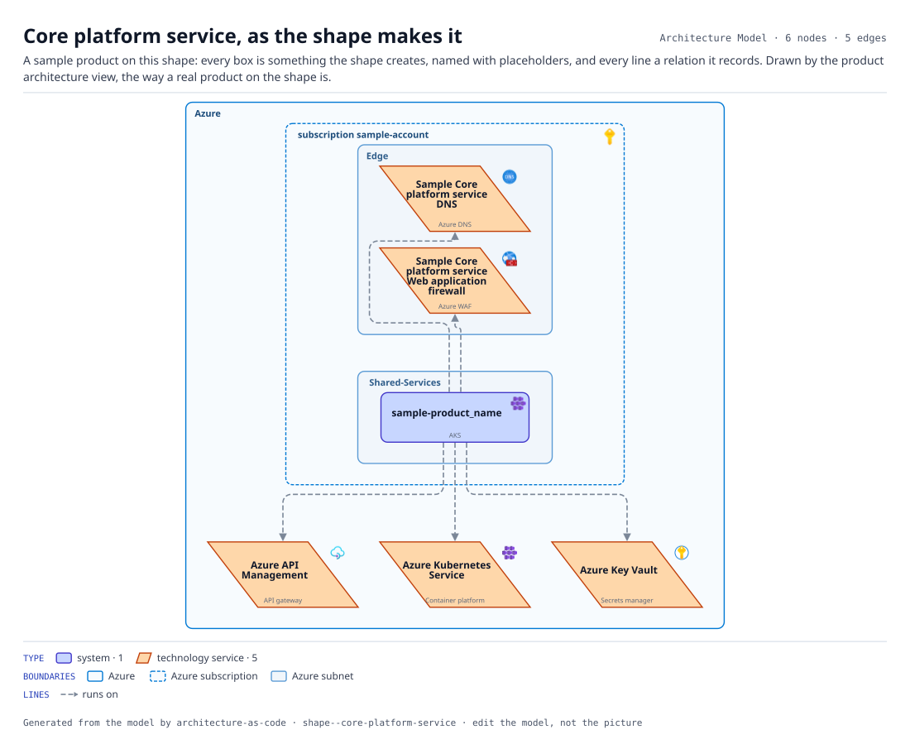
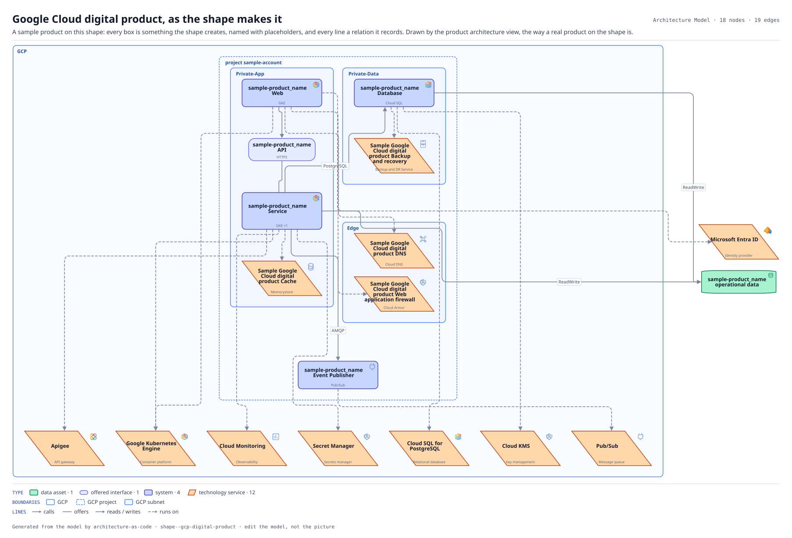
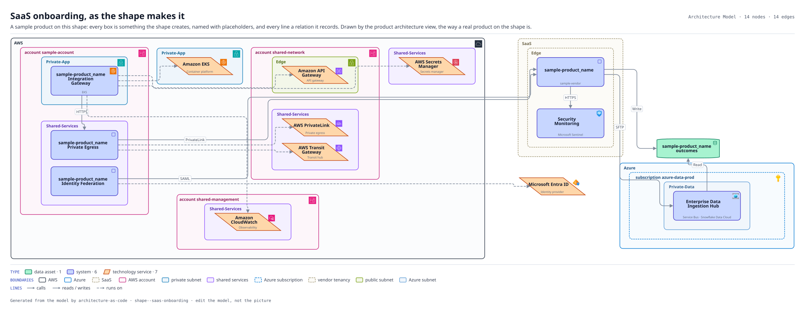
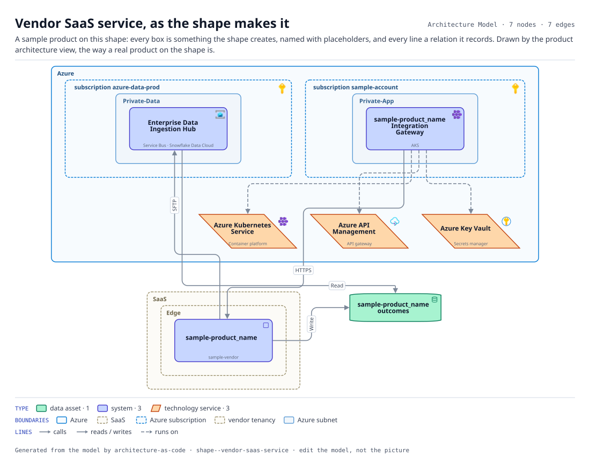
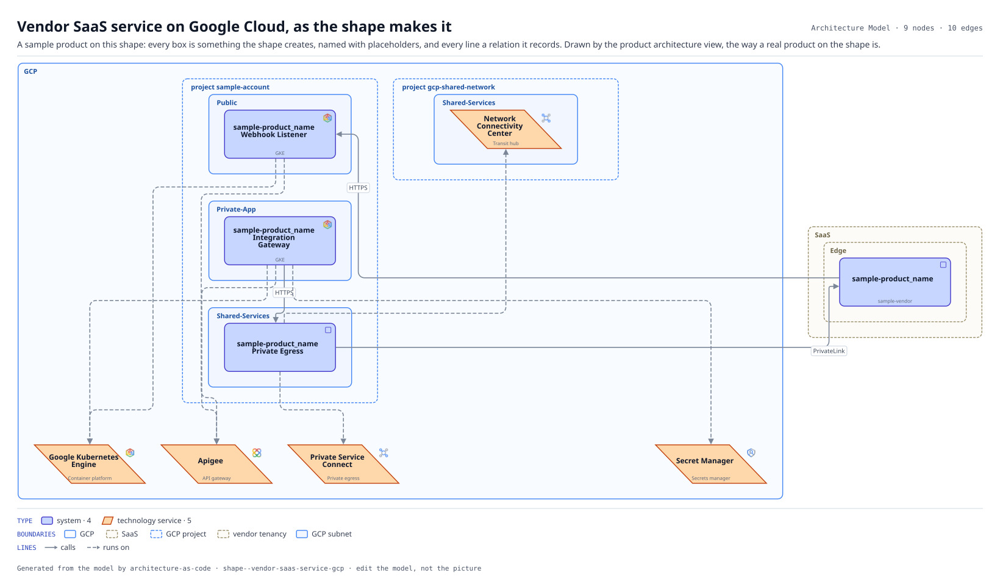

# Shapes

A shape is a provider, the parts it always has, the slots where it varies, and a `bind` only where the landing zone cannot decide. A product is a shape, a handful of answers, and a choice per slot; the diagram follows. Generated from `20_ARCHETYPES/` by `terrane render`; edit those, not this.

| Shape | Version | Provider | Parts | Slots | Products |
|---|---|---|---|---|---|
| [AWS product onboarding](#aws-product-onboarding) | 3.1.0 | AWS | 6 | 0 | 1 |
| [Azure digital product](#azure-digital-product) | 3.2.0 | Azure | 4 | 0 | 3 |
| [Batch data product](#batch-data-product) | 3.0.0 | — | 0 | 0 | 1 |
| [Batch data product on Google Cloud](#batch-data-product-gcp) | 2.0.0 | GCP | 0 | 0 | 1 |
| [Core platform service](#core-platform-service) | 2.2.0 | Azure | 0 | 0 | 1 |
| [Google Cloud digital product](#gcp-digital-product) | 1.1.0 | GCP | 4 | 0 | 1 |
| [SaaS onboarding](#saas-onboarding) | 3.0.0 | AWS | 6 | 2 | 1 |
| [Vendor SaaS service](#vendor-saas-service) | 3.1.0 | Azure | 3 | 2 | 2 |
| [Vendor SaaS service on Google Cloud](#vendor-saas-service-gcp) | 1.0.0 | GCP | 3 | 2 | 1 |

## AWS product onboarding

`aws-product-onboarding` · version 3.1.0 · on AWS · applies to products

What onboarding a product onto the AWS landing zone actually creates. A workload account is vended, the workload lands across four network tiers, and the platform services it consumes are recorded rather than assumed. Instantiating this is the architecture half of an onboarding ticket: it produces the inventory, the placement and the integration points that security, network and operations otherwise each ask for separately. Version 3 is composed from modules on top of building blocks. The blocks say what the landing zone provides and what the product gets of its own; the modules are the parts of the product, each of which an instance can drop: a product with no screens drops the web channel and the front door, a product with no files drops the object store. 3.1 binds the landing zone by kind where it named the sample's own AWS services by id.

*A sample product on the shape, drawn by the product architecture view; the names are placeholders.*

**Parts.** `api-service`, `web-channel`, `public-web-entry`, `async-worker`, `relational-datastore`, `object-store`.
**Blocks.** `public-web-tier`, `stateless-service`, `transactional-store`.
**Binds.** `cdn` → the landing zone's (`TS-AWS-CLOUDFRONT`), `container-platform` → the landing zone's (`TS-AWS-EKS`), `kms` → the landing zone's (`TS-AWS-KMS`), `load-balancer` → the landing zone's (`TS-AWS-ALB`), `observability` → the landing zone's (`TS-AWS-CLOUDWATCH`), `relational-db` → the landing zone's (`TS-AWS-RDS`).
**Applies.** `workload-account-baseline`.
**Asks for.** `slug`, `product_name`, `owner_org`, `domain`, `account`, `region` (default `eu-west-2`), `criticality` (default `High`), `classification` (default `Restricted`), `resilience` (default `Multi-AZ`).
**Products.** Installment Lending (`PRD-INSTALLMENT-LENDING`).

## Azure digital product

`azure-digital-product` · version 3.2.0 · on Azure · applies to products

A customer-facing digital product built in-house on Azure. Every one of these we have built has the same parts: a browser front end, an API that backs it, a product datastore, and an event publisher onto the enterprise bus. Instantiating this is how a new product enters the landscape without anyone drawing a diagram. Version 3 is composed from the same modules as the AWS shape, on the same blocks, resolved against Azure. That is the claim the library makes: the parts are the same, the bindings differ. The first product to sit on it showed the shape asked for no subscription and no region, so its onboarding drew a provider boundary with nothing inside it but the network tiers; 3.1 asks for both, the way the AWS shape asks for an account. 3.2 binds the landing zone by kind where it named the sample's own Azure services by id, so an estate builds on it with services called whatever it calls them.

*A sample product on the shape, drawn by the product architecture view; the names are placeholders.*

**Parts.** `api-service`, `web-channel`, `relational-datastore`, `event-publisher`.
**Blocks.** `public-api-tier`, `stateless-service`, `transactional-store`.
**Binds.** `api-gateway` → the landing zone's (`TS-AZURE-APIM`), `container-platform` → the landing zone's (`TS-AZURE-AKS`), `kms` → the landing zone's (`TS-AZURE-KEYVAULT`), `observability` → the landing zone's (`TS-AZURE-MONITOR`), `relational-db` → the landing zone's (`TS-AZURE-SQL`).
**Applies.** `api-front-door`.
**Asks for.** `slug`, `product_name`, `owner_org`, `domain`, `account`, `region` (default `uksouth`), `criticality` (default `Medium`), `classification` (default `Confidential`).
**Products.** Card Servicing (`PRD-CARD-SERVICING`), Collections Workspace (`PRD-COLLECTIONS-WORKSPACE`), Rewards Redemption (`PRD-REWARDS`).

## Batch data product

`batch-data-product` · version 3.0.0 · no provider · applies to products

A curated analytics data product on Snowflake. An ingestion and curation pipeline, a semantic layer the business actually queries, a curated dataset, and the Collibra registration that makes it governed rather than merely present. Built on no blocks, on purpose. The analytics platform is shared: a data product is a tenant of the analytics landing zone, not an instance of its blocks. So the shape applies the pattern, runs on the shared services, and creates no infrastructure of its own. Version 3 names none of the sample's records. The warehouse and the catalog are the landing zone's of each kind; where the data lands and who stewards it are the estate's answers (`answers` in `model.yaml`); and every product says who owns it, as on every other shape, where this one defaulted to the sample's data engineering team.

*A sample product on the shape, drawn by the product architecture view; the names are placeholders.*

**Applies.** `analytics-landing-zone`, `windowed-batch`.
**Asks for.** `slug`, `product_name`, `owner_org`, `domain`, `ingest_system` (the estate's answer), `data_org` (the estate's answer), `classification` (default `Confidential`), `contains_pii` (default `Yes`).
**Products.** Customer 360 (`PRD-CUSTOMER-360`).

## Batch data product on Google Cloud

`batch-data-product-gcp` · version 2.0.0 · on GCP · applies to products

A curated analytics data product whose data is born on Google Cloud and stays there: the batch shape with a Google binding. The pipeline reads the source product's events from Pub/Sub, curates them with Dataflow on a Cloud Composer schedule and lands the dataset in BigQuery; the semantic layer is the governed models and metrics analysts query, served from BigQuery through Looker; Collibra registers the dataset the way it registers everything else, whichever cloud it sits in. Built on no blocks, like the shape it mirrors: a data product is a tenant of the analytics project, not an instance of its infrastructure. It asks for the workload project and region because that is where its jobs and tables live, and for the source system because a pipeline on this side ingests a product's own event publisher, not the enterprise ingestion hub on the Azure side. Version 2 names the services by kind and asks the estate who stewards the data, where it named the sample's own; and every product says who owns it, where this one defaulted to the sample's data engineering team.

*A sample product on the shape, drawn by the product architecture view; the names are placeholders.*

**Applies.** `analytics-landing-zone`, `windowed-batch`.
**Asks for.** `slug`, `product_name`, `owner_org`, `data_org` (the estate's answer), `domain`, `source_system`, `account`, `region` (default `europe-west2`), `classification` (default `Confidential`), `contains_pii` (default `Yes`).
**Products.** Lending Portfolio Performance (`PRD-LENDING-PERFORMANCE`).

## Core platform service

`core-platform-service` · version 2.2.0 · on Azure · applies to products

An internally built shared service consumed by several products through the API gateway. Deliberately thinner than a digital product: no channel of its own, and its value is measured by who consumes it. Version 2.1 asks for the subscription and region, the way the digital shape does, and puts the service in the shared-services tier, which is what makes it a platform service. The first product on it is the identity service the shape was written from. 2.2 names the gateway, the cluster and the vault by kind, where it named the sample's own by id.

*A sample product on the shape, drawn by the product architecture view; the names are placeholders.*

**Blocks.** `public-api-tier`.
**Binds.** `api-gateway` → the landing zone's (`TS-AZURE-APIM`).
**Applies.** `api-front-door`.
**Asks for.** `slug`, `product_name`, `owner_org`, `domain` (default `Enterprise Platform`), `criticality` (default `High`), `classification` (default `Confidential`), `account`, `region` (default `uksouth`).
**Products.** Customer Identity Service (`PRD-IDENTITY`).

## Google Cloud digital product

`gcp-digital-product` · version 1.1.0 · on GCP · applies to products

A customer-facing digital product built in-house on Google Cloud. The same parts as the AWS and Azure digital shapes, a browser front end, an API that backs it, a product datastore and an event publisher onto the enterprise bus, on the same blocks, resolved against the Google Cloud landing zone. That is the claim the library makes, made good a third time: the parts are the same, the bindings differ. The first product to sit on it is the one whose dealer partners already integrate through Apigee. 1.1 binds the landing zone by kind where it named the sample's own services by id.

*A sample product on the shape, drawn by the product architecture view; the names are placeholders.*

**Parts.** `api-service`, `web-channel`, `relational-datastore`, `event-publisher`.
**Blocks.** `public-api-tier`, `stateless-service`, `transactional-store`.
**Binds.** `api-gateway` → the landing zone's (`TS-GCP-APIGEE`), `container-platform` → the landing zone's (`TS-GCP-GKE`), `kms` → the landing zone's (`TS-GCP-KMS`), `observability` → the landing zone's (`TS-GCP-MONITORING`), `relational-db` → the landing zone's (`TS-GCP-CLOUD-SQL`).
**Applies.** `api-front-door`.
**Asks for.** `slug`, `product_name`, `owner_org`, `domain`, `account`, `region` (default `europe-west2`), `criticality` (default `Medium`), `classification` (default `Confidential`).
**Products.** Point-of-Sale Finance (`PRD-POS-FINANCE`).

## SaaS onboarding

`saas-onboarding` · version 3.0.0 · on AWS · applies to products

What onboarding a bought solution actually creates. Almost none of it is the vendor system: it is the identity federation, the private egress, the gateway that owns retries and audit, the return feed, the audit trail into security monitoring, and the dataset that lands in our warehouse. Those are the parts we operate, secure and get audited on, and they are what the onboarding questionnaire is really asking about. Deliberately a different shape from `aws-product-onboarding`. Buying moves the work from building components to controlling a boundary, and the diagram should show that rather than making a purchase look like a deployment. Version 3 is composed from modules. Each part below is one the vendor either needs or does not: drop the return feed for a vendor that sends nothing back, add webhooks for one that calls us, swap the private path for the public one where the vendor offers no private connectivity. The diagram is chosen, not drawn.

*A sample product on the shape, drawn by the product architecture view; the names are placeholders.*

**Parts.** `vendor-baseline` (kit: `vendor-tenancy`, `api-outbound`, `secrets-management`), `sso-federation`, `audit-forwarding`, `vendor-monitoring`.
**Slot `reach`.** `private-egress` (default), `public-call`. How our side gets to the vendor. Private where the vendor offers a private endpoint; over the public internet, pinned and authenticated, where it does not.
**Slot `return`.** `sftp-return-feed` (default), `webhook-inbound`, or none; answers `consumer_system` for `webhook-inbound`. How things come back. A file feed for a vendor that sends a batch; webhooks for one that calls us as things happen; none for a vendor that sends nothing back.
**Asks for.** `slug`, `product_name`, `vendor`, `owner_org`, `domain`, `account`, `region` (default `eu-west-2`), `vendor_region` (default `eu-west-1`), `caller_system`, `criticality` (default `High`), `classification` (default `Restricted`).
**Products.** NICE Actimize Screening (`PRD-SCREENING`).

## Vendor SaaS service

`vendor-saas-service` · version 3.1.0 · on Azure · applies to products

A bought capability running in a vendor tenancy, reached from the Azure side over the public internet. The pattern is always the same shape from our side: the vendor system itself, an outbound integration that feeds it, an inbound file feed that comes back, and a landed dataset. Modeling it this way makes vendor replacement an archetype parameter change rather than a re-draw. Composed from the same modules as `saas-onboarding`, with the public path in place of private egress and the Azure platform services in place of the AWS ones. That is the claim the module library makes: the parts are the same, the bindings differ. 3.1 asks for the subscription and region, the way the digital shape has since its 3.1 and the Google vendor shape did from the start: the gateway, the private egress and the listener are ours and live somewhere, and drew loose inside the provider's boundary until the shape could say where.

*A sample product on the shape, drawn by the product architecture view; the names are placeholders.*

**Parts.** `vendor-baseline` (kit: `vendor-tenancy`, `api-outbound`, `secrets-management`).
**Slot `reach`.** `private-egress`, `public-call` (default). How our side gets to the vendor
**Slot `return`.** `sftp-return-feed` (default), `webhook-inbound`, or none; answers `consumer_system` for `webhook-inbound`. How things come back, if anything does
**Asks for.** `slug`, `product_name`, `vendor`, `owner_org`, `domain`, `upstream_system`, `account`, `region` (default `uksouth`), `criticality` (default `Medium`), `classification` (default `Confidential`).
**Products.** Dispute Management (`PRD-DISPUTES`), Identity Document Verification (`PRD-IDV`).

## Vendor SaaS service on Google Cloud

`vendor-saas-service-gcp` · version 1.0.0 · on GCP · applies to products

A bought capability running in a vendor tenancy, reached from our Google Cloud side. The same shape as the Azure vendor shape, part for part: the vendor system itself, an outbound integration that feeds it, a return path that may be a file feed or webhooks, and a landed dataset. Only the bindings differ: the private path is Private Service Connect, and the gateway and the webhook listener land in the workload project beside the product that calls the vendor. The first product on it buys affordability data for point-of-sale finance, whose API already runs there.

*A sample product on the shape, drawn by the product architecture view; the names are placeholders.*

**Parts.** `vendor-baseline` (kit: `vendor-tenancy`, `api-outbound`, `secrets-management`).
**Slot `reach`.** `private-egress` (default), `public-call`. How our side gets to the vendor
**Slot `return`.** `sftp-return-feed`, `webhook-inbound` (default), or none; answers `consumer_system` for `webhook-inbound`. How things come back, if anything does
**Asks for.** `slug`, `product_name`, `vendor`, `owner_org`, `domain`, `upstream_system`, `account`, `region` (default `europe-west2`), `criticality` (default `Medium`), `classification` (default `Confidential`).
**Products.** Open Banking Affordability (`PRD-OB-AFFORDABILITY`).
