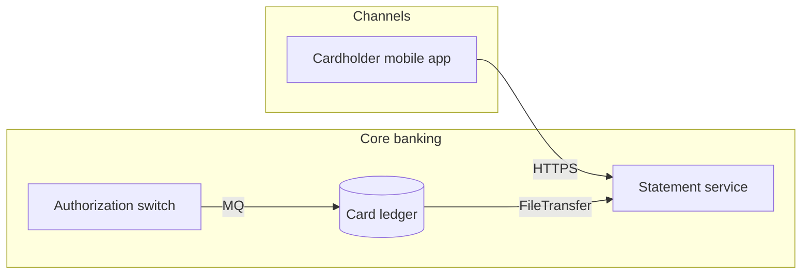
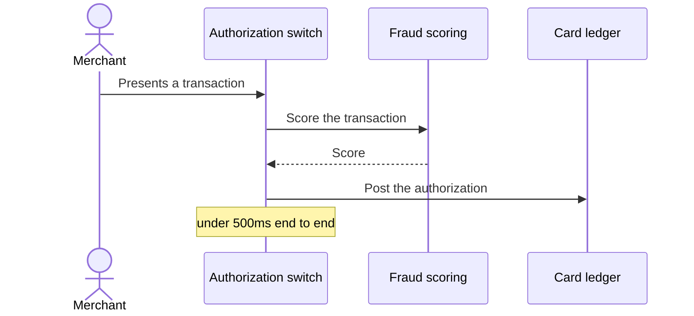
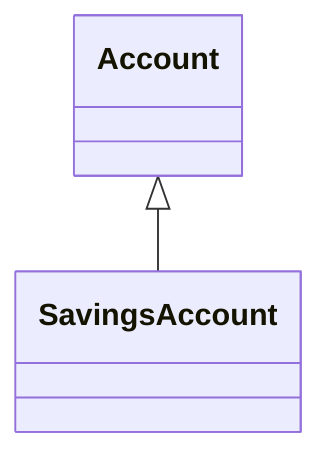

# Card payments, as the team documented it

The two diagrams the team keeps in its README, read together as one sketch:
the systems a flowchart draws and the participants a sequence diagram names
are the same records, so the picture of where things run and the picture of
what happens in what order come from one model.

## Where things run

## How an authorization goes

A third block the reader cannot take is said and left out, and the rest still
come through:

