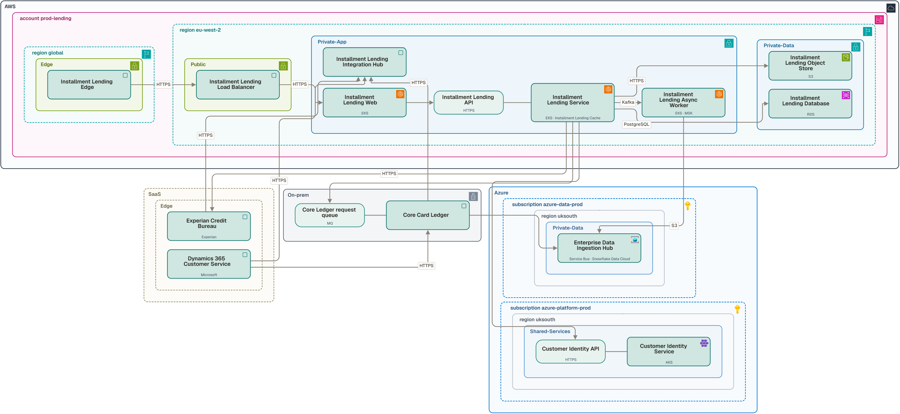
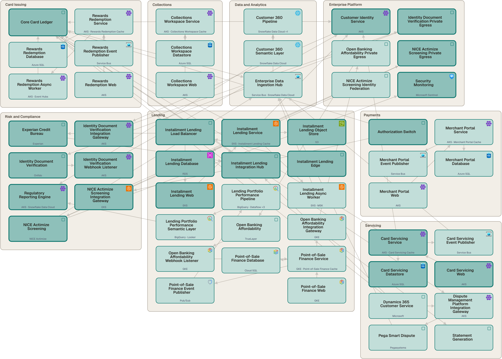
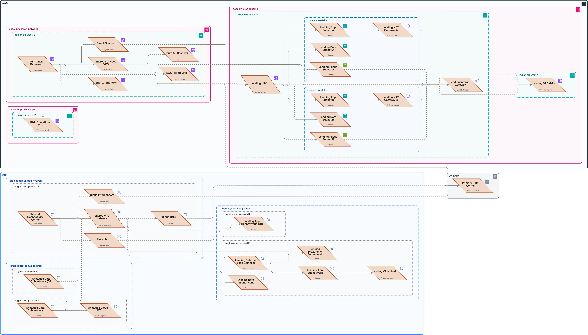
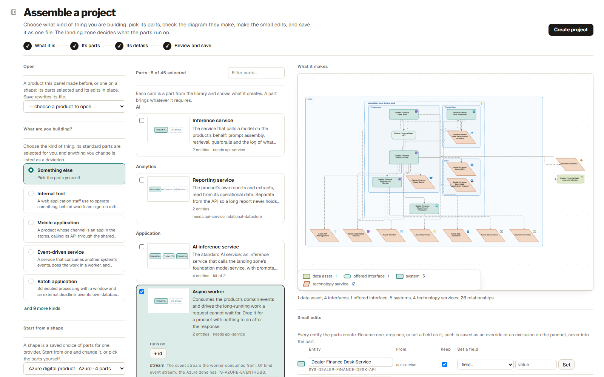
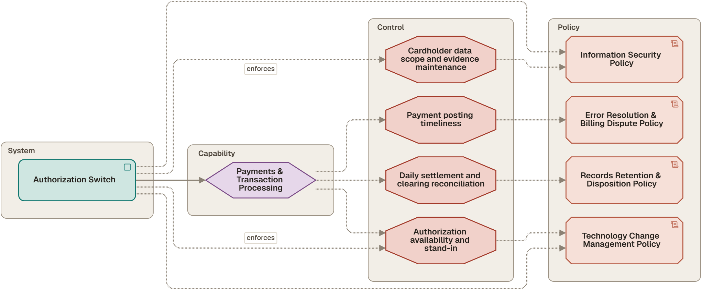
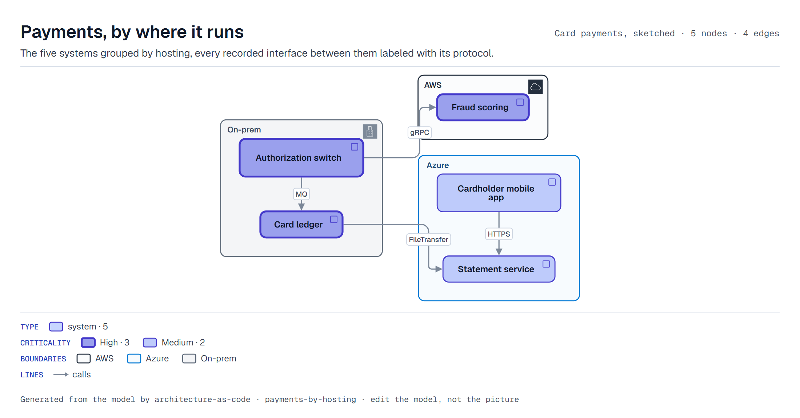
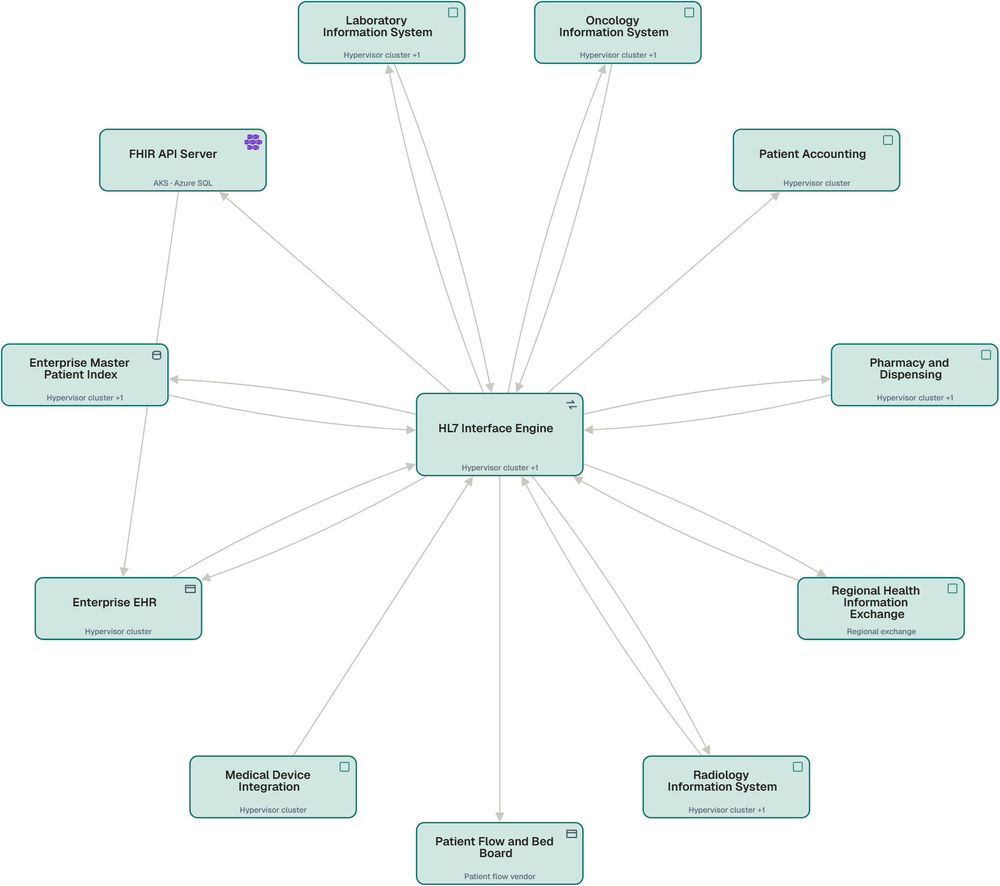

# Architecture as Code

This repository holds an organization's architecture model as YAML files, an
engine that draws every diagram from the model, and a local web app for reading
and editing it. The engine and its command line are called Terrane. Written by
Matthew Thompson.

Each diagram is a view: a query over the model rather than a drawing. A system
added to the model appears in every view whose query it matches, and no diagram
is edited by hand. A change made in the app or in a text editor is a change to a
file, reviewed as a diff and checked by `terrane validate`.



*One product's onboarding onto the AWS landing zone. The account, region and
network-tier boundaries come from fields on the records, and the same view is
drawn for every product built on that shape.*



*The application landscape: every system, grouped by business domain and
weighted by criticality.*

## Try it

Python 3.10 or later, and nothing else: PyYAML is used when present, and a
bundled reader handles the files otherwise.

```bash
pip install terrane
terrane init my-estate
cd my-estate
terrane app
```

`terrane init` starts an estate of your own on the shipped library and views,
and `terrane app` opens it in the browser. [AAC-15](00_METHOD/AAC-15_ADOPTING.md)
is the first week of filling it.

The pictures on this page are of the sample estate, a card issuer, which lives
in this repository and, read-only, on
[the demo](https://matthewbakerthompson.github.io/terrane/), with nothing to
install. To open it in the app, clone the repository and, from its root folder:

```bash
pip install .
terrane app
```

It works the same from `cmd`, PowerShell or bash, and needs no permission to run
scripts. On Windows, double-click `80_APP/run.cmd` to start it from Explorer.

The app opens at **http://127.0.0.1:8020**, and a first visit offers a
two-minute tour. Good first views are **System Context**, for
who uses what; **Installment Lending — Onboarding**, a product built on the AWS
landing zone, and **NICE Actimize Screening — Onboarding**, one bought as SaaS;
**Network Topology**; and **Controls and Where They Are Enforced**. Click any box
to see where it runs, what it connects to, and the controls and policies that
apply to it.

Everything the app does is also on the command line. `terrane` works on the
estate in the current folder, or on the one `--root` names:

```bash
terrane validate && terrane render
```

`terrane pack` writes the review pack, a PowerPoint deck with a slide per view.
The rendered diagrams are committed, so
[70_ARTIFACTS/INDEX.md](70_ARTIFACTS/INDEX.md) can be read without running
anything.

## What the model holds

The record types use the field names of `architecture_method_metamodel.v2`, so
the model exports to the metamodel's CSV layout without translation; what this
repository adds is listed in [AAC-07](00_METHOD/AAC-07_METAMODEL_CONTRACT.md).

- **The application estate.** Systems, the interfaces between them, data assets,
  technology services and products, and where each runs: account, region,
  availability zone and network tier.
- **Actors and flows.** Who is outside the estate and what they use, and
  transactions as ordered steps across recorded interfaces
  ([AAC-09](00_METHOD/AAC-09_ACTORS_AND_FLOWS.md)).
- **The business layer.** Capabilities, processes and value streams, imported
  from the business architecture repository that owns them
  ([AAC-10](00_METHOD/AAC-10_BUSINESS_LAYER.md)).
- **The governance layer.** Controls and policies, imported from the governance
  register, and where the estate enforces them: which system carries which
  control, and which data is bound by which policy. The enforcement is recorded
  here ([AAC-13](00_METHOD/AAC-13_GOVERNANCE_LAYER.md)).
- **The change layer.** Roadmaps, work packages and change requests: when a
  planned system lands, under which initiative, and on whose decision.

## Views

Forty-eight views ship: twenty-four architecture diagrams, twelve landscape
maps, eleven reports and a timeline. A view says which records it shows, by type
and field values, which relationships it draws, and which field it groups into
boundaries; it never names a system. A view can take a subject, such as one
system or one product, and is then drawn for every subject its selection
matches. Hue and shape always mean the record's type, and a view is drawn the
same way in the app, in the committed SVG and Mermaid, and in the review pack.
Views are written in YAML or in the app's view editor
([AAC-04](00_METHOD/AAC-04_VIEWS.md)).



*Network topology across three clouds: accounts and projects, regions,
availability zones, subnets, gateways, the hub each spoke attaches to, and each
cloud's two paths back to the data center. Each boundary is read from a field on
the record and carries the provider's own icon.*

## Products from shapes and parts

The library describes how the organization builds products. A product file names
a shape (an archetype, in `20_ARCHETYPES/`) or a set of parts, and answers their
questions; the engine generates the systems, interfaces, data, controls and
infrastructure that follow. Adding a product on a shape is a form with five
answers. The library, from the vocabulary up:

| Layer | Folder | What it is |
|---|---|---|
| **Component types** (109) | `25_COMPONENTS/` | *A load balancer.* A category, a shape on the drawing, and what each cloud calls it |
| **Building blocks** (23) | `26_BLOCKS/` | *A public web tier.* Components that always arrive together |
| **Patterns** (23) | `27_PATTERNS/` | *Public web entry.* A block plus the decision: what it is for, what it costs, when not to use it, and its status |
| **Parts** (45) | `28_MODULES/` | *An outbound API gateway. A return feed. SSO federation.* The systems, interfaces, data, people, controls and pattern that arrive together, with parameters. Nine are kits of other parts |
| **Connection kinds** (12) | `24_CONNECTIONS/` | *An event on the bus. A scheduled file.* The ways two systems connect, each with its style, protocols and pattern |
| **Shapes** (9) | `20_ARCHETYPES/` | *A SaaS onboarding.* A whole product composed from parts on blocks, with slots where it varies |

No block or pattern names a vendor. Resolved against AWS, a public web tier is
CloudFront, AWS WAF and an ALB; against Azure it is Front Door, Azure WAF and an
Application Gateway. The same parts on the same blocks make the AWS, Azure and Google Cloud
shapes, and only the bindings differ. A product can override or leave out
anything its shape makes, and add what the shape does not
([AAC-03](00_METHOD/AAC-03_ARCHETYPES.md),
[AAC-11](00_METHOD/AAC-11_DIAGRAM_KINDS_AND_BUILDING_BLOCKS.md),
[AAC-16](00_METHOD/AAC-16_EXTENDING_THE_LIBRARY.md)).



*Assembling a product in the app: the Azure shape's parts plus a worker, the
drawing they make, and the records to edit.*

## Changes, impact and coverage

`terrane diff HEAD~5` reports what changed between two revisions in the model's
terms: records added, removed and changed field by field, relationship rows,
views and the library. `--picture change.svg` draws the change, with what is one
hop away faded around it; `--view application-landscape` marks it on the
landscape; and
`--excel change.xlsx` writes it as a workbook.


*The landscape after three changes: a fraud scoring service added (in full), the
authorization switch renamed (heavy border), the credit bureau retired (dashed
red).*

`terrane impact SYS-CORE-LEDGER` lists what a change to one record affects, as
two separate sets: what is affected if it changes, and what it depends on. Each
finding is graded `direct`, `likely` or `possible` by distance, and the walk
includes the governance layer, so retiring a system lists the controls it
enforces ([AAC-08](00_METHOD/AAC-08_IMPACT_ANALYSIS.md)).

**Coverage** reports what the model does not record: capabilities nothing
realizes, systems no capability claims, personal data subject to no policy,
controls nothing enforces, and systems that realize a governed capability
without recording its control.



*One system's governance: the controls it enforces, the policies it is subject
to, and the controls that apply through the capabilities it realizes. A control
that reaches it only through a capability is one of the gaps Coverage lists.*

## Draw one file

`terrane draw` draws a single file without a repository. The file is a sketch: a
small model in the same vocabulary that names the shipped views it wants or
writes its own, and may put products on the library's shapes or parts.

```bash
terrane draw --example > sketch.yaml && terrane draw sketch.yaml
```

One SVG per view lands beside the file; `--mermaid`, `--png` and `--pack` add
Mermaid, PNGs and a PowerPoint deck. Anything the file leaves out is filled with
a default, and the output says which. From Python, `terrane.diagrams(sketch)`
returns the same pictures, which display in a notebook.
[AAC-17](00_METHOD/AAC-17_DRAWING_FROM_PYTHON.md) is the manual for drawing,
reading, adopting and exporting.



*The example sketch's hosting view, drawn with no repository.*

## Other tools, in and out

`terrane draw` also reads diagrams and inventories made in other tools. It writes
what it read beside the file as a sketch to correct and keep, and draws that.
`terrane adopt file` writes a sketch, or any of these files, into the estate as
records of its own, each in its own file with a header saying where it came
from. Nothing already in the estate changes unless `--correct` is given, which
is how corrections made by a reviewer in a workbook come back; `--dry-run` lists
what would be written, and `--picture change.svg` draws it first.

Each format, how it is read, and what writes the estate out in it:

| Format | Read with `terrane draw` | Written by |
|---|---|---|
| Mermaid flowchart, C4 or sequence diagram, or Markdown holding them | `--from-mermaid` | `terrane render` |
| Structurizr DSL | `--from-structurizr` | `terrane render` |
| C4-PlantUML | `--from-plantuml` | `terrane export plantuml` |
| ArchiMate, as Archi saves it or in the Open Group exchange format | `--from-archimate` | `terrane export archimate` |
| draw.io | `--from-drawio` | `terrane export drawio` |
| Visio | `--from-visio` | |
| A spreadsheet of systems: CSV, TSV or Excel | `--from-inventory` | `terrane export csv`, `terrane export excel` |
| PowerPoint | | `terrane pack` |
| Backstage catalog | | `terrane export backstage` |

The Mermaid, Structurizr, C4-PlantUML, ArchiMate, draw.io and Excel exports read
back as the estate they came from, with nothing to add or correct, so an export
can be edited in its own tool and adopted back with `--correct`.

`terrane pack` writes the review pack. `--editable` puts each diagram on its
slide as PowerPoint shapes that can be moved and renamed, and `--since v1` opens
the deck with what changed since that revision.


*A Visio drawing, [`90_EXAMPLE/quick/sample.vsdx`](90_EXAMPLE/quick/sample.vsdx),
read by the engine and drawn as a view.*

## The app

The app is a local web server over the same engine. Its main pages:

- **Map.** Every view drawn, with pan, zoom, click-through and PNG export.
- **Inspector and editor.** A record's fields, its file and everything it
  connects to; a form to add or change it, saved where it lives and validated.
- **New diagram.** A canvas for placing library parts, existing systems and whole
  views such as Network Topology, saved to `30_VIEWS/` as you draw.
- **Edit view.** A view's query in parts beside the drawing, redrawn on every
  change and saved as ordinary YAML.
- **Assemble.** A product built from library parts, its drawing updating as parts
  are picked and questions answered.
- **Connect and move.** Drop one box on another to record a connection between
  them, or into another boundary to change the field that boundary stands for.
- **Import.** A CSV or Excel export mapped to the model's fields, with every
  record it would add and what the checks would say shown before anything is
  written.
- **Checks.** Validation, coverage, drift against a ServiceNow export, and changes
  between revisions.
- **Impact and Focus.** What a selected record affects, and its neighborhood up
  to four hops out.

Every view and selection is in the address bar, so a link opens the same diagram
with the same thing selected. The app binds to loopback, has no authentication
and loads nothing from the internet: Cytoscape, dagre and ELK are committed
under `80_APP/web/vendor/`. [80_APP/README.md](80_APP/README.md) describes every
page.

## Starting from your own estate

```bash
terrane clear
```

```bash
terrane clear --yes
```

```bash
terrane import csv --from /path/to/the/export --map mapping.yaml
```

`terrane clear` says what it would remove; with `--yes` it removes the sample
estate and keeps the library, the views and the method, and `terrane validate`
passes on the empty model. `--keep org_units`, or any other type, keeps that part
as a starting point. `terrane import csv` brings an inventory in as it was
exported: the mapping says which column is which field, which of its values is
which of the model's (`Tier 1` is High) and how its codes become ids, and rows it
cannot place are held back and named. Metamodel v2 CSVs need no mapping, and
`60_SOURCES/inventory/` is a worked example. After the import, `terrane validate`
names the few views written for the sample estate, and its warnings list what
the inventory is missing. [AAC-15](00_METHOD/AAC-15_ADOPTING.md) covers the first
day, week and month, and what is and is not ready for an organization adopting
it.

## The sample estates

The repository ships with a made-up card issuer: 88 systems, 13 products, 48
views, four transaction flows, a business layer of 194 capabilities and 149
processes, and a governance register of 40 controls and 10 policies. Every
product is on one of the library's nine shapes or assembled from its parts
([90_EXAMPLE](90_EXAMPLE/README.md)).

The engine, the library and the views contain nothing specific to card issuing.
[`90_EXAMPLE/thurman-health`](90_EXAMPLE/thurman-health/README.md) is a made-up
regional health system built with the same engine, library and views: an EHR
and its departmental
systems, an HL7 interface engine, a FHIR API and a patient portal, 31 systems in
all, under HIPAA and Joint Commission controls. Its four products are on the
shipped shapes, 31 of its 32 views are the shipped views unchanged, and it adds
two connection kinds of its own, HL7 v2 feeds and DICOM transfers. The app opens
it with `terrane --root 90_EXAMPLE/thurman-health app --port 8021`,
and every `terrane` command takes the same `--root`.



*The health system's HL7 interface engine and every system that exchanges
messages through it, drawn by the shipped hub-and-spoke view.*

## What is in the repo

| Folder | Contents |
|---|---|
| [`CHANGELOG.md`](CHANGELOG.md) | What each release changed |
| [`docs/COMMANDS.md`](docs/COMMANDS.md) | Every command and its arguments |
| `00_METHOD/` | AAC-01 to AAC-17: the method, one chapter per part of it, from model conventions to drawing from Python |
| `10_MODEL/` | The model. One file per system, relations in `relations/` |
| `20_ARCHETYPES/` | The shapes products are built on |
| `24_CONNECTIONS/` to `29_TYPES/` | The library: connection kinds, component types, building blocks, patterns, parts, and the kinds of product and application the organization builds |
| `30_VIEWS/` | The 48 views, each a query |
| `40_SCHEMAS/` | Generated JSON Schemas, for editor completion while authoring |
| `50_ENGINE/` | The engine and its tests |
| `60_SOURCES/` | External inputs: a ServiceNow CI export, a portfolio export and the mappings that import them |
| `70_ARTIFACTS/` | Generated diagrams, docs, the library catalog and the exports. Committed, and still disposable |
| `80_APP/` | The local web app |
| `90_EXAMPLE/` | The sample estate as CSVs, the second estate in `thurman-health/`, and the sample files the readers are shown on |

## Design decisions

**A system is a file.** Each system has a file of its own, so a change to it has
an owner, a diff and a reviewer.

**Views are queries.** A view names a filter, never a system, so it stays current
as the model changes.

**Shapes carry the repetition.** A product onboarding onto a landing zone always
creates the same tiers, and a bought product always creates the same boundary
controls. A shape declares that once; an instance supplies a slug, a name, an
owner, an account and the places where it differs.

**The CMDB is an input, not the source of truth.** The ServiceNow adapter compares
a CI export with the model and reports the drift. It writes nothing to
ServiceNow and nothing to the model
([AAC-06](00_METHOD/AAC-06_CMDB_RECONCILIATION.md)).

**Generated output is committed.** `70_ARTIFACTS/` is checked in so diagrams can
be reviewed in a pull request without running anything. It is still generated:
never edit it or resolve a conflict in it by hand; run `terrane refresh`.

**Warnings do not fail the build; errors do.** Broken references and duplicate
ids are errors. Gaps a person has to follow up, such as an unowned system or a
Restricted system with no control recorded, are warnings with a count.
`terrane validate --strict` turns warnings into failures.

## The metamodel

The model follows a canonical metamodel kept outside this repository, and
[AAC-07](00_METHOD/AAC-07_METAMODEL_CONTRACT.md) is the contract with it.
Thirteen of the metamodel's fifteen entities are held here; `steps` and
`architecture_principles` are not. The business layer and the governance
register are imported from the repositories that own them rather than authored
here.

## Tests

```bash
cd 50_ENGINE && python -m unittest discover -s tests
```

The suite includes a parity test that parses every YAML file in the repository
with both PyYAML and the bundled reader and requires identical results,
regression tests on every path that deletes a file, and guards on the library:
no block or pattern names a vendor, every pattern states its cost and its
exclusions, and every shape expands.

## Status

Everything in both estates is placeholder content built to demonstrate the
mechanism. No owner, criticality rating, capability mapping, control or
enforcement point in either describes a real organization, and none of it should
be quoted as one. Thurman Health is a made-up name; the regulations its controls
cite are real, and nothing about how it meets them is anybody's.

## License

Terrane is free to use, change and share, at work or at home, for any purpose but one:
you may not offer it, or something built from it, as a product or hosted service that
competes with Terrane, whether you charge for it or not. The terms are the
[PolyForm Shield License 1.0.0](LICENSE). If you are not sure whether something you have
in mind is allowed, ask: matthewbakerthompson@gmail.com.

The license covers the software and the method documents, not an estate you model
with it.
